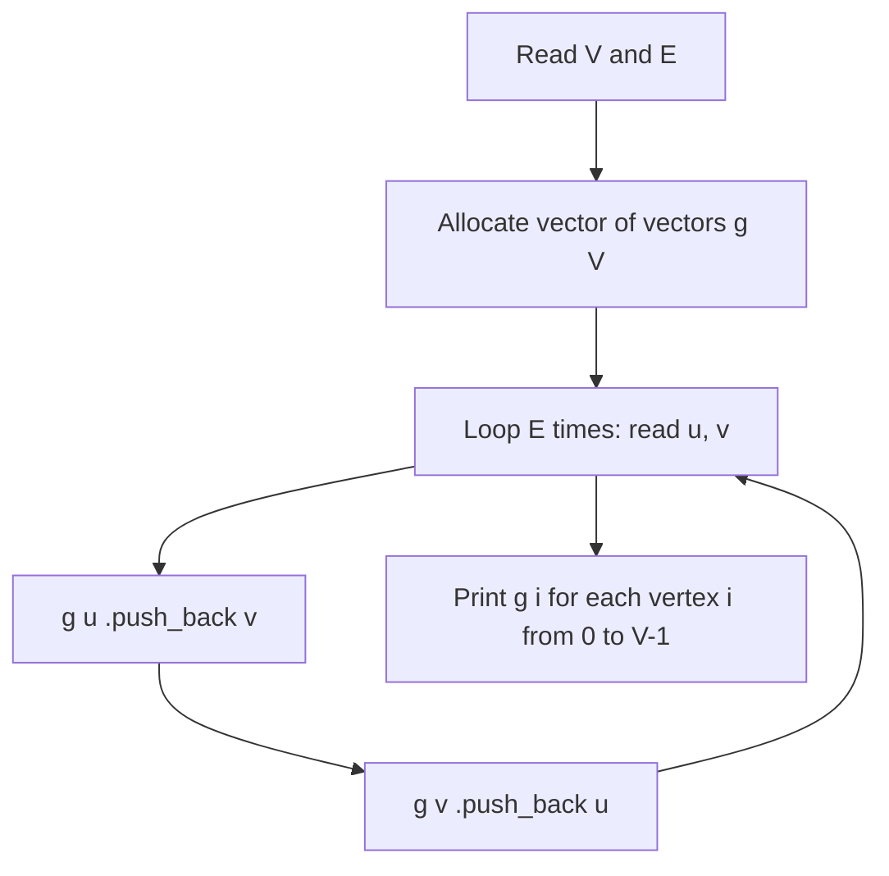

# Graph Creation & Adjacency Representation in C++

- **Source File:** `[graphs/create_graph.cpp](file:///Users/shamanth/Desktop/DSA/problem-solving/graphs/create_graph.cpp)`
- **Language:** C++
- **Category:** Graphs / Representation
- **Navigation:** [← Back to Master Documentation Index](../README.md)

---

## 1. Problem Statement / Question

Read number of vertices and edge pairs from standard input, construct an adjacency list representation of an undirected graph, and print the adjacent neighbors of each vertex.

**Input:** $V = 5$, $E = 4$; Edges: `(0, 1), (1, 2), (2, 3), (3, 4)`  
**Output:** Formatted adjacency list representation.

---

## 2. Algorithm & Approach

1. Allocate `vector<vector<int>> g(V)`.
2. For each edge `(u, v)`:
   - `g[u].push_back(v)`
   - `g[v].push_back(u)` (undirected edge).
3. Print each vertex index and its linked neighbors.

---

## 3. Flowchart



---

## 4. Source Code

```c++
#include<bits/stdc++.h>
using namespace std;

// 'u' is a node 'from', 'v' is a node 'to': from u to v
void add_edge_list(vector<vector<int>> &g, int u, int v) {
    g[u].push_back(v);      
    g[v].push_back(u);      // Delete this line if graph is directed
}

void add_edge_matrix(vector<vector<int>> &g, int u, int v) {
    g[u][v] = 1;
    g[v][u] = 1;            // Delete this line for directed graph
}

// Two helper functions to print the graphs
void print_graph_list(vector<vector<int>> g) {
    cout << "ADJ LIST:\n";
    for (int i = 0; i < g.size(); i++) {
        cout << i << ": ";
        for (auto v: g[i]) {
            cout << v << " ";
        }
        cout << endl;
    }
    cout << endl;
}

void print_graph_matrix(vector<vector<int>> g) {
    cout << "ADJ MATRIX:\n";
    cout << "  ";
    for (int i = 0; i < g.size(); i++) {
        cout << " " << i;
    }
    cout << endl;

    for (int i = 0; i < g.size(); i++) {
        cout << i << ": ";
        for (int j = 0; j < g[i].size(); j++) {
            cout << g[i][j] << " ";
        }
        cout << endl;
    }
    cout << endl;
}

int main() {

    int n, e; cin >> n >> e;

    // Adjacency list
    vector<vector<int>> adj_list(n, vector<int>());

    // Adjacency matrix
    vector<vector<int>> adj_matrix(n, vector<int>(n, 0));   // nxn matrix all zeros

    // Our nodes are from 0 to n-1
    while (e--) {
        int u, v; cin >> u >> v;
        add_edge_list(adj_list, u, v);
        add_edge_matrix(adj_matrix, u, v);
    }

    print_graph_list(adj_list);
    print_graph_matrix(adj_matrix);

    return 0;
}
```

---

## 5. Simple Dry Run

Input:
`5 4`
`0 1`, `1 2`, `2 3`, `3 4`
- Vertex 0 connects to: 1
- Vertex 1 connects to: 0, 2
- Vertex 2 connects to: 1, 3
- Vertex 3 connects to: 2, 4
- Vertex 4 connects to: 3

---

## 6. Sample Output

```text
Adjacency List:
0 -> 1
1 -> 0 2
2 -> 1 3
3 -> 2 4
4 -> 3
```

---

## 7. Complexity Analysis

- **Time Complexity:** $O(V + E)$ to build and display
- **Space Complexity:** $O(V + 2E)$ memory for adjacency list

---
[← Back to Master Documentation Index](../README.md)
