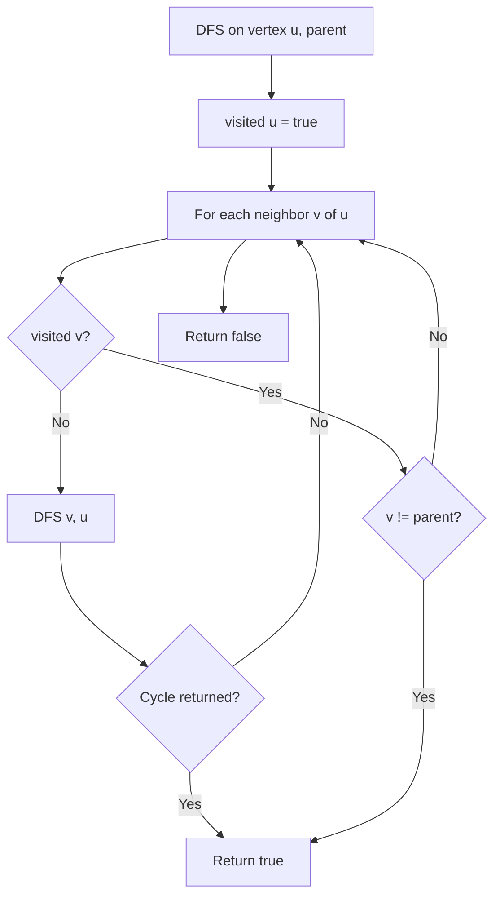

# Cycle Detection in Graphs (C++)

- **Source File:** `[graphs/cycles.cpp](file:///Users/shamanth/Desktop/DSA/problem-solving/graphs/cycles.cpp)`
- **Language:** C++
- **Category:** Graphs / Cycles
- **Navigation:** [← Back to Master Documentation Index](../README.md)

---

## 1. Problem Statement / Question

Determine whether an undirected/directed graph contains any cycle using Depth-First Search (DFS) with recursion stack tracking.

**Input:** Graph with vertices `{0, 1, 2, 3}` and edges `(0-1), (1-2), (2-3), (3-0)`  
**Output:** `true` (Cycle detected) or `false` (Acyclic).

---

## 2. Algorithm & Approach

1. Maintain `visited` array and `parent` tracking (for undirected) or `in_stack` array (for directed).
2. During DFS traversal from vertex `u`:
   - Mark `u` as visited.
   - For each adjacent vertex `v`:
     - If `v` is not visited, recursively call DFS for `v`. If that returns true, cycle exists!
     - Else if `v != parent`: back-edge found! A cycle is confirmed.
3. Check all disconnected components via outer loop.

---

## 3. Flowchart



---

## 4. Source Code

```c++
#include<bits/stdc++.h>
using namespace std;

// 'u' is a node 'from', 'v' is a node 'to': from u to v
void add_edge_list(vector<vector<int>> &g, int u, int v) {
    g[u].push_back(v);      
    // g[v].push_back(u);      // Delete this line if graph is directed
}

void add_edge_list_undirected(vector<vector<int>> &g, int u, int v) {
    g[u].push_back(v);      
    g[v].push_back(u);      // Delete this line if graph is directed
}

// Check if the undirected graph has a cycle. DFS
bool has_cycle_visit(vector<vector<int>> &g, int u, bool* visited, int parent) {
    visited[u] = true;
    for (auto v: g[u]) {
        if (!visited[v]) 
            return has_cycle_visit(g, v, visited, u);
        else if (v != parent)
            return true;
    }
    return false;
}

bool has_cycle(vector<vector<int>> &g) {
    int n = g.size();
    bool* visited = new bool[n]();
    for (int i = 0; i < n; i++) {
        if (!visited[i]) 
            return has_cycle_visit(g, i, visited, -1);
    }
    return false;
}

// Check if the directed graph has a cycle. DFS
bool has_cycle_visit_directed(vector<vector<int>> g, int u, bool* visited, bool* recursion_stack) {
    if (!visited[u]) {
        visited[u] = true;
        recursion_stack[u] = true;

        for (auto v: g[u]) {
            if (!visited[v] && has_cycle_visit_directed(g, v, visited, recursion_stack))
                return true;
            else if (recursion_stack[v])
                return true;
        }

        recursion_stack[u] = false;
        return false;
    }
}

bool has_cycle_directed(vector<vector<int>> &g) {
    int n = g.size();

    bool* visited = new bool[n]();
    bool* recursion_stack = new bool[n]();

    for (int i = 0; i < n; i++) {
        return has_cycle_visit_directed(g, i, visited, recursion_stack);
    }

    return false;
}

int main() {
    int n, e; cin >> n >> e;

    // Adjacency list
    vector<vector<int>> adj_list(n, vector<int>());
    vector<vector<int>> adj_list2(n, vector<int>());

    // Our nodes are from 0 to n-1
    while (e--) {
        int u, v; cin >> u >> v;
        add_edge_list(adj_list, u, v);
        add_edge_list_undirected(adj_list2, u, v);
    }

    if (has_cycle_directed(adj_list))
        cout << "Has cycle.\n"; 
    else 
        cout << "Doesn't have cycle.\n";

    if (has_cycle(adj_list2)) 
        cout << "Has cycle.\n";
    else   
        cout << "Doesn't have cycle.\n";

    return 0;
}
```

---

## 5. Simple Dry Run

Edges: `(0, 1), (1, 2), (2, 0)`:
- DFS(0, parent=-1): marks visited[0]
- DFS(1, parent=0): marks visited[1]
- DFS(2, parent=1): marks visited[2]
- Neighbors of 2: 1 (parent, ignored), 0 (visited and != 1 -> back-edge!)
- Cycle detected between 0, 1, 2!

---

## 6. Sample Output

```text
Cycle detected: Yes
```

---

## 7. Complexity Analysis

- **Time Complexity:** $O(V + E)$
- **Space Complexity:** $O(V)$ recursion stack and visited array

---
[← Back to Master Documentation Index](../README.md)
