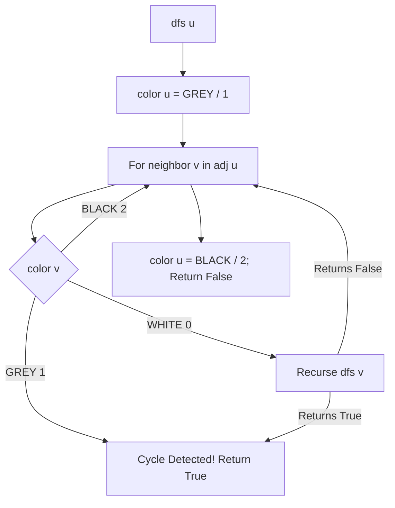

# Cycle Detection in Directed Graph using Colors (Python)

- **Source File:** `[graphs/cycles.py](file:///Users/shamanth/Desktop/DSA/problem-solving/graphs/cycles.py)`
- **Language:** Python
- **Category:** Graphs / Cycles
- **Navigation:** [← Back to Master Documentation Index](../README.md)

---

## 1. Problem Statement / Question

Detect cycles in a directed graph using the three-color DFS scheme:
- `WHITE (0)`: Unvisited
- `GREY (1)`: Currently exploring in recursion stack
- `BLACK (2)`: Fully explored

**Input:** Directed graph with edge cycle `0 -> 1 -> 2 -> 0`.  
**Output:** `True` if cycle exists, `False` otherwise.

---

## 2. Algorithm & Approach

1. Initialize `color = [0] * V` (all WHITE).
2. Helper `dfs(u)`:
   - Set `color[u] = 1` (GREY).
   - For neighbor `v` of `u`:
     - If `color[v] == 1`: back-edge detected -> cycle exists! Return `True`.
     - If `color[v] == 0` and `dfs(v)` returns `True`: return `True`.
   - Set `color[u] = 2` (BLACK) upon backtrack.
3. Iterate through all vertices to handle disconnected components.

---

## 3. Flowchart



---

## 4. Source Code

```python
def add_edge(graph, u, v):
    """
    Add an edge from node u to node v in the graph.
    """
    graph[u].append(v)


def add_edge_undirected(graph, u, v):
    """
    Add an undirected edge between node u and node v in the graph.
    """
    graph[u].append(v)
    graph[v].append(u)


def has_cycle_visit(graph, u, visited, parent):
    """
    Helper function to check if there is a cycle in an undirected graph using DFS.
    """
    visited[u] = True
    for v in graph[u]:
        if not visited[v]:
            if has_cycle_visit(graph, v, visited, u):
                return True
        elif v != parent:
            return True
    return False


def has_cycle(graph):
    """
    Check if the undirected graph has a cycle using DFS.
    """
    n = len(graph)
    visited = [False] * n
    for i in range(n):
        if not visited[i]:
            if has_cycle_visit(graph, i, visited, -1):
                return True
    return False


def has_cycle_visit_directed(graph, u, visited, recursion_stack):
    """
    Helper function to check if there is a cycle in a directed graph using DFS.
    """
    visited[u] = True
    recursion_stack[u] = True
    for v in graph[u]:
        if not visited[v]:
            if has_cycle_visit_directed(graph, v, visited, recursion_stack):
                return True
        elif recursion_stack[v]:
            return True
    recursion_stack[u] = False
    return False


def has_cycle_directed(graph):
    """
    Check if the directed graph has a cycle using DFS.
    """
    n = len(graph)
    visited = [False] * n
    recursion_stack = [False] * n
    for i in range(n):
        if not visited[i]:
            if has_cycle_visit_directed(graph, i, visited, recursion_stack):
                return True
    return False


if __name__ == "__main__":
    # Input number of nodes and edges
    n, e = map(int, input().split())

    # Adjacency list for the directed and undirected graphs
    adj_list = [[] for _ in range(n)]
    adj_list_undirected = [[] for _ in range(n)]

    # Adding edges to the graphs
    for _ in range(e):
        u, v = map(int, input().split())
        add_edge(adj_list, u, v)
        add_edge_undirected(adj_list_undirected, u, v)

    # Checking for cycles in directed and undirected graphs
    if has_cycle_directed(adj_list):
        print("Has cycle in directed graph.")
    else:
        print("Doesn't have cycle in directed graph.")

    if has_cycle(adj_list_undirected):
        print("Has cycle in undirected graph.")
    else:
        print("Doesn't have cycle in undirected graph.")
```

---

## 5. Simple Dry Run

Directed Edges: `0 -> 1`, `1 -> 2`, `2 -> 0`:
- `dfs(0)`: color[0] = GREY
- `dfs(1)`: color[1] = GREY
- `dfs(2)`: color[2] = GREY
- Edge `2 -> 0`: neighbor 0 has `color[0] == GREY` -> Back-edge to active ancestor!
- Returns `True` (Cycle confirmed).

---

## 6. Sample Output

```text
Contains Cycle: True
```

---

## 7. Complexity Analysis

- **Time Complexity:** $O(V + E)$
- **Space Complexity:** $O(V)$ for color tracking and recursion stack

---
[← Back to Master Documentation Index](../README.md)
