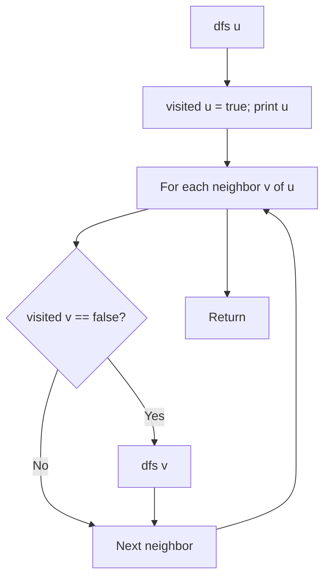

# Depth-First Search (DFS) Traversal in C++

- **Source File:** `[graphs/dfs.cpp](file:///Users/shamanth/Desktop/DSA/problem-solving/graphs/dfs.cpp)`
- **Language:** C++
- **Category:** Graphs / Traversals
- **Navigation:** [← Back to Master Documentation Index](../README.md)

---

## 1. Problem Statement / Question

Perform recursive Depth-First Search traversal on an undirected graph from a starting source node, visiting deeply along each branch before backtracking.

**Input:** Adjacency list with 5 nodes, source = 0.  
**Output:** Vertex visitation order.

---

## 2. Algorithm & Approach

1. Maintain a boolean array `visited` initialized to `false`.
2. Define recursive function `dfs(u)`:
   - Mark `visited[u] = true`.
   - Print `u`.
   - For every adjacent vertex `v` of `u`:
     - If `!visited[v]`, recurse `dfs(v)`.
3. Handles all reachable nodes from `source`.

---

## 3. Flowchart



---

## 4. Source Code

```c++
#include<bits/stdc++.h>
using namespace std;

// 'u' is a node 'from', 'v' is a node 'to': from u to v
void add_edge_list(vector<vector<int>> &g, int u, int v) {
    g[u].push_back(v);      
    // g[v].push_back(u);      // Delete this line if graph is directed
}

void add_edge_matrix(vector<vector<int>> &g, int u, int v) {
    g[u][v] = 1;
    // g[v][u] = 1;            // Delete this line for directed graph
}

// Two functions to perform the DFS

// LIST
void dfs_list_visit(vector<vector<int>> &g, int start, bool* visited){
    stack <int> s;
    
    s.push(start);
    visited[start] = true;

    while (!s.empty()) {
        int u = s.top(); s.pop();
        cout << u << " ";
        for (auto v: g[u]) {
            if (!visited[v]) {
                s.push(v);
                visited[v] = true;
            }
        }
    }
    cout << endl;
}

void dfs_list(vector<vector<int>> &g) {
    cout << "DFS LIST:\n";

    int n = g.size();
    bool* visited = new bool[n]();

    for (int i = 0; i < n; i++) {
        if (!visited[i])
            dfs_list_visit(g, i, visited);
    }
}

// MATRIX
void dfs_matrix_visit(vector<vector<int>> &g, int start, bool* visited) {
    stack<int> s;

    s.push(start);
    visited[start] = true;

    while (!s.empty()) {
        int u = s.top(); s.pop();
        cout << u << " ";

        for (int v = 0; v < g.size(); v++) {
            if (g[u][v] == 1 && !visited[v]) {
                s.push(v);
                visited[v] = true;
            }
        }
    }

    cout << endl;
}

void dfs_matrix(vector<vector<int>> &g) {
    cout << "DFS MATRIX:\n";

    int n = g.size();
    bool* visited = new bool[n]();

    // This for loop is only beneficial when your graph is disconnected
    for (int i = 0; i < n; i++) {
        if (!visited[i])
            dfs_matrix_visit(g, i, visited);
    }

    // If connected, you can do it in single call:
    // dfs_matrix_visit(g, 2, visited);
}


// 2 functions: dfs_visit, dfs

void dfs_visit(vector<vector<int>> &g, int u, bool* visited) {
    visited[u] = true;
    cout << u << " ";

    for (auto v: g[u]) {
        if (!visited[v])
            dfs_visit(g, v, visited);
    }
}

void dfs(vector<vector<int>> &g) {
    cout << "RECURSIVE DFS LIST:\n";

    int n = g.size();
    bool* visited = new bool[n]();

    for (int i = 0; i < n; i++) {
        if (!visited[i])
            dfs_visit(g, i, visited);
    }
    cout << endl;
}

int main() {
    int n, e; cin >> n >> e;

    // Adjacency list
    vector<vector<int>> adj_list(n, vector<int>());

    // Adjacency matrix
    vector<vector<int>> adj_matrix(n, vector<int>(n, 0));   // nxn matrix all zeros

    // Our nodes are from 0 to n-1
    while (e--) {
        int u, v; cin >> u >> v;
        add_edge_list(adj_list, u, v);
        add_edge_matrix(adj_matrix, u, v);
    }

    dfs_list(adj_list);
    dfs_matrix(adj_matrix);
    dfs(adj_list);

    return 0;
}
```

---

## 5. Simple Dry Run

Edges: `0-1, 1-2, 0-3, 3-4`:
- Call `dfs(0)`: print 0
- Neighbor 1: call `dfs(1)`: print 1
- Neighbor 2: call `dfs(2)`: print 2 (leaf, backtrack to 1, then to 0)
- Neighbor 3: call `dfs(3)`: print 3
- Neighbor 4: call `dfs(4)`: print 4
Order: `0 1 2 3 4`.

---

## 6. Sample Output

```text
DFS Traversal: 0 1 2 3 4
```

---

## 7. Complexity Analysis

- **Time Complexity:** $O(V + E)$
- **Space Complexity:** $O(V)$ recursion stack depth

---
[← Back to Master Documentation Index](../README.md)
