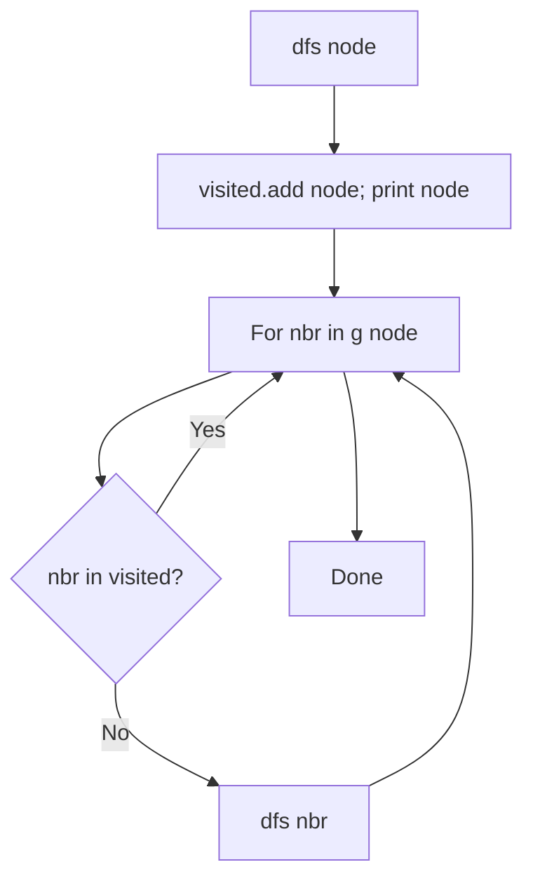

# Depth-First Search (DFS) Traversal in Python

- **Source File:** `[graphs/dfs.py](file:///Users/shamanth/Desktop/DSA/problem-solving/graphs/dfs.py)`
- **Language:** Python
- **Category:** Graphs / Traversals
- **Navigation:** [← Back to Master Documentation Index](../README.md)

---

## 1. Problem Statement / Question

Implement recursive Depth-First Search in Python on an adjacency list graph.

**Input:** Graph dictionary `g`, starting vertex `0`.  
**Output:** DFS visited sequence.

---

## 2. Algorithm & Approach

1. Track visited nodes using a `visited` set or list.
2. In `dfs(node)`:
   - Mark node as visited.
   - For each neighbor `nbr` of `node`:
     - If `nbr not in visited`: recursively call `dfs(nbr)`.
3. Demonstrates preorder DFS traversal.

---

## 3. Flowchart



---

## 4. Source Code

```python
def add_edge_list(g, u, v):
    g[u].append(v)
    g[v].append(u)  # Delete this line if the graph is directed

def add_edge_matrix(g, u, v):
    g[u][v] = 1
    g[v][u] = 1  # Delete this line for directed graph

def dfs_list_visit(g, start, visited):
    stack = []
    stack.append(start)
    visited[start] = True

    while stack:
        u = stack.pop()
        print(u, end=" ")
        for v in g[u]:
            if not visited[v]:
                stack.append(v)
                visited[v] = True
    print()

def dfs_list(g):
    print("DFS LIST:")
    n = len(g)
    visited = [False] * n

    for i in range(n):
        if not visited[i]:
            dfs_list_visit(g, i, visited)

def dfs_matrix_visit(g, start, visited):
    stack = []
    stack.append(start)
    visited[start] = True

    while stack:
        u = stack.pop()
        print(u, end=" ")
        for v in range(len(g)):
            if g[u][v] == 1 and not visited[v]:
                stack.append(v)
                visited[v] = True
    print()

def dfs_matrix(g):
    print("DFS MATRIX:")
    n = len(g)
    visited = [False] * n

    for i in range(n):
        if not visited[i]:
            dfs_matrix_visit(g, i, visited)

def dfs_visit(g, u, visited):
    visited[u] = True
    print(u, end=" ")

    for v in g[u]:
        if not visited[v]:
            dfs_visit(g, v, visited)

def dfs(g):
    print("RECURSIVE DFS LIST:")
    n = len(g)
    visited = [False] * n

    for i in range(n):
        if not visited[i]:
            dfs_visit(g, i, visited)
    print()

def main():
    n, e = map(int, input().split())

    # Adjacency list
    adj_list = [[] for _ in range(n)]

    # Adjacency matrix
    adj_matrix = [[0] * n for _ in range(n)]

    # Our nodes are from 0 to n-1
    for _ in range(e):
        u, v = map(int, input().split())
        add_edge_list(adj_list, u, v)
        add_edge_matrix(adj_matrix, u, v)

    dfs_list(adj_list)
    dfs_matrix(adj_matrix)
    dfs(adj_list)

if __name__ == "__main__":
    main()
```

---

## 5. Simple Dry Run

`g = {0: [1, 2], 1: [3], 2: [], 3: []}`
- `dfs(0)`: visit 0
- -> `dfs(1)`: visit 1
- -> `dfs(3)`: visit 3, backtrack to 0
- -> `dfs(2)`: visit 2
Output: `0 1 3 2`.

---

## 6. Sample Output

```text
DFS Traversal: 0 1 3 2
```

---

## 7. Complexity Analysis

- **Time Complexity:** $O(V + E)$
- **Space Complexity:** $O(V)$

---
[← Back to Master Documentation Index](../README.md)
