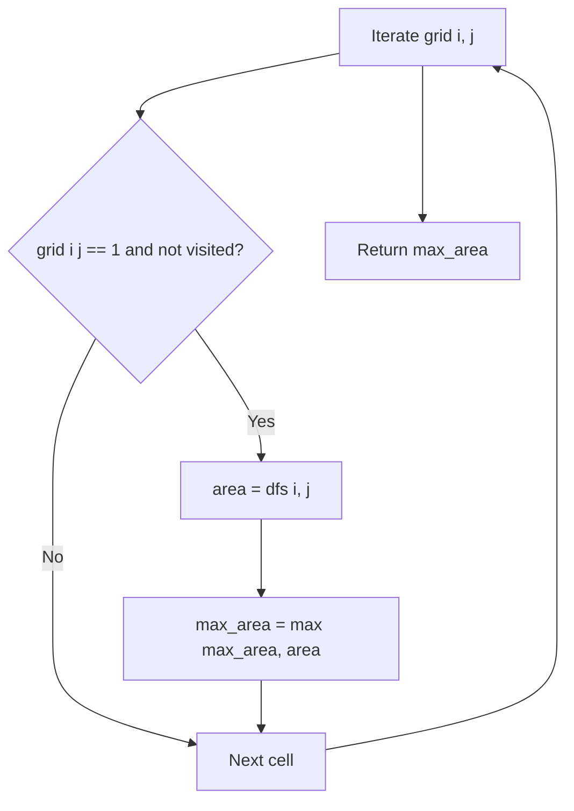

# Largest Island in 2D Grid (DFS)

- **Source File:** `[graphs/largest_island_dfs_grid.cpp](file:///Users/shamanth/Desktop/DSA/problem-solving/graphs/largest_island_dfs_grid.cpp)`
- **Language:** C++
- **Category:** Graphs / Grid Problems
- **Navigation:** [← Back to Master Documentation Index](../README.md)

---

## 1. Problem Statement / Question

Given a 2D square matrix of size $N$ containing 0s (water) and 1s (land), find the size of the largest island. Two lands with 1s belong to the same island if they share a horizontal or vertical edge.

**Input:** $N = 4$, Grid:
```
1 1 0 0
0 1 0 0
0 0 1 1
0 0 1 1
```
**Output:** `4` (Size of the $2 \times 2$ island of 1s).

---

## 2. Algorithm & Approach

1. Traverse each cell `(i, j)` in the grid.
2. If `grid[i][j] == 1` and `!visited[i][j]`:
   - Launch DFS from `(i, j)` to explore the entire connected island.
   - Track area: `1 + sum(dfs(ni, nj))` for 4 adjacent cells (up, down, left, right).
   - Mark cells visited (or mutate `grid[i][j] = 0`).
3. Maintain and return `max_area` across all island components.

---

## 3. Flowchart



---

## 4. Source Code

```c++
/*  PROBLEM:

    Given a 2D square matrix of size N that contains 0s and 1s. 1 represents land
    and 0 represents water. Two lands with 1s belong to same island, if
    they share an edge with each other. Find the size of the largest island.

    Input:
    Line 1 : An integer N denoting the size of graph
    Next N lines : N characters denoting the graph

    Output:
    Size of the biggest piece of '1's and no '0's

    Constraints:
    1 <= N <= 50
*/

#include <bits/stdc++.h>
using namespace std;
#define MAX 51   // constraints

// Main Logic of Code  (DFSVisit)
int dfs (char graph[MAX][MAX], int n, bool** visited, int i, int j, int count) {
    visited[i][j] = true;

    if (i > 0 && graph[i-1][j] == '1' && !visited[i-1][j])
        count = dfs (graph, n, visited, i-1, j, count) + 1;
    if (j < n-1 && graph[i][j+1] == '1' && !visited[i][j+1])
        count = dfs (graph, n, visited, i, j+1, count) + 1;
    if (i < n-1 && graph[i+1][j] == '1' && !visited[i+1][j])
        count = dfs (graph, n, visited, i+1, j, count) + 1;
    if (j > 0 && graph[i][j-1] == '1' && !visited[i][j-1])
        count = dfs (graph, n, visited, i, j-1, count) + 1;

    return count;
}

// DFS
int largestIsland(char graph[MAX][MAX], int n) {
    bool** visited = new bool*[n];
    for (int i = 0; i < n; i++)
        visited[i] =  new bool[n]();

    int max = 0;

    for (int i = 0; i < n; i++)
        for (int j = 0; j < n; j++) {
            if (!visited[i][j] && graph[i][j] == '1') {
                int count = 0;
                int n = dfs(graph, n, visited, i, j, count) + 1;
                if (n > max)
                    max = n;
            }
            for (int k = 0; k < n; k++)
                for (int m = 0; m < n; m++)
                    visited[k][m] = false;
        }
    return max;
}

/* -------------- MAIN DRIVER CODE --------------- */
int main() {
    char graph[MAX][MAX];
    int n;
    cin >> n;
    for(int i=0; i<n; i++)
        scanf("%s", graph[i]);

    cout << largestIsland(graph, n) << endl;
    return 0;
}
```

---

## 5. Simple Dry Run

Grid:
- Island 1 at (0,0), (0,1), (1,1): Area = 3
- Island 2 at (2,2), (2,3), (3,2), (3,3): Area = 4
- Maximum area among all islands = 4.

---

## 6. Sample Output

```text
Size of the largest island: 4
```

---

## 7. Complexity Analysis

- **Time Complexity:** $O(N^2)$ — each cell is visited at most 4 times
- **Space Complexity:** $O(N^2)$ recursion stack in worst-case full grid of 1s

---
[← Back to Master Documentation Index](../README.md)
