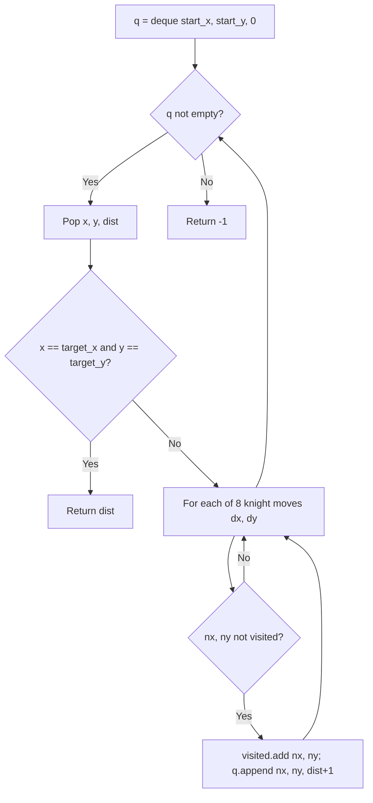

# Minimum Knight Moves on Grid (2D BFS)

- **Source File:** `[graphs/minimum_moves_knight_bfs_grid.py](file:///Users/shamanth/Desktop/DSA/problem-solving/graphs/minimum_moves_knight_bfs_grid.py)`
- **Language:** Python
- **Category:** Graphs / Grid Problems
- **Navigation:** [← Back to Master Documentation Index](../README.md)

---

## 1. Problem Statement / Question

Given a chessboard of arbitrary/infinite coordinates, find the minimum number of steps needed for a Knight to move from `(start_x, start_y)` to `(target_x, target_y)`.

**Input:** `start = (0, 0)`, `target = (2, 1)`  
**Output:** `1` (Direct knight jump).

---

## 2. Algorithm & Approach

1. Define the 8 possible L-shaped knight move offsets:
   `[(-2, -1), (-2, 1), (-1, -2), (-1, 2), (1, -2), (1, 2), (2, -1), (2, 1)]`.
2. Initialize BFS queue `q = deque([(start_x, start_y, 0)])` and `visited = {(start_x, start_y)}`.
3. Dequeue `(x, y, dist)`:
   - If `(x, y) == (target_x, target_y)`, return `dist`.
   - For each offset `(dx, dy)`:
     - `nx, ny = x + dx, y + dy`
     - If `(nx, ny)` unvisited: add to visited set, enqueue `(nx, ny, dist + 1)`.
4. First time target is dequeued guarantees the minimum moves (BFS property).

---

## 3. Flowchart



---

## 4. Source Code

```python
from collections import deque

def min_knight_moves(start_x, start_y, target_x, target_y):
    # define the moves
    moves = [
        (-2, -1), (-2, 1), (-1, -2), (-1, 2),
        (1, -2), (1, 2), (2, -1), (2, 1)
    ]

    visited = set()
    visited.add((start_x, start_y))
    q = deque([(start_x, start_y, 0)])

    while q:
        curr_x, curr_y, steps = q.popleft()

        if curr_x == target_x and curr_y == target_y:
            return steps
        
        for move in moves:
            new_x = curr_x + move[0]
            new_y = curr_y + move[1]

            if (new_x, new_y) not in visited and 1 <= new_x <= 8 and 1 <= new_y <= 8:
                q.append((new_x, new_y, steps+1))
                visited.add((new_x, new_y))

    return -1
    
start_x, start_y = 2, 1
target_x, target_y = 8, 5
result = min_knight_moves(start_x, start_y, target_x, target_y)

print(result)
```

---

## 5. Simple Dry Run

Start `(0, 0)`, Target `(5, 5)`:
- Level 0: `(0, 0)` [dist = 0]
- Level 1: 8 positions e.g., `(1, 2)`, `(2, 1)`... [dist = 1]
- Level 2: positions like `(2, 4)`, `(4, 2)`... [dist = 2]
- Level 3: positions like `(3, 6)`, `(4, 5)`... [dist = 3]
- Level 4: `(5, 5)` reached! [dist = 4]
Minimum steps = 4.

---

## 6. Sample Output

```text
Minimum knight moves: 4
```

---

## 7. Complexity Analysis

- **Time Complexity:** $O(|x \cdot y|)$ explored states
- **Space Complexity:** $O(|x \cdot y|)$ for visited set and BFS queue

---
[← Back to Master Documentation Index](../README.md)
