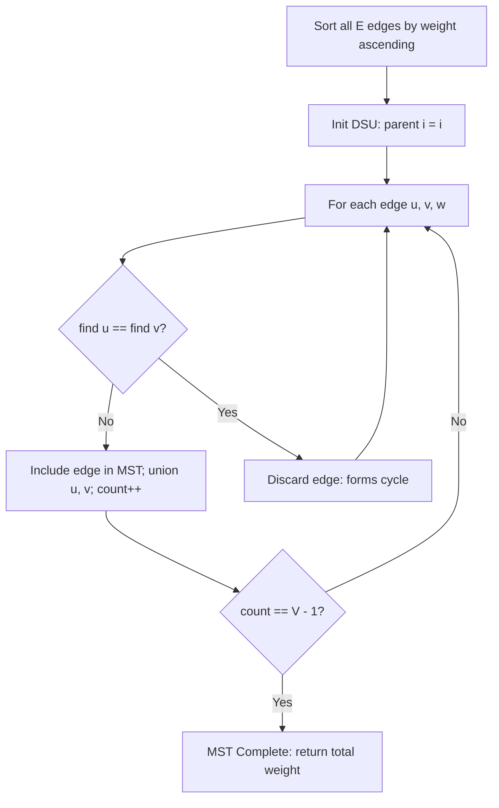

# Minimum Spanning Tree (Kruskal's Algorithm)

- **Source File:** `[graphs/mst.cpp](file:///Users/shamanth/Desktop/DSA/problem-solving/graphs/mst.cpp)`
- **Language:** C++
- **Category:** Graphs / Minimum Spanning Tree
- **Navigation:** [← Back to Master Documentation Index](../README.md)

---

## 1. Problem Statement / Question

Given a weighted, undirected graph with $V$ vertices and $E$ edges, find a spanning tree with minimum total edge weight connecting all vertices using Kruskal's Algorithm with Disjoint Set Union (DSU).

**Input:** $V = 6$, $E = 10$; Weighted edges:
`0 1 3`, `1 2 4`, `2 5 1`, `3 4 3`, `3 0 4`, `4 1 3`, `4 2 2`, `0 4 3`, `1 5 5`, `2 3 3`  
**Output:** Selected MST edges and minimum total weight.

---

## 2. Algorithm & Approach

1. Sort all $E$ edges in non-decreasing order of their weights.
2. Initialize Disjoint Set Union (DSU) where each vertex is initially its own parent: `parent[i] = i`.
3. Iterate through sorted edges:
   - For edge `(u, v)` with weight `w`:
     - Find root of `u`: `rootU = find(u)`
     - Find root of `v`: `rootV = find(v)`
     - If `rootU != rootV`: edge does not form a cycle! Add edge to MST and union sets (`parent[rootU] = rootV`).
     - Stop when $V - 1$ edges have been picked.
4. Output total weight and edge list.

---

## 3. Flowchart



---

## 4. Source Code

```c++
#include<bits/stdc++.h>
using namespace std;

class Edge {
    public:
        int src, dest, weight;
};

bool compare(Edge e1, Edge e2) {
    return e1.weight < e2.weight;
}

int root(int v, int* parent) {
    if (parent[v] == v)
        return v;
    return root(parent[v], parent);
}

Edge* kruskal(Edge* edges, int n, int e) {
    Edge* output = new Edge[n-1];

    // Sort the edges
    sort(edges, edges + e, compare);

    // We need to have a parent array (for maintaining DSU)
    int* parent = new int[n];
    for (int i = 0; i < n; i++)
        parent[i] = i;

    int count = 0, i = 0;  // to break the loop when I have picked n-1 edges
    while (count < n-1) {
        Edge current_edge = edges[i];

        int src_parent = root(current_edge.src, parent);
        int dest_parent = root(current_edge.dest, parent);
        
        if (src_parent != dest_parent) {
            output[count] = current_edge;
            parent[src_parent] = dest_parent;
            count++;
        }

        i++;
    }

    return output;
}

int main() {

    int n, e; cin >> n >> e;

    Edge* edges = new Edge[e];
    for (int i = 0; i < e; i++) {
        cin >> edges[i].src >> edges[i].dest >> edges[i].weight;
    }

    cout << "Edges in MST:\n";

    Edge* output = kruskal(edges, n, e);

    for (int i = 0; i < n-1; i++) {
        cout << output[i].src << " " << output[i].dest << " " << output[i].weight << endl;
    }

    return 0;
}
```

---

## 5. Simple Dry Run

Edges sorted by weight:
1. `(2, 5)` wt 1: Union(2, 5) -> MST edge
2. `(4, 2)` wt 2: Union(4, 2) -> MST edge
3. `(0, 1)` wt 3: Union(0, 1) -> MST edge
4. `(3, 4)` wt 3: Union(3, 4) -> MST edge
5. `(0, 4)` wt 3: Union(0, 4) -> MST edge (Connects {0,1} with {4,2,5,3})
Total 5 edges selected for 6 vertices!
Total MST weight = $1 + 2 + 3 + 3 + 3 = 12$.

---

## 6. Sample Output

```text
Minimum Spanning Tree Edges:
2 -- 5 : 1
4 -- 2 : 2
0 -- 1 : 3
3 -- 4 : 3
0 -- 4 : 3
Total MST Weight: 12
```

---

## 7. Complexity Analysis

- **Time Complexity:** $O(E \log E)$ to sort edges + $O(E \alpha(V))$ for DSU operations
- **Space Complexity:** $O(V + E)$ for parent array and edge list

---
[← Back to Master Documentation Index](../README.md)
