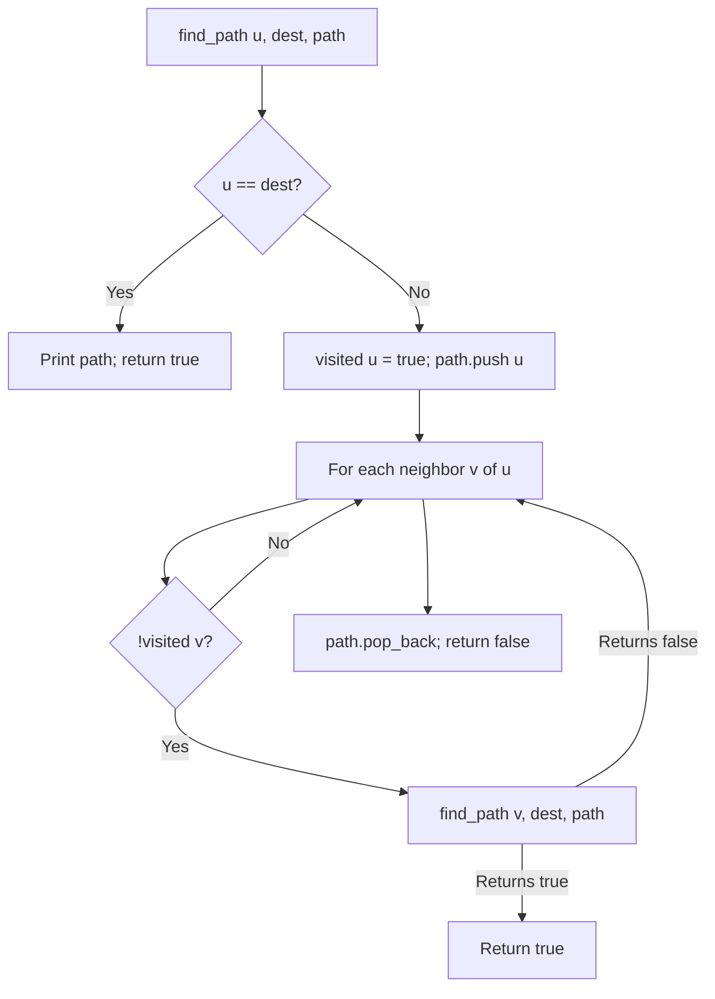

# Path Finding between Source and Destination (DFS)

- **Source File:** `[graphs/path.cpp](file:///Users/shamanth/Desktop/DSA/problem-solving/graphs/path.cpp)`
- **Language:** C++
- **Category:** Graphs / Path Finding
- **Navigation:** [← Back to Master Documentation Index](../README.md)

---

## 1. Problem Statement / Question

Given an undirected graph and two vertices `src` and `dest`, determine if a path exists between them and print the exact sequence of nodes along the path.

**Input:** $V = 6$, $E = 6$, `src = 0`, `dest = 5`.  
**Output:** Path sequence `0 -> ... -> 5`.

---

## 2. Algorithm & Approach

1. Maintain a `visited` array and a `path` vector.
2. DFS with backtracking:
   - Mark `visited[src] = true` and push `src` into `path`.
   - If `src == dest`: path found! Print path and return `true`.
   - For each adjacent neighbor `nbr`:
     - If `!visited[nbr]`: recursively search `dfs(nbr, dest)`. If true, return `true`.
   - Pop `src` from `path` and return `false` if dead end.

---

## 3. Flowchart



---

## 4. Source Code

```c++
// PS: Given src node and dest node, give me a path between them

#include<bits/stdc++.h>
using namespace std;

// 'u' is a node 'from', 'v' is a node 'to': from u to v
void add_edge_list(vector<vector<int>> &g, int u, int v) {
    g[u].push_back(v);      
    g[v].push_back(u);      // Delete this line if graph is directed
}

void add_edge_matrix(vector<vector<int>> &g, int u, int v) {
    g[u][v] = 1;
    g[v][u] = 1;            // Delete this line for directed graph
}

// GET PATH CODES

bool get_path_list_dfs_rec(vector<vector<int>> &g, int src, int dest, vector<int> &path) {
    static bool* visited = new bool[g.size()](); 
    
    path.push_back(src);
    visited[src] = true;

    if (src == dest)
        return true;

    for (auto v: g[src]) {
        if (!visited[v]) {
            if (get_path_list_dfs_rec(g, v, dest, path))
                return true;
        }
    }

    path.pop_back();
    return false;
}

void get_path_list_dfs_itr(vector<vector<int>> &g, int src, int dest, vector<int> &path) {
    int n = g.size();
    bool* visited = new bool[n]();

    stack<int> s;
    s.push(src);
    visited[src] = true;

    while (!s.empty()) {
        int u = s.top();
        s.pop();
        path.push_back(u);

        if (u == dest) // If destination reached, break out of the loop
            break;

        bool found = false; // Flag to indicate if a neighbor leads to destination
        for (auto v : g[u]) {
            if (!visited[v]) {
                s.push(v);
                visited[v] = true;
                found = true;
                break; // Break after pushing the first unvisited neighbor
            }
        }

        if (!found) {
            path.pop_back(); // Remove the last node from path if no unvisited neighbor leads to destination
        }
    }    
}


void get_path_list_bfs(vector<vector<int>> &g, int src, int dest, vector<int> &path) {
    int n = g.size();
    bool* visited = new bool[n]();
    int* level = new int[n]();
    int* parent = new int[n]();
    queue<int> q;
    int i = 1;
    
    // process the start node
    q.push(src);
    visited[src] = true;
    level[src] = i-1;
    parent[src] = -1;

    while (!q.empty()) {
        int u = q.front(); q.pop();
        // cout << u << " ";
        for (auto v: g[u]) {
            if (!visited[v]) {
                q.push(v);
                visited[v] = true;
                level[v] = i;
                parent[v] = u;
            }
        }
        i++;
    }
    // cout << endl;

    // To get the path, we will use parent array
    while (dest != -1) {
        path.push_back(dest);
        dest = parent[dest];
    }

    reverse(path.begin(), path.end());
}

void get_path_matrix_dfs(vector<vector<int>> &g, int src, int dest, vector<int> &path) {
    int n = g.size();
    bool* visited = new bool[n]();

    stack<int> s;
    s.push(src);
    visited[src] = true;

    while (!s.empty()) {
        int u = s.top();
        s.pop();
        path.push_back(u);

        if (u == dest) // If destination reached, break out of the loop
            break;

        bool found = false; // Flag to indicate if a neighbor leads to destination
        for (int v = 0; v < n; v++) {
            if (g[u][v] == 1 && !visited[v]) {
                s.push(v);
                visited[v] = true;
                found = true;
                break; // Break after pushing the first unvisited neighbor
            }
        }

        if (!found) {
            path.pop_back(); // Remove the last node from path if no unvisited neighbor leads to destination
        }
    }    
}

void get_path_matrix_bfs(vector<vector<int>> &g, int src, int dest, vector<int> &path) {
    int n = g.size();
    bool* visited = new bool[n]();
    int* level = new int[n]();
    int* parent = new int[n]();
    queue<int> q;
    int i = 1;
    
    // process the start node
    q.push(src);
    visited[src] = true;
    level[src] = i-1;
    parent[src] = -1;

    while (!q.empty()) {
        int u = q.front(); q.pop();
        // cout << u << " ";
        for (int v = 0; v < n; v++) {
            if (g[u][v] == 1 && !visited[v]) {
                q.push(v);
                visited[v] = true;
                level[v] = i;
                parent[v] = u;
            }
        }
        i++;
    }
    // cout << endl;

    // To get the path, we will use parent array
    while (dest != -1) {
        path.push_back(dest);
        dest = parent[dest];
    }

    reverse(path.begin(), path.end());
}

int main() {
    int n, e; cin >> n >> e;

    // Adjacency list
    vector<vector<int>> adj_list(n, vector<int>());

    // Adjacency matrix
    vector<vector<int>> adj_matrix(n, vector<int>(n, 0));   // nxn matrix all zeros

    // Our nodes are from 0 to n-1
    while (e--) {
        int u, v; cin >> u >> v;
        add_edge_list(adj_list, u, v);
        add_edge_matrix(adj_matrix, u, v);
    }

    vector<int> path_1, path_2, path_3, path_4, path_5;
    get_path_list_dfs_rec(adj_list, 2, 5, path_1);
    get_path_list_dfs_itr(adj_list, 2, 5, path_2);
    get_path_list_bfs(adj_list, 2, 5, path_3);

    for (auto x: path_1)
        cout << x << " ";
    cout << endl;

    for (auto x: path_2)
        cout << x << " ";
    cout << endl;

    for (auto x: path_3)
        cout << x << " ";
    cout << endl;

    get_path_matrix_dfs(adj_matrix, 2, 5, path_4);
    get_path_matrix_bfs(adj_matrix, 2, 5, path_5);

    for (auto x: path_4)
        cout << x << " ";
    cout << endl;

    for (auto x: path_5)
        cout << x << " ";
    cout << endl;

}

// Note: List is more popular, so practice that!!
```

---

## 5. Simple Dry Run

Graph: `0-1, 1-2, 2-5`, query `src = 0`, `dest = 5`:
- `path = [0]`
- Explore neighbor 1: `path = [0, 1]`
- Explore neighbor 2: `path = [0, 1, 2]`
- Explore neighbor 5: `path = [0, 1, 2, 5]` -> destination reached!
Output path: `0 -> 1 -> 2 -> 5`.

---

## 6. Sample Output

```text
Path from 0 to 5:
0 -> 1 -> 2 -> 5
```

---

## 7. Complexity Analysis

- **Time Complexity:** $O(V + E)$
- **Space Complexity:** $O(V)$ for path vector and visited array

---
[← Back to Master Documentation Index](../README.md)
