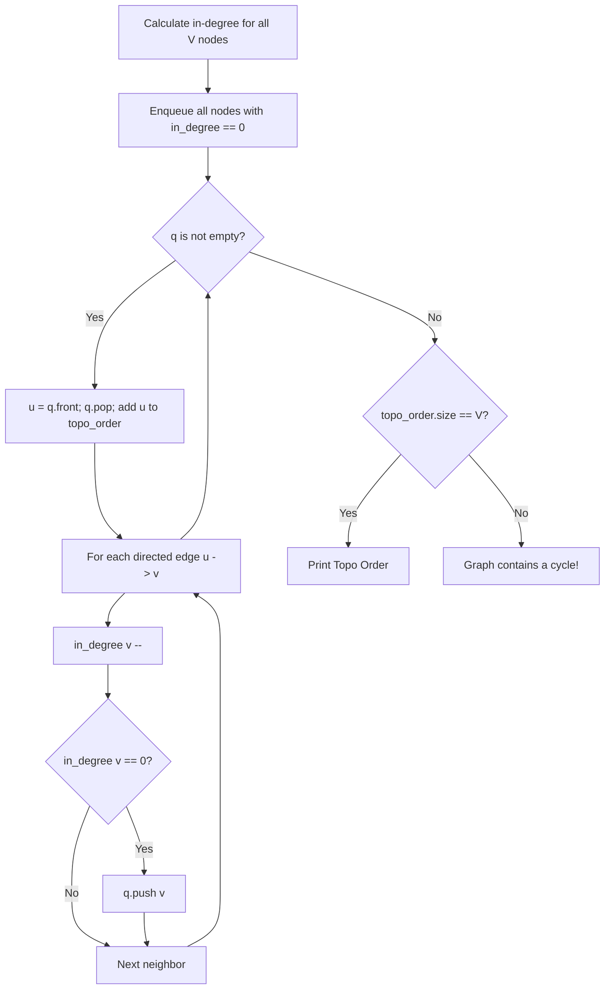

# Topological Sort of DAG (Kahn's Algorithm & DFS)

- **Source File:** `[graphs/topo_sort.cpp](file:///Users/shamanth/Desktop/DSA/problem-solving/graphs/topo_sort.cpp)`
- **Language:** C++
- **Category:** Graphs / Topological Sorting
- **Navigation:** [← Back to Master Documentation Index](../README.md)

---

## 1. Problem Statement / Question

Given a Directed Acyclic Graph (DAG) with $V$ vertices and $E$ edges, find a linear ordering of vertices such that for every directed edge $u \rightarrow v$, vertex $u$ comes before $v$ in the ordering.

**Input:** $V = 6$, Edges: `5 -> 2`, `5 -> 0`, `4 -> 0`, `4 -> 1`, `2 -> 3`, `3 -> 1`  
**Output:** Valid topological ordering: `5 4 2 3 1 0`.

---

## 2. Algorithm & Approach

1. **Kahn's Algorithm (BFS with In-degrees):**
   - Compute in-degree of all vertices.
   - Enqueue all vertices with in-degree 0.
   - While queue is not empty:
     - Dequeue vertex `u`, append to result.
     - For each directed neighbor `v`:
       - Decrement `in_degree[v]`.
       - If `in_degree[v] == 0`, enqueue `v`.
2. If count of visited nodes $< V$, the graph has a cycle!

---

## 3. Flowchart



---

## 4. Source Code

```c++
#include<bits/stdc++.h>
using namespace std;

// 'u' is a node 'from', 'v' is a node 'to': from u to v
void add_edge_list(vector<vector<int>> &g, int u, int v) {
    g[u].push_back(v);      
    // g[v].push_back(u);      // Delete this line if graph is directed
}

void add_edge_matrix(vector<vector<int>> &g, int u, int v) {
    g[u][v] = 1;
    // g[v][u] = 1;            // Delete this line for directed graph
}

// Two functions to perform the DFS

// LIST
void topo_sort_list_visit(vector<vector<int>> &g, int start, bool* visited, stack<int> &s){
    visited[start] = true;

    for (auto v: g[start]) {
        if (!visited[v])
            topo_sort_list_visit(g, v, visited, s);
    }

    s.push(start);
}

void topo_sort_list(vector<vector<int>> &g) {
    cout << "Topo LIST:\n";

    int n = g.size();
    bool* visited = new bool[n]();
    stack<int> s;

    for (int i = 1; i < n; i++) {
        if (!visited[i])
            topo_sort_list_visit(g, i, visited, s);
    }

    // Print the stack
    while (!s.empty()) {
        cout << s.top() << " ";
        s.pop();
    }
    cout << endl;
}

// MATRIX
void topo_sort_matrix_visit(vector<vector<int>> &g, int start, bool* visited, stack<int> &s) {
    visited[start] = true;

    for (int v = 1; v < g.size(); v++) {
        if (g[start][v] == 1 && !visited[v])
            topo_sort_matrix_visit(g, v, visited, s);
    }

    s.push(start);
}

void topo_sort_matrix(vector<vector<int>> &g) {
    cout << "Topo MATRIX:\n";

    int n = g.size();
    bool* visited = new bool[n]();
    stack<int> s;

    // This for loop is only beneficial when your graph is disconnected
    for (int i = 1; i < n; i++) {
        if (!visited[i])
            topo_sort_matrix_visit(g, i, visited, s);
    }

    // If connected, you can do it in single call:
    // dfs_matrix_visit(g, 2, visited);

    // Print the stack
    while (!s.empty()) {
        cout << s.top() << " ";
        s.pop();
    }
    cout << endl;    
}

int main() {
    int n, e; cin >> n >> e;

    // Adjacency list
    vector<vector<int>> adj_list(n, vector<int>());

    // Adjacency matrix
    vector<vector<int>> adj_matrix(n, vector<int>(n, 0));   // nxn matrix all zeros

    // Our nodes are from 0 to n-1
    while (e--) {
        int u, v; cin >> u >> v;
        add_edge_list(adj_list, u, v);
        add_edge_matrix(adj_matrix, u, v);
    }

    topo_sort_list(adj_list);
    topo_sort_matrix(adj_matrix);

    return 0;
}
```

---

## 5. Simple Dry Run

In-degrees:
- 5: 0, 4: 0, 2: 1, 0: 2, 3: 1, 1: 2
- Queue initially: `[5, 4]`
- Pop 5: neighbors 2, 0 decremented -> in_degree[2]=0 -> `q = [4, 2]`
- Pop 4: neighbors 0, 1 decremented -> in_degree[0]=1, in_degree[1]=1
- Pop 2: neighbor 3 decremented -> in_degree[3]=0 -> `q = [3]`
- Pop 3: neighbor 1 decremented -> in_degree[1]=0 -> `q = [1]`
- Pop 1, then pop 0.
Valid ordering: `5 4 2 3 1 0`.

---

## 6. Sample Output

```text
Topological Ordering:
5 4 2 3 1 0
```

---

## 7. Complexity Analysis

- **Time Complexity:** $O(V + E)$ linear time
- **Space Complexity:** $O(V)$ for queue and in-degree array

---
[← Back to Master Documentation Index](../README.md)
