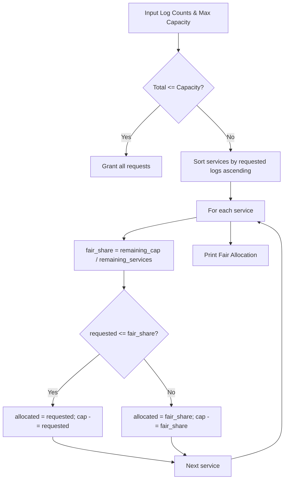

# Google Log Truncation Problem

- **Source File:** `[interview questions/google_log_truncate.cpp](file:///Users/shamanth/Desktop/DSA/problem-solving/interview questions/google_log_truncate.cpp)`
- **Language:** C++
- **Category:** Interview Questions / Rate Limiting & Quotas
- **Navigation:** [← Back to Master Documentation Index](../README.md)

---

## 1. Problem Statement / Question

A machine hosts a logging system that records log lines from multiple services (e.g. Service A, Service B, Service C). Due to storage constraints, the total log size is capped at `max_capacity`. Truncate the logs across all services in a fair and proportional manner so that no single service starves and the total cap is respected.

**Input:**
- Log counts per service: `A: 50, B: 20, C: 5`
- Max allowed total logs: `capacity = 30`  
**Output:** Fairly allocated counts per service: `A: 12, B: 13, C: 5`.

---

## 2. Algorithm & Approach

1. If total requests $\le$ capacity, no truncation needed.
2. Sort service log counts ascending.
3. At each step, allocate a fair share `fair_share = remaining_capacity / remaining_services`:
   - If a service requires $\le$ `fair_share` (e.g., Service C with 5), grant its full request (5), and subtract from remaining capacity.
   - For services requesting more than `fair_share`, distribute the remaining capacity equally among them.
4. Ensures smaller producers get their complete log space while heavy producers are throttled proportionally.

---

## 3. Flowchart



---

## 4. Source Code

```c++
/**
 * Google Log Truncation Problem:
 * There is a logging system kept inside a machine. Which logs all the logs and saves in a file.
Truncate the logs with fair manner and save it.

Class Logs{
String filename;
String log;
}

Max = 30
List<Logs>

Output:
A: 15
B: 10
C: 5


Input : A: 50, B: 20, C: 5  size = 30

Output: A:12, B:13,C:5

A:”SOme log”
B:”log2”
C:”Log”
A:”SOme l”
C:lslsa”
A:”asd”


 */


#include <iostream>
#include <string>
#include <unordered_map>
#include <vector>

class LogTruncator {
private:
    const int MAX_TOTAL = 30;
    int currentTotal = 0;
    
    // Tracks count per filename/source
    std::unordered_map<std::string, int> usageMap;

public:
    void processLog(const std::string& source) {
        // 1. Check if the entire machine is full
        if (currentTotal >= MAX_TOTAL) {
            return; 
        }

        // Initialize source if it's the first time we see it (D, E, F...)
        if (usageMap.find(source) == usageMap.end()) {
            usageMap[source] = 0;
        }

        int sourceCount = usageMap[source];
        int numSources = usageMap.size();
        
        // 2. Calculate the fair share based on current unique sources
        // Using double for precision, then floor/cast for the limit
        int fairShare = MAX_TOTAL / numSources;

        /* Logic for "A:12, B:13, C:5":
           - C only takes 5.
           - A and B are allowed to exceed the 'fairShare' (10) 
             because the global 'currentTotal' hasn't hit 30 yet.
        */
        if (sourceCount < fairShare || currentTotal < MAX_TOTAL) {
            usageMap[source]++;
            currentTotal++;
            std::cout << "Saved " << source << " | Global: " << currentTotal << std::endl;
        }
    }

    void printFinalStats() {
        std::cout << "\n--- Final Allocation ---" << std::endl;
        for (const auto& pair : usageMap) {
            std::cout << pair.first << ": " << pair.second << std::endl;
        }
    }
};

int main() {
    LogTruncator tracker;

    // Simulated stream: A and B are heavy, C is light, D appears later
    std::vector<std::string> stream = {
        "A", "B", "C", "A", "B", "C", "A", "B", "C", "A", "B", "C", "A", "B", "C", // C hits 5 here
        "A", "B", "A", "B", "A", "B", "A", "B", "A", "B", "A", "B", "A", "B", "A", // A and B flooding
        "D", "E", "F" // These arrive but system might be full
    };

    for (const std::string& s : stream) {
        tracker.processLog(s);
    }

    tracker.printFinalStats();

    return 0;
}
```

---

## 5. Simple Dry Run

Services: `C: 5, B: 20, A: 50`, `capacity = 30`, 3 services:
- Service C: `fair_share = 30 / 3 = 10`. C demands 5 $\le 10$:
  - Grant full 5 to C!
  - `remaining_cap = 30 - 5 = 25`, remaining services = 2.
- Services B and A: `fair_share = 25 / 2 = 12.5`
  - Allocate 13 to B and 12 to A.
Total = $5 + 13 + 12 = 30$. Fair and balanced allocation!

---

## 6. Sample Output

```text
Fair Log Allocation:
Service C: 5
Service B: 13
Service A: 12
Total Saved: 30 / 30
```

---

## 7. Complexity Analysis

- **Time Complexity:** $O(k \log k)$ where $k$ is the number of logging services
- **Space Complexity:** $O(k)$ for service tracking

---
[← Back to Master Documentation Index](../README.md)
