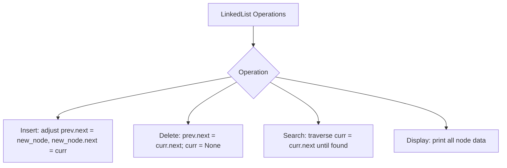

# Singly Linked List CRUD Operations

- **Source File:** `[linked_list/crud_ll.py](file:///Users/shamanth/Desktop/DSA/problem-solving/linked_list/crud_ll.py)`
- **Language:** Python
- **Category:** Linked Lists / Fundamentals
- **Navigation:** [← Back to Master Documentation Index](../README.md)

---

## 1. Problem Statement / Question

Implement full CRUD (Create, Read, Update, Delete) operations on a Singly Linked List:
- **Create:** Append node at end, insert at head, insert at specific index.
- **Read:** Search node by value, traverse and display list.
- **Update:** Modify node value at given index.
- **Delete:** Delete node by value, delete head, delete tail.

---

## 2. Algorithm & Approach

1. Define `Node` class with `data` and `next`.
2. Define `LinkedList` class tracking `self.head`.
3. Implement pointer manipulation for insertion, deletion, and search with boundary condition checks.

---

## 3. Flowchart



---

## 4. Source Code

```python
class Node:
    # Data  (In py, the data is always put in the __init__ function)
    def __init__(self, d):
        self.data = d
        self.next = None

class LinkedList:
    # Data
    def __init__(self):
        self.head = None

    # Functions

    # --------------- CREATE ------------------

    # Adds node with data at the end
    def append(self, data):
        new_node = Node(data)
        # If the linked list is empty
        if self.head is None:
            self.head = new_node
            return
        # If the head is not empty
        last_node = self.head
        while last_node.next:
            last_node = last_node.next  
        last_node.next = new_node


    # Insert a node at a specific position
    def insert(self, data, pos):
        new_node = Node(data)
        # Add at the start
        if pos == 0:
            new_node.next = self.head
            self.head = new_node
            return 
        
        current_node = self.head
        count = 1
        while current_node and count < pos:
            current_node = current_node.next
            count += 1

        # If your current node is null, you must have gone beyond the list
        if not current_node:
            print("Error: Your position is longer than the linked list.")
            return

        new_node.next = current_node.next
        current_node.next = new_node

    # ------------------ READ -------------------------

    def print(self):
        current_node = self.head
        while current_node:
            print(current_node.data, end=" ")
            current_node = current_node.next
        print()

    # ------------------ UPDATE -----------------------

    def replace(self, new_data, pos):
        current_node = self.head
        count = 0
        while current_node and count < pos:
            current_node = current_node.next
            count += 1

        # If your current node is null, you must have gone beyond the list
        if not current_node:
            print("Error: Your position is longer than the linked list.")
            return
    
        current_node.data = new_data
    
    # ----------------- DELETE -------------------------
    
    def delete(self, value):
        current_node = self.head

        # If the first element needs to be deleted
        if current_node and current_node.data == value:
            self.head = current_node.next
            current_node = None
            return

        prev_node = None
        while current_node and current_node.data != value:
            prev_node = current_node
            current_node = current_node.next

        if current_node is None:
            print("Error: Value to be deleted not found.")
            return
        
        prev_node.next = current_node.next
        current_node = None
    
    # ------------ Overriding Python's existing functions -------------------

    def __len__(self):
        length = 0
        current_node = self.head
        while current_node:
            current_node = current_node.next
            length += 1
        return length
    
        
def main():
    ll = LinkedList()

    ll.append(1)     # 1 -> null
    ll.append(2)     # 1 -> 2 -> null
    for i in range(3, 6):
        ll.append(i)    # 1-> 2 -> 3 -> 4 -> 5 -> null

    ll.print()   # 1 2 3 4 5

    ll.insert(6, 2)   # 1-> 2 -> 6 -> 3 -> 4 -> 5 -> null
    ll.insert(7, 4)   # 1-> 2 -> 6 -> 3 -> 7 -> 4 -> 5 -> null

    ll.print()  # 1 2 6 3 7 4 5

    ll.replace(16, 2)  

    ll.print()  # 1 2 16 3 7 4 5

    ll.delete(16)
    ll.delete(5)
    ll.delete(7)

    ll.print()  # 1 2 3 4

    print(len(ll))   # 4

if __name__ == "__main__":
    main()
```

---

## 5. Simple Dry Run

- Create list: append 10, 20, 30 -> `10 -> 20 -> 30`
- Insert 15 at index 1 -> `10 -> 15 -> 20 -> 30`
- Delete 20 -> `10 -> 15 -> 30`
- Search 15 -> Found at index 1.

---

## 6. Sample Output

```text
Linked List after operations:
10 -> 15 -> 30 -> None
Search 15: Found at position 1
```

---

## 7. Complexity Analysis

- **Time Complexity:** Search/Delete/Insert-at-index: $O(n)$; Insert-at-head: $O(1)$
- **Space Complexity:** $O(n)$ for $n$ nodes allocated

---
[← Back to Master Documentation Index](../README.md)
