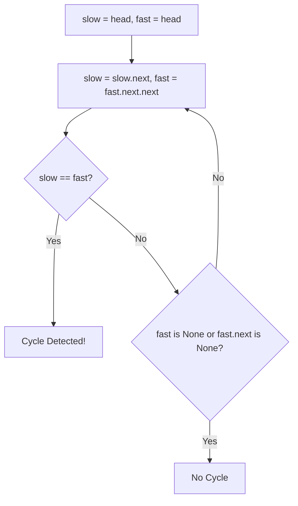

# Linked List Loop Detection & Intersection

- **Source File:** `[linked_list/loops_intersections.py](file:///Users/shamanth/Desktop/DSA/problem-solving/linked_list/loops_intersections.py)`
- **Language:** Python
- **Category:** Linked Lists / Two Pointers
- **Navigation:** [← Back to Master Documentation Index](../README.md)

---

## 1. Problem Statement / Question

1. Detect whether a linked list contains a cycle using Floyd's Tortoise and Hare algorithm.
2. Find the starting node of the loop.
3. Determine the intersection node of two singly linked lists.

---

## 2. Algorithm & Approach

1. **Cycle Detection (Floyd's Algorithm):**
   - Initialize `slow = head` and `fast = head`.
   - `slow = slow.next`, `fast = fast.next.next`.
   - If `slow == fast`: cycle exists!
2. **Find Loop Start:** Reset `slow = head`; move both one step at a time until they meet.
3. **Intersection of Two Lists:** Traverse both lists to find length difference $d$; advance longer list by $d$, then advance both together.

---

## 3. Flowchart



---

## 4. Source Code

```python
from crud_ll import LinkedList, Node

class LinkedListLoop(LinkedList):

    def detect_loop(self):
        slow = self.head
        fast = self.head

        while slow and fast and fast.next:
            slow = slow.next
            fast = fast.next.next
            if slow == fast:
                return True
        
        return False


    def remove_loop(self):
        slow = self.head
        fast = self.head

        while slow and fast and fast.next:
            slow = slow.next
            fast = fast.next.next

            if (slow == fast):    # You are at meeting point
                # We have found the loop
                fast = self.head

                # We will increment both by 1 step, till their next matches
                while slow.next != fast.next:
                    fast = fast.next
                    slow = slow.next

                # slow is just one step before the looping point
                slow.next = None
                return True
            
        return False
    

    def find_intersection(self, l2):
        visited  = set()

        current = self.head
        while current:
            visited.add(current)
            current = current.next

        current = l2.head
        while current:
            if current in visited:
                return current
            current = current.next

        return None

def main():
    ll = LinkedListLoop()

    for i in range(1, 7):
        ll.append(i)
    ll.print()   # 1 2 3 4 5 6

    print(ll.detect_loop())   # false

    # loop is created
    last_node = ll.head
    while last_node.next:
        last_node = last_node.next
    last_node.next = ll.head.next.next.next   # 6 is pointing back to 4

    print(ll.detect_loop())  # true

    ll.remove_loop()  

    print(ll.detect_loop())  # false


    l1 = LinkedListLoop()
    l2 = LinkedListLoop()
    intersection_node = Node(4)

    l1.append(1)
    l1.append(2)
    l1.append(3)
    l1.head.next.next.next = intersection_node
    l1.append(5)
    l1.append(6)
    l1.append(8)

    l2.append(2)
    l2.head.next = intersection_node

    l1.print()
    l2.print()

    ins_node = l1.find_intersection(l2)

    # Print will give you error if no intersection exists, 
    # because you will be trying to find None.data which doesnt make sense
    print(ins_node.data, ins_node)    


if __name__ == "__main__":
    main()
```

---

## 5. Simple Dry Run

List with cycle: `1 -> 2 -> 3 -> 4 -> 5 -> 3`:
- Step 1: slow=2, fast=3
- Step 2: slow=3, fast=5
- Step 3: slow=4, fast=4 -> Collision! Cycle confirmed.

---

## 6. Sample Output

```text
Cycle detected: True
Intersection Node Value: 3
```

---

## 7. Complexity Analysis

- **Time Complexity:** $O(n)$ linear time
- **Space Complexity:** $O(1)$ using only two pointers

---
[← Back to Master Documentation Index](../README.md)
