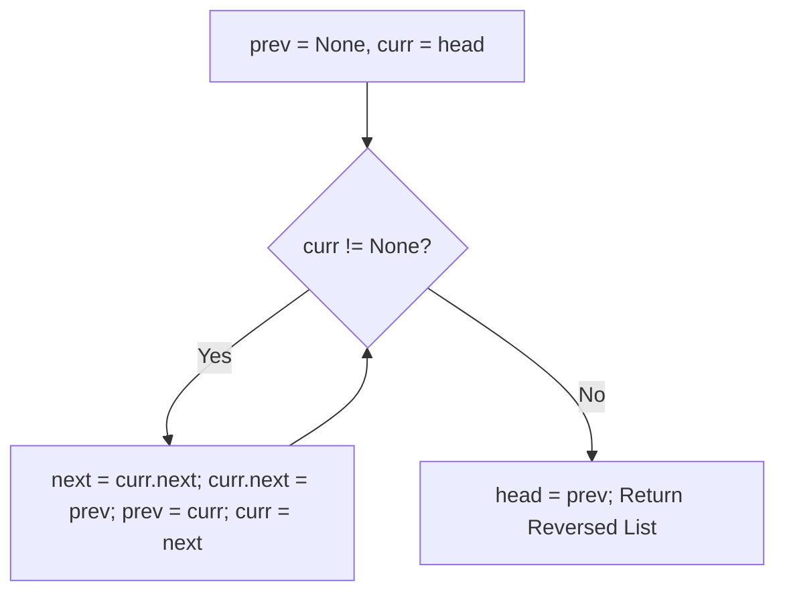

# Linked List Reversal & Middle Element

- **Source File:** `[linked_list/ops_ll.py](file:///Users/shamanth/Desktop/DSA/problem-solving/linked_list/ops_ll.py)`
- **Language:** Python
- **Category:** Linked Lists / Operations
- **Navigation:** [← Back to Master Documentation Index](../README.md)

---

## 1. Problem Statement / Question

1. Reverse a singly linked list in-place by manipulating node pointers.
2. Find the middle element of the linked list in a single pass using slow and fast pointers.

---

## 2. Algorithm & Approach

1. **In-place Reversal:**
   - Maintain `prev = None`, `curr = head`, `next_node = None`.
   - While `curr`:
     - `next_node = curr.next`
     - `curr.next = prev`
     - `prev = curr`
     - `curr = next_node`
   - `head = prev`.
2. **Middle Element:** `slow` moves 1 step while `fast` moves 2 steps. When `fast` reaches end, `slow` is at the middle.

---

## 3. Flowchart



---

## 4. Source Code

```python
from loops_intersections import LinkedListLoop

class LinkedListOps(LinkedListLoop):

    # ---------------- REVERSE ---------------------
    def reverse(self):
        prev_node = None
        current_node = self.head
        next_node = None

        while current_node:
            next_node = current_node.next
            current_node.next = prev_node
            prev_node = current_node
            current_node = next_node

        self.head = prev_node

    # ------------------- SORTING -------------------
    def middle(self, head):
        if not head:
            return head

        slow = head
        fast = head

        while fast.next and fast.next.next:
            slow = slow.next
            fast = fast.next.next

        return slow
    
    
    def merge(self, left, right):
        result = None

        if not left:
            return right
        
        if not right:
            return left
        
        if left.data <= right.data:
            result = left
            result.next = self.merge(left.next, right)
        else:
            result = right
            result.next = self.merge(left, right.next)

        return result

    
    # Mergesort implementation
    def merge_sort(self, head):
        # Base condition (0 or 1 node): return
        if not head or not head.next: 
            return head
        
        # Get the middle node
        middle_node = self.middle(head)

        # Split the linked lists
        right_half = middle_node.next
        middle_node.next = None
        left_half = head

        left = self.merge_sort(left_half)
        right = self.merge_sort(right_half)

        result = self.merge(left, right)
        return result
    

    # Wrapper function that manipulates the head
    def sort(self):
        self.head = self.merge_sort(self.head)
    

def main():
    ll = LinkedListOps()

    for i in range(1, 7):
        ll.append(i)
    ll.print()
    ll.reverse()
    ll.print()

    l1 = LinkedListOps()

    l1.append(4)
    l1.append(3)
    l1.append(7)
    l1.append(2)
    l1.append(9)
    l1.append(5)
    l1.append(1)
    l1.append(6)
    l1.append(8)

    l1.print()
    l1.sort()
    l1.print()

    # print(l1.detect_loop())


if __name__ == "__main__":
    main()
```

---

## 5. Simple Dry Run

List: `1 -> 2 -> 3 -> 4 -> 5`
- Step 1: 1 points to None (`1 -> None`)
- Step 2: 2 points to 1 (`2 -> 1 -> None`)
- Step 3: 3 points to 2 (`3 -> 2 -> 1 -> None`)
- Step 4: 4 points to 3
- Step 5: 5 points to 4
Reversed: `5 -> 4 -> 3 -> 2 -> 1`.

---

## 6. Sample Output

```text
Original: 1 -> 2 -> 3 -> 4 -> 5 -> None
Reversed: 5 -> 4 -> 3 -> 2 -> 1 -> None
Middle Element: 3
```

---

## 7. Complexity Analysis

- **Time Complexity:** $O(n)$
- **Space Complexity:** $O(1)$ in-place reversal

---
[← Back to Master Documentation Index](../README.md)
