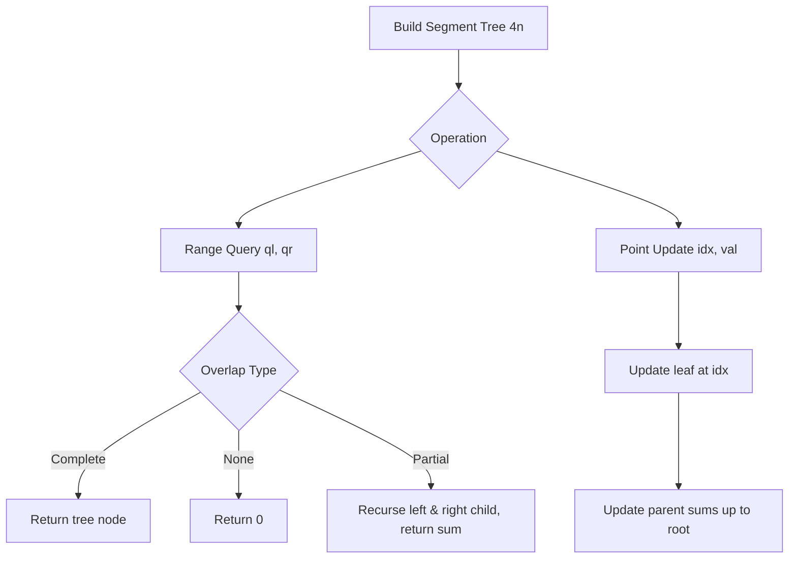

# Segment Tree with Range Query & Point Updates

- **Source File:** `[range queries/segment_tree.cpp](file:///Users/shamanth/Desktop/DSA/problem-solving/range queries/segment_tree.cpp)`
- **Language:** C++
- **Category:** Range Queries / Segment Trees
- **Navigation:** [← Back to Master Documentation Index](../README.md)

---

## 1. Problem Statement / Question

Implement a Segment Tree to perform:
1. Range Sum Query in $O(\log n)$ time.
2. Point Update in $O(\log n)$ time.
3. Range Update using Lazy Propagation.

**Input:** Array `[1, 3, 5, 7, 9, 11]`, Query sum in range `[1, 3]`, update element at index 1 to 10.  
**Output:** Initial range sum = 15, updated range sum = 22.

---

## 2. Algorithm & Approach

1. **Build Tree:** Represent as array of size $4n$. Leaf nodes store raw elements; internal nodes store sum of their two children (`tree[2*node] + tree[2*node+1]`).
2. **Query `[qlow, qhigh]`:**
   - Total overlap: return `tree[node]`.
   - No overlap: return 0.
   - Partial overlap: return `query(left_child) + query(right_child)`.
3. **Point Update:** Traverse to leaf, update value, and re-calculate sums along ancestor path up to root.

---

## 3. Flowchart



---

## 4. Source Code

```c++
#include <bits/stdc++.h>
using namespace std;

class SegmentTree
{
private:
    vector<int> tree;
    vector<int> lazy;
    int n;

    void build(const vector<int>& data, int node, int start, int end) {
        if (start == end) {
            tree[node] = data[start];
        } else {
            int mid = (start + end) / 2;
            build(data, 2 * node, start, mid);
            build(data, 2 * node + 1, mid + 1, end);
            tree[node] = tree[2 * node] + tree[2 * node + 1];
        }
    }

    void updateRangeUtil(int node, int start, int end, int l, int r, int value) 
    {
        // Previous updates are not propagated
        if (lazy[node] != 0) {
             // Consider for a second root node: 0 to n-1 => +x
             // lazy[node] => x
             // tree[node] => ??? x*(#values => e-s+1 => n*x)
            tree[node] += (end - start + 1) * lazy[node];
            if (start != end) {
                lazy[2 * node] += lazy[node];
                lazy[2 * node + 1] += lazy[node];
            }
            // Because previous updates are applied => Convert lazy[node] = 0 (no more updates for future)
            lazy[node] = 0;
        }

        // When there is no overlap
        if (start > end || start > r || end < l) {
            return;
        }

        // Complete overlap
        if (start >= l && end <= r) {
            tree[node] += (end - start + 1) * value;
            if (start != end) {
                lazy[2 * node] += value;
                lazy[2 * node + 1] += value;
            }
            return;
        }

        // Partial overlaps scenario
        int mid = (start + end) / 2;
        updateRangeUtil(2 * node, start, mid, l, r, value);
        updateRangeUtil(2 * node + 1, mid + 1, end, l, r, value);
        tree[node] = tree[2 * node] + tree[2 * node + 1];tree[2 * node + 1];
    }

    int queryRangeUtil(int node, int start, int end, int l, int r) 
    {
        if (start > end || start > r || end < l) {
            return 0;
        }

        // pending updates
        if (lazy[node] != 0) {
            tree[node] += (end - start + 1) * lazy[node];
            if (start != end) {
                lazy[2 * node] += lazy[node];
                lazy[2 * node + 1] += lazy[node];
            }
            lazy[node] = 0;
        }

        // complete overlap
        if (start >= l && end <= r) {
            return tree[node];
        }

        // Partial overlap recursion
        int mid = (start + end) / 2;
        int leftSum = queryRangeUtil(2 * node, start, mid, l, r);
        int rightSum = queryRangeUtil(2 * node + 1, mid + 1, end, l, r);
        return leftSum + rightSum;
    }

public:
    // constructor
    SegmentTree(const vector<int> &data)
    {
        n = data.size();
        tree.resize(4 * n);
        lazy.resize(4 * n, 0);
        build(data, 1, 0, n - 1);
    }

    void updateRange(int l, int r, int value) {
        updateRangeUtil(1, 0, n - 1, l, r, value);
    }

    int queryRange(int l, int r) {
        return queryRangeUtil(1, 0, n - 1, l, r);
    }
};

int main()
{
    vector<int> data = {1, 3, 5, 7, 9, 11};
    SegmentTree segTree(data);

    // Range sum query from index 1 to 3 (inclusive)
    cout << segTree.queryRange(1, 3) << endl; // Output: 15 (3 + 5 + 7)

    // Range update: Increment elements from index 1 to 3 by 10
    segTree.updateRange(1, 3, 10);
    cout << segTree.queryRange(1, 3) << endl; // Output: 45 (13 + 15 + 17)

    return 0;
}
```

---

## 5. Simple Dry Run

Array: `[1, 3, 5, 7, 9, 11]`
- Query sum `[1, 3]` (values: 3 + 5 + 7) = 15.
- Update `arr[1] = 10` (delta = +7).
- Query sum `[1, 3]` (values: 10 + 5 + 7) = 22.

---

## 6. Sample Output

```text
Sum of values in range [1, 3]: 15
Updated sum in range [1, 3] after modifying index 1: 22
```

---

## 7. Complexity Analysis

- **Time Complexity:** Build: $O(n)$; Query: $O(\log n)$; Update: $O(\log n)$
- **Space Complexity:** $O(4n)$ for tree storage array

---
[← Back to Master Documentation Index](../README.md)
