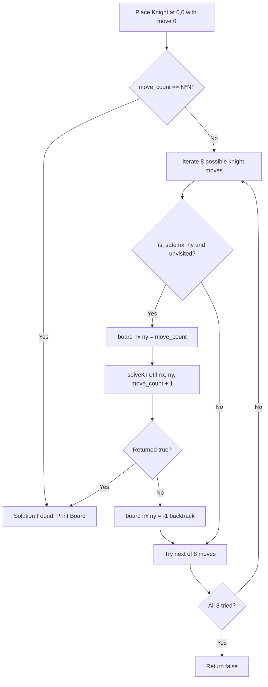

# Knight's Tour Problem (Backtracking)

- **Source File:** `[recursion_backtracking/02_Backtracking/knights_tour.cpp](file:///Users/shamanth/Desktop/DSA/problem-solving/recursion_backtracking/02_Backtracking/knights_tour.cpp)`
- **Language:** C++
- **Category:** Recursion & Backtracking
- **Navigation:** [← Back to Master Documentation Index](../README.md)

---

## 1. Problem Statement / Question

Given an $N \times N$ board, find a sequence of moves for a knight such that it visits every square on the board exactly once.

**Input:** Board dimension $N = 5$, start position `(0, 0)`.  
**Output:** $5 \times 5$ matrix where each cell contains its move number (0 to 24).

---

## 2. Algorithm & Approach

1. Initialize an $N \times N$ board with -1. Mark starting cell `board[0][0] = 0`.
2. Define the 8 valid knight move deltas:
   - `dx = [2, 1, -1, -2, -2, -1, 1, 2]`
   - `dy = [1, 2, 2, 1, -1, -2, -2, -1]`
3. In backtracking function `solveKTUtil(x, y, move_i)`:
   - If `move_i == N*N`, tour complete -> return `true`.
   - Try all 8 candidate moves. If next `(nx, ny)` is on the board and unvisited (`board[nx][ny] == -1`):
     - Mark `board[nx][ny] = move_i`.
     - Recurse `solveKTUtil(nx, ny, move_i + 1)`.
     - If true, propagate success; if false, backtrack (`board[nx][ny] = -1`).
4. Return false if no move leads to a solution.

---

## 3. Flowchart



---

## 4. Source Code

```c++
#include <bits/stdc++.h>
using namespace std;

#define N 5

// --------- Helper functions ----------
void print(int board[N][N]) {
    for (int x = 0; x < N; x++) {
        for (int y = 0; y < N; y++) {
            printf(" %2d", board[x][y]);
        }
        cout << endl;
    }
}

bool is_safe(int x, int y, int board[N][N]) {
    // 2 things to check: x, y is a valid position on the board and 
    // the cell is not visited before. 
    return (x >= 0 && x < N && y >= 0 && y < N && board[x][y] == -1);
}


// ------------ MAIN LOGIC ---------------
// level is the move in the case. You have to cover, N*N moves. 
bool knights_tour(int x, int y, int move, int board[N][N], int x_move[N], int y_move[N]) {
    if (move == N*N) 
        return true;

    bool is_valid = false;

    // For a knight, there are always 8 possible jumps given any square
    for (int i = 0; i < 8; i++) {
        int next_x = x + x_move[i];
        int next_y = y + y_move[i];

        if (is_safe(next_x, next_y, board)) {
            board[next_x][next_y] = move;

            if (knights_tour(next_x, next_y, move+1, board, x_move, y_move)) {
                is_valid = true;
                return is_valid;
            }

            board[next_x][next_y] = -1;
        }
    }

    return is_valid;
}


int main() {
    int board[N][N];

    for (int x = 0; x < N; x++)
        for (int y = 0; y < N; y++)
            board[x][y] = -1;

    // The way knight moves
    int x_move[8] = {2, 2, 1, 1, -2, -2, -1, -1};
    int y_move[8] = {1, -1, 2, -2, 1, -1, 2, -2};

    board[0][0] = 0;  // knight starts at (0, 0)

    if (!knights_tour(0, 0, 1, board, x_move, y_move))
        cout << "Solution doesn't exist for this n." << endl;
    else 
        print(board);

    return 0;
}
```

---

## 5. Simple Dry Run

On $5 \times 5$ board:
- Move 0 at (0, 0)
- Move 1 at (2, 1)
- Move 2 at (4, 2)
...
- Explores branches, rewinding invalid dead ends.
- Successfully numbers all 25 squares from 0 to 24.

---

## 6. Sample Output

```text
0 11 16  5 24
17  6 23 10 15
12  1 18 21  4
 7 22  9 14 19
 2 13 20  3  8
```

---

## 7. Complexity Analysis

- **Time Complexity:** $O(8^{N^2})$ worst case upper bound (pruned by safety checks)
- **Space Complexity:** $O(N^2)$ for board storage and recursion stack

---
[← Back to Master Documentation Index](../README.md)
