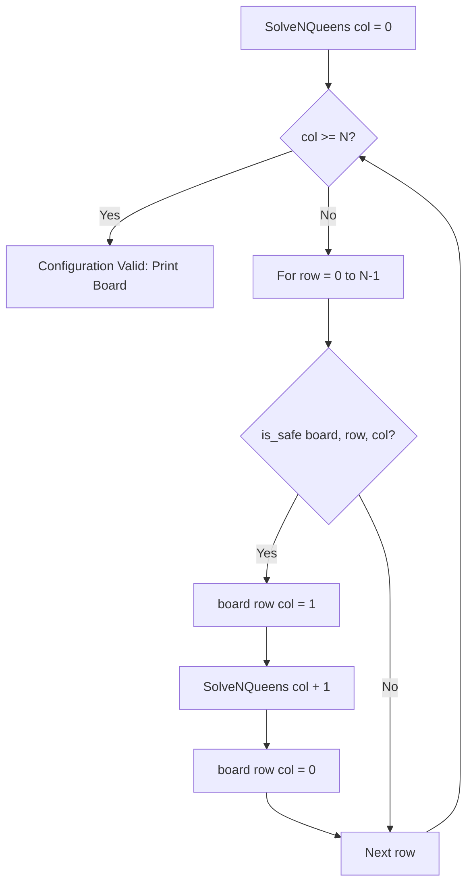

# N-Queens Problem (Backtracking)

- **Source File:** `[recursion_backtracking/02_Backtracking/n_queens.cpp](file:///Users/shamanth/Desktop/DSA/problem-solving/recursion_backtracking/02_Backtracking/n_queens.cpp)`
- **Language:** C++
- **Category:** Recursion & Backtracking
- **Navigation:** [← Back to Master Documentation Index](../README.md)

---

## 1. Problem Statement / Question

The N-Queens puzzle is the problem of placing $N$ chess queens on an $N \times N$ chessboard such that no two queens threaten each other (no two queens share the same row, column, or diagonal).

**Input:** $N = 4$  
**Output:** All valid non-attacking queen configurations on the $4 \times 4$ board.

---

## 2. Algorithm & Approach

1. Place queens column by column (or row by row).
2. For current column `col`:
   - Try placing queen in each row `row` from 0 to $N-1$.
   - Check if `is_safe(board, row, col)`:
     - No queen in same row to the left.
     - No queen in upper diagonal to the left.
     - No queen in lower diagonal to the left.
   - If safe:
     - Mark `board[row][col] = 1`.
     - Recurse for `col + 1`.
     - Backtrack: reset `board[row][col] = 0` to find other configurations.

---

## 3. Flowchart



---

## 4. Source Code

```c++
#include<bits/stdc++.h>
using namespace std;

// -------- Helper functions ----------
// print() just prints the board.
void print(vector<vector<int>> &board) {
    for (int i = 0; i < board.size(); i++) {
        for (int j = 0; j < board[i].size(); j++) {
            cout << board[i][j] << " ";
        }
        cout << endl;
    }
    cout << endl;
}

// is_safe() checks if the queen is safe at board[i][col].
bool is_safe(int row, int col, vector<vector<int>> &board) {
    // Check if there is any queen in same row on previous columns
    for (int i = 0; i < col; i++) 
        if (board[row][i])
            return false;

    // Check for upper diagonal  
    for (int i = row, j = col; i >= 0 && j >= 0; i--, j--) 
        if (board[i][j])
            return false;

    // Check for lower diagonal
    for (int i = row, j = col; i < board.size() && j >= 0; i++, j--)
        if (board[i][j])
            return false;

    return true;
}


// --------- MAIN LOGIC ---------------
// Level in this game is about columns.
bool n_queens(int col, vector<vector<int>> &board) {
    if (col >= board.size()) {
        print(board);
        return true;
    }

    bool is_valid = false;

    // Checking all possibilities
    for (int i = 0; i < board.size(); i++) {
        // Checking if constraint is satisfied
        if (is_safe(i, col, board)) {
            // Considering this to be a potential possibility
            board[i][col] = 1;

            // Try to solve for further levels
            if (n_queens(col+1, board)) {
                is_valid = true;
                // return is_valid;   // This commented means all possibilities
            }

            // If unable to solve for further levels, remove the potential possibility
            board[i][col] = 0;
        }
    }

    return is_valid;
}


int main() {
    int n; cin >> n;

    // nxn board with all zeros
    vector<vector<int>> board(n, vector<int>(n, 0));

    if (!n_queens(0, board))
        cout << "Solution doesn't exist for this value of n." << endl;

    return 0;
}

/*

Note: If you comment, the return is_valid statement inside if block, you will print 
all the solutions!!

*/
```

---

## 5. Simple Dry Run

For $N = 4$:
- Solution 1:
  - Row 1: col 0
  - Row 3: col 1
  - Row 0: col 2
  - Row 2: col 3
  `0 0 1 0`
  `1 0 0 0`
  `0 0 0 1`
  `0 1 0 0`
- Solution 2:
  `0 1 0 0`
  `0 0 0 1`
  `1 0 0 0`
  `0 0 1 0`

---

## 6. Sample Output

```text
Configuration 1:
0 0 1 0 
1 0 0 0 
0 0 0 1 
0 1 0 0 

Configuration 2:
0 1 0 0 
0 0 0 1 
1 0 0 0 
0 0 1 0
```

---

## 7. Complexity Analysis

- **Time Complexity:** $O(N!)$
- **Space Complexity:** $O(N^2)$ board representation + $O(N)$ recursion depth

---
[← Back to Master Documentation Index](../README.md)
