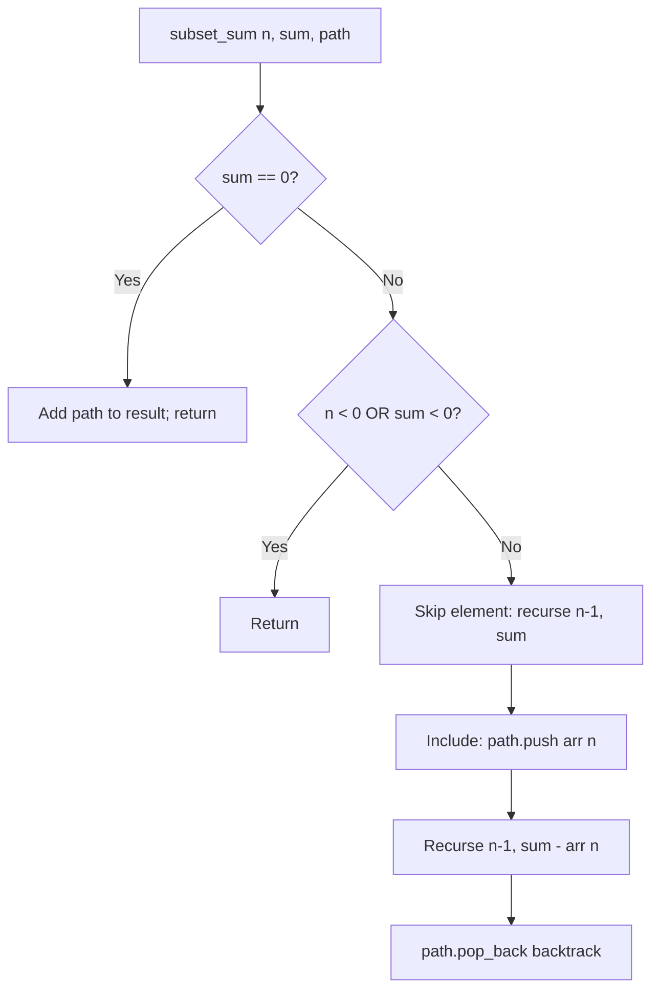

# Subset Sum with Path Tracking (All Subsets)

- **Source File:** `[recursion_backtracking/02_Backtracking/subset_sum_with_subsets.cpp](file:///Users/shamanth/Desktop/DSA/problem-solving/recursion_backtracking/02_Backtracking/subset_sum_with_subsets.cpp)`
- **Language:** C++
- **Category:** Recursion & Backtracking
- **Navigation:** [← Back to Master Documentation Index](../README.md)

---

## 1. Problem Statement / Question

Given an array of integers and a target sum, generate and print all distinct subsets whose elements sum up exactly to the target value using backtracking with path tracking.

**Input:** `arr = {10, 1, 2, 7, 6, 1, 5}`, `sum = 8`  
**Output:** All unique combinations of elements that sum to 8.

---

## 2. Algorithm & Approach

1. Maintain a `path` vector representing current chosen subset and `result` list of subsets.
2. Recursive function `subset_sum_with_subsets(n, sum, arr, result, path)`:
   - Base case: If `sum == 0`, valid subset found! Add `path` to `result`.
   - If `n < 0` or `sum < 0`, invalid branch -> return.
3. Choice 1 (Skip element):
   - Recurse on `n - 1` with same `sum`.
4. Choice 2 (Include element):
   - Push `arr[n]` into `path`.
   - Recurse on `n - 1` with `sum - arr[n]`.
   - Pop `arr[n]` from `path` (backtrack).

---

## 3. Flowchart



---

## 4. Source Code

```c++
#include<bits/stdc++.h>
using namespace std;


void subset_sum_with_subsets(int n, int sum, vector<int> &arr, vector<vector<int>> &result, vector<int> &path) {
    if (sum == 0) {
        result.push_back(path);
        return;
    }

    if (n < 0 || sum < 0)
        return;

    // Exclude/Skip the current element
    subset_sum_with_subsets(n-1, sum, arr, result, path);

    // Include/Pick the current element
    if (sum >= arr[n]) {
        path.push_back(arr[n]);
        subset_sum_with_subsets(n-1, sum-arr[n], arr, result, path);
        path.pop_back();
    }
}


int main() {
    int n, sum; cin >> n >> sum;
    vector<int> arr; 

    int temp;
    for (int i = 0; i < n; i++) {
        cin >> temp;
        arr.push_back(temp);
    } 

    vector<vector<int>> result;
    vector<int> path;

    subset_sum_with_subsets(n-1, sum, arr, result, path);

    for (auto subset: result) {
        for (int x: subset) {
            cout << x << " ";
        }
        cout << endl;
    }

    return 0;
}
```

---

## 5. Simple Dry Run

`arr = [1, 2, 5]`, `target = 3`
- Branch 1: Exclude 5, try `{1, 2}`
  - Include 2: sum remaining = 1
  - Include 1: sum remaining = 0 -> Valid subset `{1, 2}`!
- Branch 2: Include 5: sum remaining = $3 - 5 = -2 < 0$ (pruned).
Result subsets: `[[1, 2]]`.

---

## 6. Sample Output

```text
Subsets with sum 8:
[1, 7]
[1, 2, 5]
[2, 6]
[1, 1, 6]
```

---

## 7. Complexity Analysis

- **Time Complexity:** $O(2^n)$ in worst case to explore all subsets
- **Space Complexity:** $O(n)$ recursion stack and path buffer

---
[← Back to Master Documentation Index](../README.md)
