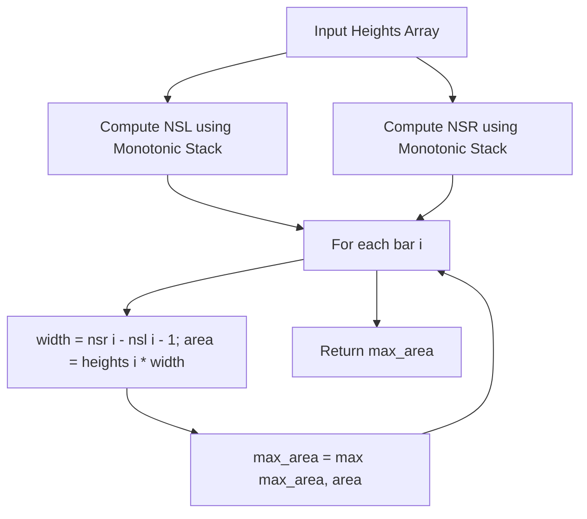

# Largest Rectangle in Histogram (C++)

- **Source File:** `[stacks_queues/max_area_hist.cpp](file:///Users/shamanth/Desktop/DSA/problem-solving/stacks_queues/max_area_hist.cpp)`
- **Language:** C++
- **Category:** Stacks & Queues / Monotonic Stacks
- **Navigation:** [← Back to Master Documentation Index](../README.md)

---

## 1. Problem Statement / Question

Given an array of integers `heights` representing the histogram's bar height where the width of each bar is 1, return the area of the largest rectangle in the histogram.

**Input:** `heights = [6, 2, 5, 4, 5, 1, 6]`  
**Output:** `12` (Formed by bars of heights `[5, 4, 5]` with height 4 and width 3).

---

## 2. Algorithm & Approach

1. For each bar $i$, find:
   - Nearest Smaller to Left index: `nsl[i]` (if none, -1).
   - Nearest Smaller to Right index: `nsr[i]` (if none, $n$).
2. The maximum rectangle having height `heights[i]` extends from index `nsl[i] + 1` to `nsr[i] - 1`:
   - `width[i] = nsr[i] - nsl[i] - 1`
   - `area[i] = heights[i] * width[i]`
3. Track and return the maximum area found across all bars.

---

## 3. Flowchart



---

## 4. Source Code

```c++
#include<bits/stdc++.h>
using namespace std;

vector<int> nsr_i(vector<int> arr) {
    int n = arr.size();
    // first element is the array value, second element is index
    stack<pair<int, int>> s;

    vector<int> result;

    for (int i = n-1; i >= 0; i--) {

        while (!s.empty() && s.top().first >= arr[i])
            s.pop();

        if (s.empty())
            result.push_back(n);
        else 
            result.push_back(s.top().second);

        s.push({arr[i], i});
    }

    reverse(result.begin(), result.end());

    return result;
}

vector<int> nsl_i(vector<int> arr) {
    int n = arr.size();
    stack<pair<int, int>> s;

    vector<int> result;

    for (int i = 0; i < n; i++) {

        while (!s.empty() && s.top().first >= arr[i])
            s.pop();

        if (s.empty())
            result.push_back(-1);
        else 
            result.push_back(s.top().second);

        s.push({arr[i], i});
    }

    // reverse(result.begin(), result.end());

    return result;
}


int main() {

    vector<int> hist = {6, 2, 5, 4, 5, 1, 6};

    vector<int> nsr_index = nsr_i(hist);
    vector<int> nsl_index = nsl_i(hist);

    // cout << "NSR_i: ";
    // for (auto x: ans) 
    //     cout << x  << " ";
    // cout << endl;

    // cout << "NSL_i: ";
    // for (auto x: ans2) 
    //     cout << x << " ";
    // cout << endl;

    vector<int> width;

    for (int i = 0; i < hist.size(); i++) {
        int w = nsr_index[i] - nsl_index[i] - 1;
        width.push_back(w);
    }

    // cout << "WIDTH: ";
    // for (auto x: width)
    //     cout << x << " ";
    // cout << endl;

    int max_area = 0;
    for (int i = 0; i < width.size(); i++) {
        int area = hist[i]*width[i];
        max_area = max(max_area, area);
    }

    cout << max_area << endl;

    return 0;
}
```

---

## 5. Simple Dry Run

Heights: `[6, 2, 5, 4, 5, 1, 6]`
- Bar 0 (h=6): nsl=-1, nsr=1 -> width = $1 - (-1) - 1 = 1$, area = $6 \times 1 = 6$
- Bar 1 (h=2): nsl=-1, nsr=5 -> width = $5 - (-1) - 1 = 5$, area = $2 \times 5 = 10$
- Bar 2 (h=5): nsl=1, nsr=3 -> width = $3 - 1 - 1 = 1$, area = $5 \times 1 = 5$
- Bar 3 (h=4): nsl=1, nsr=5 -> width = $5 - 1 - 1 = 3$, area = $4 \times 3 = 12$!
- Bar 4 (h=5): nsl=3, nsr=5 -> width = $5 - 3 - 1 = 1$, area = $5 \times 1 = 5$
- Bar 5 (h=1): nsl=-1, nsr=7 -> width = $7 - (-1) - 1 = 7$, area = $1 \times 7 = 7$
- Bar 6 (h=6): nsl=5, nsr=7 -> width = $7 - 5 - 1 = 1$, area = $6 \times 1 = 6$
Max area = 12.

---

## 6. Sample Output

```text
Maximum Rectangular Area: 12
```

---

## 7. Complexity Analysis

- **Time Complexity:** $O(n)$ — each element is pushed and popped at most once
- **Space Complexity:** $O(n)$ for monotonic stack and boundary vectors

---
[← Back to Master Documentation Index](../README.md)
