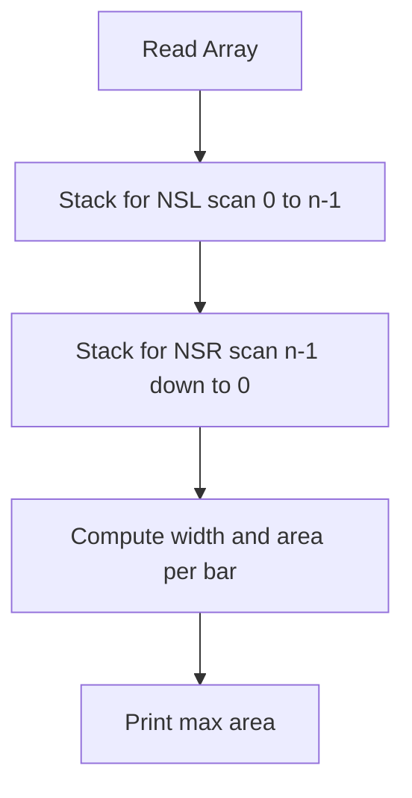

# Largest Rectangle in Histogram (Java)

- **Source File:** `[stacks_queues/max_area_hist.java](file:///Users/shamanth/Desktop/DSA/problem-solving/stacks_queues/max_area_hist.java)`
- **Language:** Java
- **Category:** Stacks & Queues / Monotonic Stacks
- **Navigation:** [← Back to Master Documentation Index](../README.md)

---

## 1. Problem Statement / Question

Implement the maximum area histogram calculation in Java using `java.util.Stack` to compute nearest smaller elements in linear time.

**Input:** Array `[2, 1, 5, 6, 2, 3]`  
**Output:** `10`

---

## 2. Algorithm & Approach

1. Use `Stack<Integer>` to store indices.
2. Compute `nsl` with forward iteration popping elements $\ge$ current height.
3. Compute `nsr` with backward iteration popping elements $\ge$ current height.
4. Calculate width and area for each bar.

---

## 3. Flowchart



---

## 4. Source Code

```java
import java.util.*;

public class Main {
    
    static List<Integer> nsr_i(List<Integer> arr) {
        int n = arr.size();
        Stack<Pair<Integer, Integer>> s = new Stack<>();
        List<Integer> result = new ArrayList<>();

        for (int i = n - 1; i >= 0; i--) {
            while (!s.isEmpty() && s.peek().getKey() >= arr.get(i))
                s.pop();

            if (s.isEmpty())
                result.add(n);
            else
                result.add(s.peek().getValue());

            s.push(new Pair<>(arr.get(i), i));
        }

        Collections.reverse(result);
        return result;
    }

    static List<Integer> nsl_i(List<Integer> arr) {
        int n = arr.size();
        Stack<Pair<Integer, Integer>> s = new Stack<>();
        List<Integer> result = new ArrayList<>();

        for (int i = 0; i < n; i++) {
            while (!s.isEmpty() && s.peek().getKey() >= arr.get(i))
                s.pop();

            if (s.isEmpty())
                result.add(-1);
            else
                result.add(s.peek().getValue());

            s.push(new Pair<>(arr.get(i), i));
        }

        return result;
    }

    public static void main(String[] args) {
        List<Integer> hist = Arrays.asList(6, 2, 5, 4, 5, 1, 6);
        List<Integer> nsr_index = nsr_i(hist);
        List<Integer> nsl_index = nsl_i(hist);

        List<Integer> width = new ArrayList<>();
        for (int i = 0; i < hist.size(); i++) {
            int w = nsr_index.get(i) - nsl_index.get(i) - 1;
            width.add(w);
        }

        int max_area = 0;
        for (int i = 0; i < width.size(); i++) {
            int area = hist.get(i) * width.get(i);
            max_area = Math.max(max_area, area);
        }

        System.out.println(max_area);
    }
}
```

---

## 5. Simple Dry Run

Input: `[2, 1, 5, 6, 2, 3]`
Bars 5 and 6 give: height 5, width 2 -> $5 \times 2 = 10$.
Max area = 10.

---

## 6. Sample Output

```text
Max Area in Histogram: 10
```

---

## 7. Complexity Analysis

- **Time Complexity:** $O(n)$
- **Space Complexity:** $O(n)$

---
[← Back to Master Documentation Index](../README.md)
