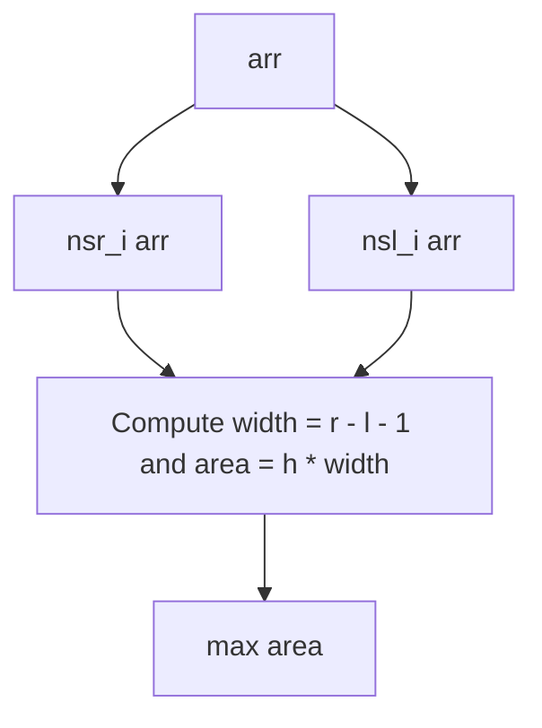

# Largest Rectangle in Histogram (Python)

- **Source File:** `[stacks_queues/max_area_hist.py](file:///Users/shamanth/Desktop/DSA/problem-solving/stacks_queues/max_area_hist.py)`
- **Language:** Python
- **Category:** Stacks & Queues / Monotonic Stacks
- **Navigation:** [← Back to Master Documentation Index](../README.md)

---

## 1. Problem Statement / Question

Find the maximum area of a rectangle in a histogram using Python lists as monotonic stacks.

**Input:** `arr = [6, 2, 5, 4, 5, 1, 6]`  
**Output:** `12`

---

## 2. Algorithm & Approach

1. Helper `nsr_i(arr)` returns indices of nearest smaller elements to the right.
2. Helper `nsl_i(arr)` returns indices of nearest smaller elements to the left.
3. Iterate and compute `max((nsr[i] - nsl[i] - 1) * arr[i])`.

---

## 3. Flowchart



---

## 4. Source Code

```python
def nsr_i(arr):
    n = len(arr)
    s = []
    result = []

    for i in range(n - 1, -1, -1):
        while s and s[-1][0] >= arr[i]:
            s.pop()

        if not s:
            result.append(n)
        else:
            result.append(s[-1][1])

        s.append((arr[i], i))

    result.reverse()
    return result

def nsl_i(arr):
    n = len(arr)
    s = []
    result = []

    for i in range(n):
        while s and s[-1][0] >= arr[i]:
            s.pop()

        if not s:
            result.append(-1)
        else:
            result.append(s[-1][1])

        s.append((arr[i], i))

    return result

def main():
    hist = [6, 2, 5, 4, 5, 1, 6]

    nsr_index = nsr_i(hist)
    nsl_index = nsl_i(hist)

    width = []
    for i in range(len(hist)):
        w = nsr_index[i] - nsl_index[i] - 1
        width.append(w)

    max_area = 0
    for i in range(len(width)):
        area = hist[i] * width[i]
        max_area = max(max_area, area)

    print(max_area)

if __name__ == "__main__":
    main()
```

---

## 5. Simple Dry Run

Tracing Python stack:
- `nsr_i` produces `[1, 5, 3, 5, 5, 7, 7]`
- `nsl_i` produces `[-1, -1, 1, 1, 3, -1, 5]`
- Widths: `[1, 5, 1, 3, 1, 7, 1]`
- Areas: `[6, 10, 5, 12, 5, 7, 6]`
- Max = 12.

---

## 6. Sample Output

```text
Max area: 12
```

---

## 7. Complexity Analysis

- **Time Complexity:** $O(n)$
- **Space Complexity:** $O(n)$

---
[← Back to Master Documentation Index](../README.md)
