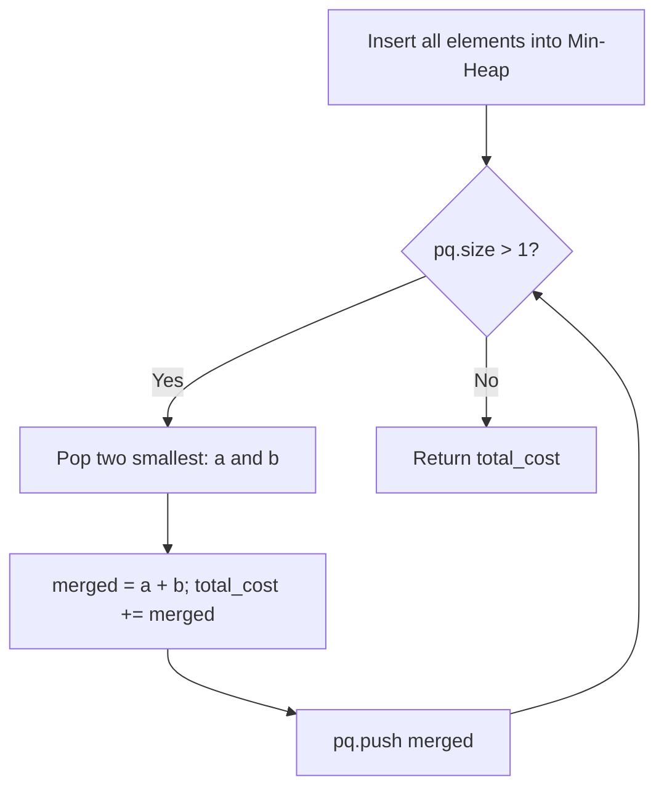

# Connect Ropes / Rods with Minimum Cost (C++)

- **Source File:** `[stacks_queues/merge_rods.cpp](file:///Users/shamanth/Desktop/DSA/problem-solving/stacks_queues/merge_rods.cpp)`
- **Language:** C++
- **Category:** Stacks & Queues / Priority Queues
- **Navigation:** [← Back to Master Documentation Index](../README.md)

---

## 1. Problem Statement / Question

Given $n$ ropes of different lengths, connect them into one rope. The cost to connect two ropes is equal to the sum of their lengths. Find the minimum total cost to connect all ropes.

**Input:** `arr = {4, 3, 2, 6}`  
**Output:** `29`

---

## 2. Algorithm & Approach

1. Push all rod lengths into a min-priority queue (`std::priority_queue<int, vector<int>, greater<int>>`).
2. While `pq.size() > 1`:
   - Pop the two smallest lengths `a` and `b`.
   - The cost to merge them is `cost = a + b`.
   - Add `cost` to `total_cost`.
   - Push `cost` back into the min-priority queue.
3. Return `total_cost`.

---

## 3. Flowchart



---

## 4. Source Code

```c++
#include<bits/stdc++.h>
using namespace std;

int min_cost_rods_merge(vector<int> arr) {
    int cost = 0;

    priority_queue<int, vector<int>, greater<int>> min_heap;
    for (auto x: arr)
        min_heap.push(x);

    while (min_heap.size() > 1) {
        int rod1 = min_heap.top(); min_heap.pop();
        int rod2 = min_heap.top(); min_heap.pop();

        cost += rod1 + rod2;

        min_heap.push(rod1+rod2);
    }

    return cost;
}

int main() {
    vector<int> arr = {1, 2, 3, 2, 1, 4};

    cout << min_cost_rods_merge(arr) << endl;

    return 0;
}
```

---

## 5. Simple Dry Run

Input: `[4, 3, 2, 6]`
1. Min-heap: `[2, 3, 4, 6]`
2. Pop 2, 3 -> merge = 5, cost = 5; heap = `[4, 5, 6]`
3. Pop 4, 5 -> merge = 9, cost = 5 + 9 = 14; heap = `[6, 9]`
4. Pop 6, 9 -> merge = 15, cost = 14 + 15 = 29; heap = `[15]`
Heap size = 1. Total min cost = 29.

---

## 6. Sample Output

```text
Minimum Cost to Connect Ropes: 29
```

---

## 7. Complexity Analysis

- **Time Complexity:** $O(n \log n)$ using binary heap operations
- **Space Complexity:** $O(n)$ priority queue capacity

---
[← Back to Master Documentation Index](../README.md)
