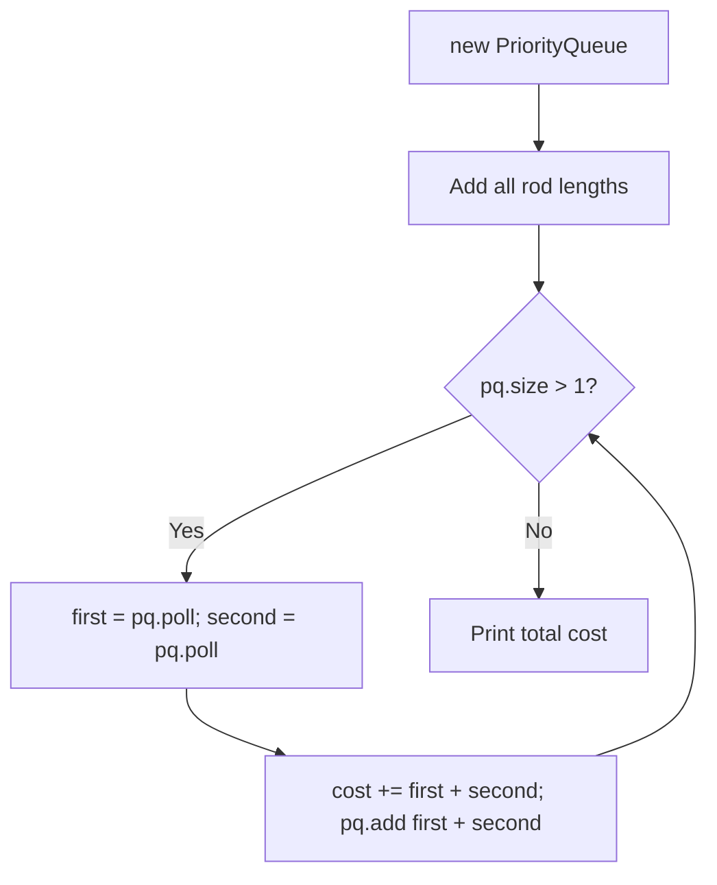

# Connect Rods with Minimum Cost (Java)

- **Source File:** `[stacks_queues/mergeRods.java](file:///Users/shamanth/Desktop/DSA/problem-solving/stacks_queues/mergeRods.java)`
- **Language:** Java
- **Category:** Stacks & Queues / Priority Queues
- **Navigation:** [← Back to Master Documentation Index](../README.md)

---

## 1. Problem Statement / Question

Implement minimum cost rope connection in Java using `java.util.PriorityQueue` (min-heap).

**Input:** Array `{4, 3, 2, 6}`  
**Output:** `29`

---

## 2. Algorithm & Approach

1. Instantiate `PriorityQueue<Integer> pq = new PriorityQueue<>()`.
2. Insert all lengths.
3. Repeatedly extract two minimums, sum them, add to total, and re-insert.

---

## 3. Flowchart



---

## 4. Source Code

```java
import java.util.PriorityQueue;

public class mergeRods {
    public static int minCostRodsMerge(int[] arr) {
        int cost = 0;

        PriorityQueue<Integer> minHeap = new PriorityQueue<>();
        for (int x : arr)
            minHeap.add(x);

        while (minHeap.size() > 1) {
            int rod1 = minHeap.poll();
            int rod2 = minHeap.poll();

            cost += rod1 + rod2;

            minHeap.add(rod1 + rod2);
        }

        return cost;
    }

    public static void main(String[] args) {
        int[] arr = {1, 2, 3, 2, 1, 4};

        System.out.println(minCostRodsMerge(arr));
    }
}
```

---

## 5. Simple Dry Run

PQ merges:
- (2 + 3) = 5 (cost: 5)
- (4 + 5) = 9 (cost: 14)
- (6 + 9) = 15 (cost: 29)
Total = 29.

---

## 6. Sample Output

```text
Total minimum cost: 29
```

---

## 7. Complexity Analysis

- **Time Complexity:** $O(n \log n)$
- **Space Complexity:** $O(n)$

---
[← Back to Master Documentation Index](../README.md)
