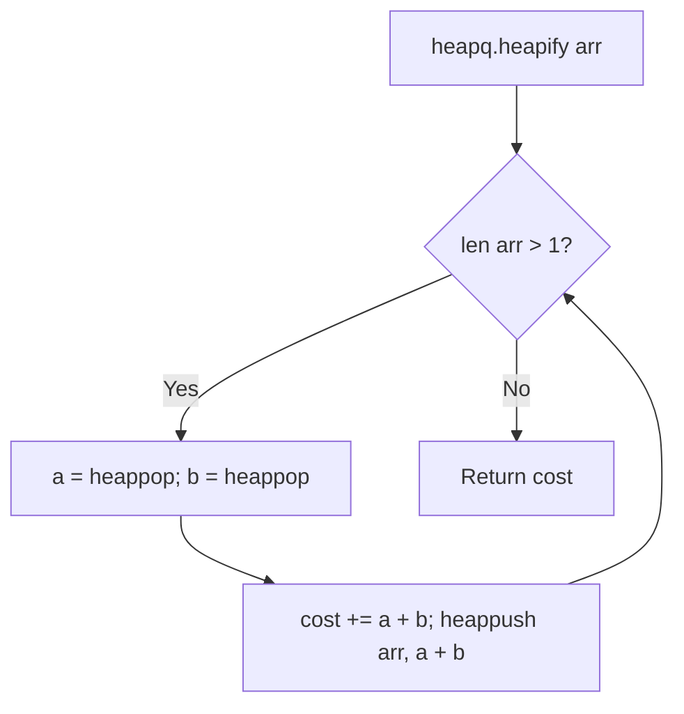

# Connect Rods with Minimum Cost (Python)

- **Source File:** `[stacks_queues/merge_rods.py](file:///Users/shamanth/Desktop/DSA/problem-solving/stacks_queues/merge_rods.py)`
- **Language:** Python
- **Category:** Stacks & Queues / Priority Queues
- **Navigation:** [← Back to Master Documentation Index](../README.md)

---

## 1. Problem Statement / Question

Implement minimum cost rope connection in Python using the `heapq` module.

**Input:** `arr = [4, 3, 2, 6]`  
**Output:** `29`

---

## 2. Algorithm & Approach

1. Use `heapq.heapify(arr)` to transform list into min-heap in $O(n)$ time.
2. While `len(arr) > 1`:
   - `a = heapq.heappop(arr)`
   - `b = heapq.heappop(arr)`
   - `total_cost += a + b`
   - `heapq.heappush(arr, a + b)`
3. Return `total_cost`.

---

## 3. Flowchart



---

## 4. Source Code

```python
import heapq

def min_cost_rods_merge(arr):
    cost = 0

    min_heap = arr[:]
    heapq.heapify(min_heap)

    while len(min_heap) > 1:
        rod1 = heapq.heappop(min_heap)
        rod2 = heapq.heappop(min_heap)

        cost += rod1 + rod2

        heapq.heappush(min_heap, rod1 + rod2)

    return cost

arr = [1, 2, 3, 2, 1, 4]
print(min_cost_rods_merge(arr))
```

---

## 5. Simple Dry Run

Heap transitions:
- Heapify: `[2, 3, 4, 6]`
- Pop 2, 3 -> push 5 -> `[4, 5, 6]`
- Pop 4, 5 -> push 9 -> `[6, 9]`
- Pop 6, 9 -> push 15 -> `[15]`
Total cost = $5 + 9 + 15 = 29$.

---

## 6. Sample Output

```text
Minimum cost: 29
```

---

## 7. Complexity Analysis

- **Time Complexity:** $O(n \log n)$
- **Space Complexity:** $O(1)$ in-place heapification

---
[← Back to Master Documentation Index](../README.md)
