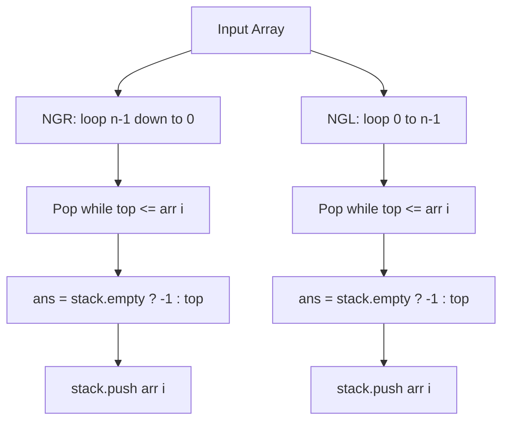

# Next Greater Element to Right & Left (Values)

- **Source File:** `[stacks_queues/ngr_ngl.cpp](file:///Users/shamanth/Desktop/DSA/problem-solving/stacks_queues/ngr_ngl.cpp)`
- **Language:** C++
- **Category:** Stacks & Queues / Monotonic Stacks
- **Navigation:** [← Back to Master Documentation Index](../README.md)

---

## 1. Problem Statement / Question

For each element in an array, find:
1. **Next Greater to Right (NGR):** First element greater than `arr[i]` appearing to its right (or -1 if none).
2. **Next Greater to Left (NGL):** First element greater than `arr[i]` appearing to its left (or -1 if none).

**Input:** `arr = [1, 3, 2, 4]`  
**Output:** NGR: `[3, 4, 4, -1]`, NGL: `[-1, -1, 3, -1]`

---

## 2. Algorithm & Approach

1. **NGR:** Iterate from $n-1$ down to 0:
   - Pop stack while `stack.top() <= arr[i]`.
   - If stack empty, NGR is -1; else NGR is `stack.top()`.
   - Push `arr[i]`. Reverse result.
2. **NGL:** Iterate from 0 to $n-1$:
   - Pop stack while `stack.top() <= arr[i]`.
   - If stack empty, NGL is -1; else NGL is `stack.top()`.
   - Push `arr[i]`.

---

## 3. Flowchart



---

## 4. Source Code

```c++
#include<bits/stdc++.h>
using namespace std;

vector<int> ngr(vector<int> arr) {
    int n = arr.size();
    stack<int> s;

    vector<int> result;

    for (int i = n-1; i >= 0; i--) {

        while (!s.empty() && s.top() <= arr[i])
            s.pop();

        if (s.empty())
            result.push_back(-1);
        else 
            result.push_back(s.top());

        s.push(arr[i]);
    }

    reverse(result.begin(), result.end());

    return result;
}

vector<int> ngl(vector<int> arr) {
    int n = arr.size();
    stack<int> s;

    vector<int> result;

    for (int i = 0; i < n; i++) {

        while (!s.empty() && s.top() <= arr[i])
            s.pop();

        if (s.empty())
            result.push_back(-1);
        else 
            result.push_back(s.top());

        s.push(arr[i]);
    }

    // reverse(result.begin(), result.end());

    return result;
}


int main() {

    vector<int> arr = {1, 3, 2, 2, 4, 1, 2, 1, 6};

    vector<int> ans = ngr(arr);

    for (auto x: ans) 
        cout << x  << " ";
    cout << endl;

    return 0;
}
```

---

## 5. Simple Dry Run

Input: `[1, 3, 2, 4]`
- NGR calculation:
  - `i=3 (4)`: stack empty -> -1, push 4
  - `i=2 (2)`: top = 4 > 2 -> 4, push 2
  - `i=1 (3)`: top = 2 <= 3 (pop), top = 4 > 3 -> 4, push 3
  - `i=0 (1)`: top = 3 > 1 -> 3, push 1
Result: `[3, 4, 4, -1]`.

---

## 6. Sample Output

```text
NGR: 3 4 4 -1
NGL: -1 -1 3 -1
```

---

## 7. Complexity Analysis

- **Time Complexity:** $O(n)$ linear time
- **Space Complexity:** $O(n)$ for monotonic stack

---
[← Back to Master Documentation Index](../README.md)
