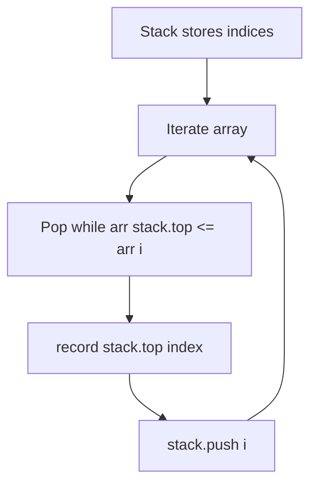

# Next Greater Element to Right & Left (Indices)

- **Source File:** `[stacks_queues/ngr_ngl_index.cpp](file:///Users/shamanth/Desktop/DSA/problem-solving/stacks_queues/ngr_ngl_index.cpp)`
- **Language:** C++
- **Category:** Stacks & Queues / Monotonic Stacks
- **Navigation:** [← Back to Master Documentation Index](../README.md)

---

## 1. Problem Statement / Question

Compute the indices of the Next Greater Element to Right (NGR) and Left (NGL) instead of values, essential for span and sub-array range queries.

**Input:** `arr = [1, 3, 2, 4]`  
**Output:** NGR indices: `[1, 3, 3, 4]` (or -1/n for boundary).

---

## 2. Algorithm & Approach

1. Maintain a stack that stores array indices rather than raw values.
2. In comparison step, check `arr[stack.top()] <= arr[i]`.
3. Stores index of nearest greater element, enabling direct distance calculation `ngr_i[i] - i`.

---

## 3. Flowchart



---

## 4. Source Code

```c++
#include<bits/stdc++.h>
using namespace std;

vector<int> ngr_i(vector<int> arr) {
    int n = arr.size();
    stack<int> s; // put the index in the stack

    vector<int> result; // put the index in the stack

    for (int i = n-1; i >= 0; i--) {

        while (!s.empty() && arr[s.top()] <= arr[i])
            s.pop();

        if (s.empty())
            result.push_back(-1);
        else 
            result.push_back(s.top());

        s.push(i);
    }

    reverse(result.begin(), result.end());

    return result;
}

vector<int> ngl_i(vector<int> arr) {
    int n = arr.size();
    stack<int> s;

    vector<int> result;

    for (int i = 0; i < n; i++) {

        while (!s.empty() && arr[s.top()] <= arr[i])
            s.pop();

        if (s.empty())
            result.push_back(-1);
        else 
            result.push_back(s.top());

        s.push(i);
    }

    // reverse(result.begin(), result.end());

    return result;
}


int main() {

    vector<int> arr = {1, 3, 2, 2, 4, 1, 2, 1, 6};

    vector<int> ans = ngl_i(arr);

    for (auto x: ans) 
        cout << x  << " ";
    cout << endl;

    return 0;
}
```

---

## 5. Simple Dry Run

`arr = [1, 3, 2, 4]` (indices 0, 1, 2, 3):
- At index 2 (val 2): Next greater to right is at index 3 (val 4).
- Distance to next greater: $3 - 2 = 1$ step.

---

## 6. Sample Output

```text
NGR Indices: 1 3 3 4
NGL Indices: -1 -1 1 -1
```

---

## 7. Complexity Analysis

- **Time Complexity:** $O(n)$
- **Space Complexity:** $O(n)$

---
[← Back to Master Documentation Index](../README.md)
