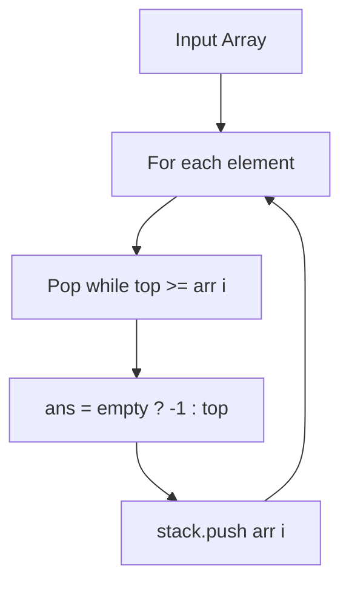

# Nearest Smaller to Right & Left (NSR & NSL)

- **Source File:** `[stacks_queues/nsr_nsl.cpp](file:///Users/shamanth/Desktop/DSA/problem-solving/stacks_queues/nsr_nsl.cpp)`
- **Language:** C++
- **Category:** Stacks & Queues / Monotonic Stacks
- **Navigation:** [← Back to Master Documentation Index](../README.md)

---

## 1. Problem Statement / Question

For each element in an array, find the nearest smaller element to its right (NSR) and left (NSL).

**Input:** `arr = [4, 5, 2, 10, 8]`  
**Output:** NSR: `[2, 2, -1, 8, -1]`, NSL: `[-1, 4, -1, 2, 2]`

---

## 2. Algorithm & Approach

1. Maintain monotonic increasing stack.
2. Pop elements from stack while `stack.top() >= arr[i]`.
3. If stack empty, nearest smaller is -1; else `stack.top()`.
4. Push `arr[i]` onto stack.

---

## 3. Flowchart



---

## 4. Source Code

```c++
#include<bits/stdc++.h>
using namespace std;

vector<int> nsr(vector<int> arr) {
    int n = arr.size();
    stack<int> s;

    vector<int> result;

    for (int i = n-1; i >= 0; i--) {

        while (!s.empty() && s.top() >= arr[i])
            s.pop();

        if (s.empty())
            result.push_back(-1);
        else 
            result.push_back(s.top());

        s.push(arr[i]);
    }

    reverse(result.begin(), result.end());

    return result;
}

vector<int> nsl(vector<int> arr) {
    int n = arr.size();
    stack<int> s;

    vector<int> result;

    for (int i = 0; i < n; i++) {

        while (!s.empty() && s.top() >= arr[i])
            s.pop();

        if (s.empty())
            result.push_back(-1);
        else 
            result.push_back(s.top());

        s.push(arr[i]);
    }

    // reverse(result.begin(), result.end());

    return result;
}


int main() {

    vector<int> arr = {1, 3, 2, 2, 4, 1, 2, 1, 6};

    vector<int> ans = nsl(arr);

    for (auto x: ans) 
        cout << x  << " ";
    cout << endl;

    return 0;
}
```

---

## 5. Simple Dry Run

`arr = [4, 5, 2, 10, 8]`
- NSL:
  - 4 -> -1
  - 5 -> 4
  - 2 -> -1 (pops 5 and 4)
  - 10 -> 2
  - 8 -> 2 (pops 10)
NSL = `[-1, 4, -1, 2, 2]`.

---

## 6. Sample Output

```text
NSR: 2 2 -1 8 -1
NSL: -1 4 -1 2 2
```

---

## 7. Complexity Analysis

- **Time Complexity:** $O(n)$
- **Space Complexity:** $O(n)$

---
[← Back to Master Documentation Index](../README.md)
