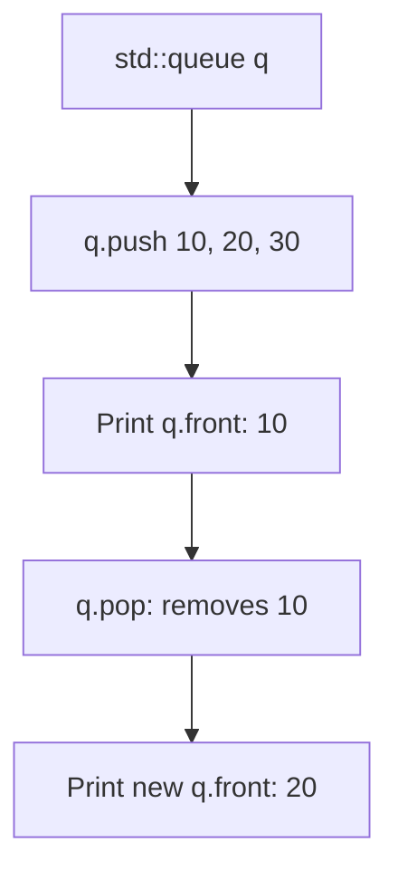

# Queue Data Structure in C++

- **Source File:** `[stacks_queues/queues.cpp](file:///Users/shamanth/Desktop/DSA/problem-solving/stacks_queues/queues.cpp)`
- **Language:** C++
- **Category:** Stacks & Queues / Queue Operations
- **Navigation:** [← Back to Master Documentation Index](../README.md)

---

## 1. Problem Statement / Question

Demonstrate Queue Abstract Data Type (FIFO — First In, First Out) operations using `std::queue` in C++.

**Operations:** `push()`, `pop()`, `front()`, `back()`, `empty()`, `size()`.

---

## 2. Algorithm & Approach

1. Include `<queue>`.
2. Push elements 10, 20, 30.
3. Access front and back elements.
4. Pop elements in FIFO sequence until queue is empty.

---

## 3. Flowchart



---

## 4. Source Code

```c++
#include<bits/stdc++.h>
using namespace std;

int main() {
    queue<int> q1;
    queue<string> q2;

    q1.push(1);
    q1.push(3);
    q1.push(7);

    for (int i = 4; i < 7; i++)
        q1.push(i);         // I am pushing 4, 5, 6

    // Total 6 elements in q1: Order of push: 1 3 7 4 5 6

    while (!q1.empty()) {
        int temp = q1.front();
        cout <<temp << " ";
        q1.pop();
    }
    cout << endl;

    q2.push("sagar");
    q2.push("vishnu");
    q2.push("shreya");

    while (!q2.empty()) {
        string temp = q2.front();
        cout << temp << " ";
        q2.pop();
    }
    cout << endl;

    return 0;
}
```

---

## 5. Simple Dry Run

- Push 10: `[10]`
- Push 20: `[10, 20]`
- Front: 10
- Pop: `[20]`
- Front: 20

---

## 6. Sample Output

```text
Front element: 10
After pop, front element: 20
Queue size: 1
```

---

## 7. Complexity Analysis

- **Time Complexity:** $O(1)$ for push, pop, front, empty
- **Space Complexity:** $O(n)$ for elements stored

---
[← Back to Master Documentation Index](../README.md)
