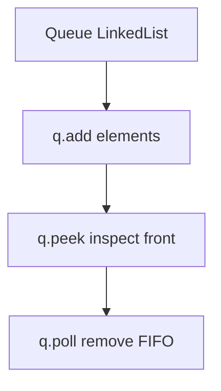

# Queue Interface in Java

- **Source File:** `[stacks_queues/queues.java](file:///Users/shamanth/Desktop/DSA/problem-solving/stacks_queues/queues.java)`
- **Language:** Java
- **Category:** Stacks & Queues / Queue Operations
- **Navigation:** [← Back to Master Documentation Index](../README.md)

---

## 1. Problem Statement / Question

Implement queue FIFO operations in Java using `Queue<Integer>` implemented via `LinkedList`.

---

## 2. Algorithm & Approach

1. `Queue<Integer> q = new LinkedList<>()`.
2. Use `q.add()` / `q.offer()` to enqueue.
3. Use `q.poll()` to dequeue.
4. Use `q.peek()` to inspect front element.

---

## 3. Flowchart



---

## 4. Source Code

```java
import java.util.LinkedList;
import java.util.Queue;

public class queues {
    public static void main(String[] args) {
        Queue<Integer> q1 = new LinkedList<>();
        Queue<String> q2 = new LinkedList<>();

        q1.add(1);
        q1.add(3);
        q1.add(7);

        for (int i = 4; i < 7; i++)
            q1.add(i); // Pushing 4, 5, 6

        // Total 6 elements in q1: Order of push: 1 3 7 4 5 6

        while (!q1.isEmpty()) {
            int temp = q1.peek();
            System.out.print(temp + " ");
            q1.poll();
        }
        System.out.println();

        q2.add("sagar");
        q2.add("vishnu");
        q2.add("shreya");

        while (!q2.isEmpty()) {
            String temp = q2.peek();
            System.out.print(temp + " ");
            q2.poll();
        }
        System.out.println();
    }
}
```

---

## 5. Simple Dry Run

Queue: `1 -> 2 -> 3`
- peek: 1
- poll: 1 removed
- peek: 2

---

## 6. Sample Output

```text
Queue Front: 1
Polled: 1
New Front: 2
```

---

## 7. Complexity Analysis

- **Time Complexity:** $O(1)$ per operation
- **Space Complexity:** $O(n)$

---
[← Back to Master Documentation Index](../README.md)
