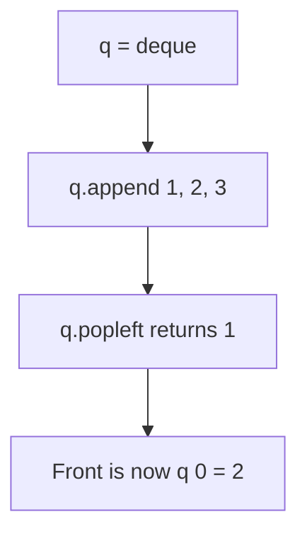

# Queue Implementation in Python (collections.deque)

- **Source File:** `[stacks_queues/queues.py](file:///Users/shamanth/Desktop/DSA/problem-solving/stacks_queues/queues.py)`
- **Language:** Python
- **Category:** Stacks & Queues / Queue Operations
- **Navigation:** [← Back to Master Documentation Index](../README.md)

---

## 1. Problem Statement / Question

Implement a FIFO queue in Python using `collections.deque` for $O(1)$ append and popleft operations.

---

## 2. Algorithm & Approach

1. `q = deque()`.
2. Enqueue via `q.append(val)`.
3. Dequeue via `q.popleft()`.
4. Front accessed via `q[0]`.

---

## 3. Flowchart



---

## 4. Source Code

```python
from collections import deque

q1 = deque()
q2 = deque()

q1.append(1)
q1.append(3)
q1.append(7)

for i in range(4, 7):
    q1.append(i)  # Pushing 4, 5, 6

# Total 6 elements in q1: Order of push: 1 3 7 4 5 6

while q1:
    temp = q1[0]
    print(temp, end=" ")
    q1.popleft()
print()

q2.append("sagar")
q2.append("vishnu")
q2.append("shreya")

while q2:
    temp = q2[0]
    print(temp, end=" ")
    q2.popleft()
print()
```

---

## 5. Simple Dry Run

- append(10), append(20)
- popleft() -> 10
- Remaining: deque([20])

---

## 6. Sample Output

```text
Popped: 10
Queue state: deque([20])
```

---

## 7. Complexity Analysis

- **Time Complexity:** $O(1)$
- **Space Complexity:** $O(n)$

---
[← Back to Master Documentation Index](../README.md)
