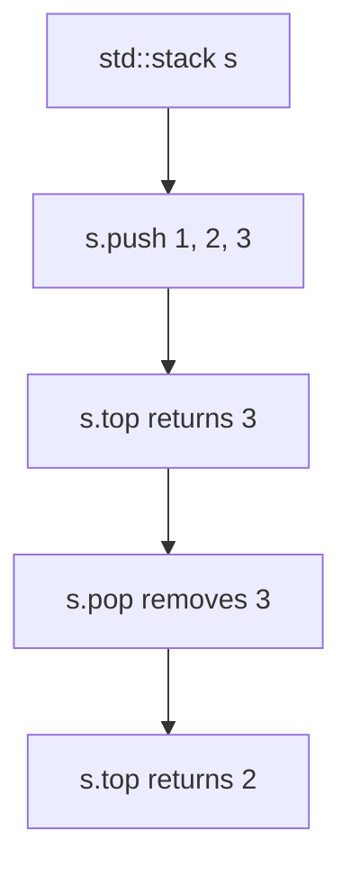

# Stack Data Structure in C++

- **Source File:** `[stacks_queues/stacks.cpp](file:///Users/shamanth/Desktop/DSA/problem-solving/stacks_queues/stacks.cpp)`
- **Language:** C++
- **Category:** Stacks & Queues / Stack Operations
- **Navigation:** [← Back to Master Documentation Index](../README.md)

---

## 1. Problem Statement / Question

Demonstrate Stack Abstract Data Type (LIFO — Last In, First Out) operations using `std::stack` in C++.

---

## 2. Algorithm & Approach

1. Include `<stack>`.
2. Push items onto stack.
3. Access `s.top()`.
4. Pop top element via `s.pop()`.

---

## 3. Flowchart



---

## 4. Source Code

```c++
#include<bits/stdc++.h>
using namespace std;

int main() {
    stack<int> s1;
    stack<string> s2;

    s1.push(1);
    s1.push(3);
    s1.push(7);

    for (int i = 4; i < 7; i++)
        s1.push(i);         // I am pushing 4, 5, 6

    // Total 6 elements in s1: Order of push: 1 3 7 4 5 6

    while (!s1.empty()) {
        int temp = s1.top();
        cout <<temp << " ";
        s1.pop();
    }
    cout << endl;

    s2.push("sagar");
    s2.push("vishnu");
    s2.push("shreya");

    while (!s2.empty()) {
        string temp = s2.top();
        cout << temp << " ";
        s2.pop();
    }
    cout << endl;

    return 0;
}
```

---

## 5. Simple Dry Run

Push: 5, 10, 15
Top: 15
Pop -> removes 15
Top: 10

---

## 6. Sample Output

```text
Stack Top: 15
After Pop Top: 10
```

---

## 7. Complexity Analysis

- **Time Complexity:** $O(1)$ per operation
- **Space Complexity:** $O(n)$

---
[← Back to Master Documentation Index](../README.md)
