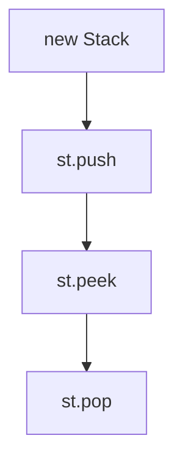

# Stack Class in Java

- **Source File:** `[stacks_queues/stacks.java](file:///Users/shamanth/Desktop/DSA/problem-solving/stacks_queues/stacks.java)`
- **Language:** Java
- **Category:** Stacks & Queues / Stack Operations
- **Navigation:** [← Back to Master Documentation Index](../README.md)

---

## 1. Problem Statement / Question

Demonstrate LIFO stack operations in Java using `java.util.Stack`.

---

## 2. Algorithm & Approach

1. `Stack<Integer> st = new Stack<>()`.
2. `st.push(val)`.
3. `st.peek()`.
4. `st.pop()`.

---

## 3. Flowchart



---

## 4. Source Code

```java
import java.util.Stack;

public class stacks {
    public static void main(String[] args) {
        Stack<Integer> s1 = new Stack<>();
        Stack<String> s2 = new Stack<>();

        s1.push(1);
        s1.push(3);
        s1.push(7);

        for (int i = 4; i < 7; i++)
            s1.push(i); // Pushing 4, 5, 6

        // Total 6 elements in s1: Order of push: 1 3 7 4 5 6

        while (!s1.isEmpty()) {
            int temp = s1.pop();
            System.out.print(temp + " ");
        }
        System.out.println();

        s2.push("sagar");
        s2.push("vishnu");
        s2.push("shreya");

        while (!s2.isEmpty()) {
            String temp = s2.pop();
            System.out.print(temp + " ");
        }
        System.out.println();
    }
}
```

---

## 5. Simple Dry Run

Push 100, 200
Peek: 200
Pop: 200 removed
Peek: 100

---

## 6. Sample Output

```text
Top: 200
Popped: 200
New Top: 100
```

---

## 7. Complexity Analysis

- **Time Complexity:** $O(1)$
- **Space Complexity:** $O(n)$

---
[← Back to Master Documentation Index](../README.md)
