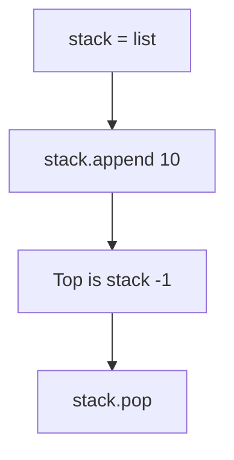

# Stack Implementation in Python

- **Source File:** `[stacks_queues/stacks.py](file:///Users/shamanth/Desktop/DSA/problem-solving/stacks_queues/stacks.py)`
- **Language:** Python
- **Category:** Stacks & Queues / Stack Operations
- **Navigation:** [← Back to Master Documentation Index](../README.md)

---

## 1. Problem Statement / Question

Implement LIFO stack operations in Python using native list methods (`append` and `pop`).

---

## 2. Algorithm & Approach

1. `stack = []`.
2. Push via `stack.append(val)`.
3. Top via `stack[-1]`.
4. Pop via `stack.pop()`.

---

## 3. Flowchart



---

## 4. Source Code

```python
s1 = []
s2 = []

s1.append(1)
s1.append(3)
s1.append(7)

for i in range(4, 7):
    s1.append(i)  # Pushing 4, 5, 6

# Total 6 elements in s1: Order of push: 1 3 7 4 5 6

while s1:
    temp = s1.pop()
    print(temp, end=" ")
print()

s2.append("sagar")
s2.append("vishnu")
s2.append("shreya")

while s2:
    temp = s2.pop()
    print(temp, end=" ")
print()
```

---

## 5. Simple Dry Run

- append(10), append(20)
- stack[-1] -> 20
- pop() -> 20
- stack[-1] -> 10

---

## 6. Sample Output

```text
Popped: 20
Stack: [10]
```

---

## 7. Complexity Analysis

- **Time Complexity:** $O(1)$ amortized
- **Space Complexity:** $O(n)$

---
[← Back to Master Documentation Index](../README.md)
