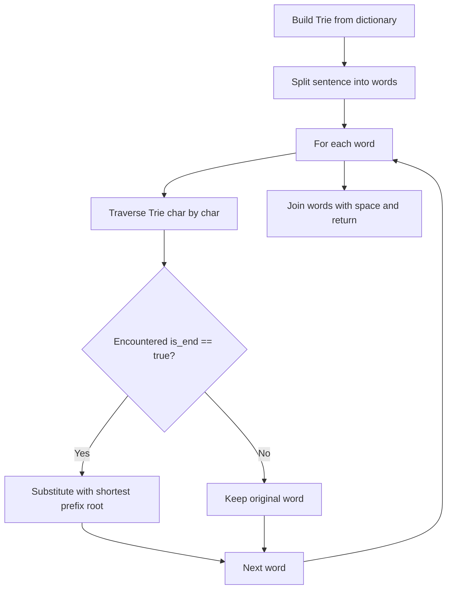

# LeetCode 648: Replace Words (Trie)

- **Source File:** `[strings/replace_words.py](file:///Users/shamanth/Desktop/DSA/problem-solving/strings/replace_words.py)`
- **Language:** Python
- **Category:** Strings / Trie (Prefix Tree)
- **Navigation:** [← Back to Master Documentation Index](../README.md)

---

## 1. Problem Statement / Question

In English, we have a concept called root, which can be followed by some other word to form another longer word. Given a dictionary consisting of many roots and a sentence consisting of words separated by spaces, replace all successors in the sentence with the root forming it. If a successor can be replaced by more than one root, replace it with the root that has the shortest length.

**Input:** `dictionary = ["cat", "bat", "rat"]`, `sentence = "the cattle was rattled by the battery"`  
**Output:** `"the cat was rat by the bat"`

---

## 2. Algorithm & Approach

1. Insert all dictionary root words into a Trie.
2. For each word in the sentence:
   - Query the Trie character by character.
   - If a node with `is_end == True` is encountered, return the prefix accumulated so far (shortest root).
   - If a character is not found in children, no root exists; keep the original word.
3. Join replaced words with spaces and return.

---

## 3. Flowchart



---

## 4. Source Code

```python
class TrieNode:
    def __init__(self):
        # Initialize a TrieNode with children as a dictionary and is_end flag as False
        self.children = {}
        self.is_end = False

class Solution:
    def __init__(self):
        # Initialize a root TrieNode
        self.new_node = TrieNode()
    
    def check(self, word: str) -> str:
        # Check the shortest prefix of the word in the Trie
        t = self.new_node
        s = ""
        
        for char in word:
            if char not in t.children:
                break
            s += char
            t = t.children[char]
            if t.is_end:
                return s
        
        return word
    
    def insert(self, word: str) -> None:
        # Insert a word into the Trie
        temp = self.new_node
        
        for char in word:
            if char not in temp.children:
                temp.children[char] = TrieNode()
            temp = temp.children[char]
        
        temp.is_end = True
    
    def replaceWords(self, dict, sentence: str) -> str:
        # Build the Trie from the dictionary and replace words in the sentence
        for word in dict:
            self.insert(word)
        
        words = sentence.split()
        ans = ""
        
        for word in words:
            ans += self.check(word) + " "
        
        return ans.strip()


# Example usage
solution = Solution()
dictionary = ["cat", "bat", "rat"]
sentence = "the cattle was rattled by the battery"
print(solution.replaceWords(dictionary, sentence))  # Output: "the cat was rat by the bat"
```

---

## 5. Simple Dry Run

- Root words inserted: `'cat'`, `'bat'`, `'rat'`.
- `'cattle'`: matches `'c'`, `'a'`, `'t'` (`is_end=True`) -> replaced by `'cat'`.
- `'rattled'`: matches `'r'`, `'a'`, `'t'` (`is_end=True`) -> replaced by `'rat'`.
- `'battery'`: matches `'b'`, `'a'`, `'t'` (`is_end=True`) -> replaced by `'bat'`.
Output: `"the cat was rat by the bat"`.

---

## 6. Sample Output

```text
Input: "the cattle was rattled by the battery"
Output: "the cat was rat by the bat"
```

---

## 7. Complexity Analysis

- **Time Complexity:** $O(D + W)$ where $D$ is sum of lengths of dictionary roots, and $W$ is sentence length
- **Space Complexity:** $O(D)$ space for Trie nodes

---
[← Back to Master Documentation Index](../README.md)
