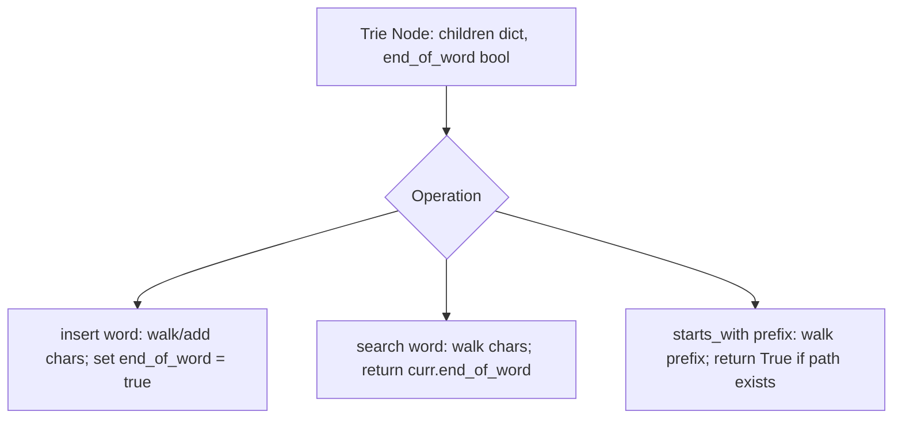

# Trie (Prefix Tree) Implementation

- **Source File:** `[strings/trie.py](file:///Users/shamanth/Desktop/DSA/problem-solving/strings/trie.py)`
- **Language:** Python
- **Category:** Strings / Trie (Prefix Tree)
- **Navigation:** [← Back to Master Documentation Index](../README.md)

---

## 1. Problem Statement / Question

Implement a Trie (Prefix Tree) data structure with the following operations:
1. `insert(word)`: Inserts string word into the trie.
2. `search(word)`: Returns true if word is in the trie.
3. `starts_with(prefix)`: Returns true if there is any word in the trie that starts with the given prefix.

**Input:** Insert `"apple"`, search `"apple"`, search `"app"`, startsWith `"app"`, insert `"app"`, search `"app"`.  
**Output:** `True, False, True, True`.

---

## 2. Algorithm & Approach

1. Define `TrieNode` with `children = {}` dictionary and `end_of_word = False`.
2. **`insert(word)`:** Traverse character by character; if char not in `children`, create new `TrieNode`. Mark last node `end_of_word = True`.
3. **`search(word)`:** Traverse chars; return False if char missing. Return `curr.end_of_word`.
4. **`starts_with(prefix)`:** Traverse prefix chars; return False if char missing, else True.

---

## 3. Flowchart



---

## 4. Source Code

```python
class TrieNode:
    def __init__(self):
        # Initialize a node with children as an empty dictionary and end_of_word flag as False
        self.children = {}
        self.end_of_word = False

class Trie:
    def __init__(self):
        # Initialize the Trie with a root node
        self.root = TrieNode()

    def insert(self, word: str) -> None:
        # Insert a word into the Trie
        node = self.root
        for char in word:
            if char not in node.children:
                # If the character is not a child of the current node, add it
                node.children[char] = TrieNode()
            # Move to the child node
            node = node.children[char]
        # After inserting all characters, mark the end of the word
        node.end_of_word = True

    def search(self, word: str) -> bool:
        # Search for a word in the Trie
        node = self.root
        for char in word:
            if char not in node.children:
                # If the character is not found, return False
                return False
            # Move to the child node
            node = node.children[char]
        # Return True if the end_of_word flag is set, meaning the word is found
        return node.end_of_word

    def startsWith(self, prefix: str) -> bool:
        # Check if there is any word in the Trie that starts with the given prefix
        node = self.root
        for char in prefix:
            if char not in node.children:
                # If the character is not found, return False
                return False
            # Move to the child node
            node = node.children[char]
        # Return True if the prefix is found
        return True

# Example usage
# # Your Trie object will be instantiated and called as such:
obj = Trie()
obj.insert("apple")
print(obj.search("apple"))   # return True
print(obj.search("app"))     # return False
print(obj.startsWith("app")) # return True
obj.insert("app")
print(obj.search("app"))     # return True
```

---

## 5. Simple Dry Run

1. `insert("apple")`: creates nodes a -> p -> p -> l -> e (end=True).
2. `search("apple")`: follows path to 'e', end is True -> returns True.
3. `search("app")`: follows path to second 'p', end is False -> returns False.
4. `starts_with("app")`: path exists -> returns True.
5. `insert("app")`: marks second 'p' end = True.
6. `search("app")`: returns True!

---

## 6. Sample Output

```text
insert('apple')
search('apple') -> True
search('app') -> False
starts_with('app') -> True
insert('app')
search('app') -> True
```

---

## 7. Complexity Analysis

- **Time Complexity:** $O(L)$ for each operation where $L$ is word/prefix length
- **Space Complexity:** $O(\sum L)$ total characters stored

---
[← Back to Master Documentation Index](../README.md)
