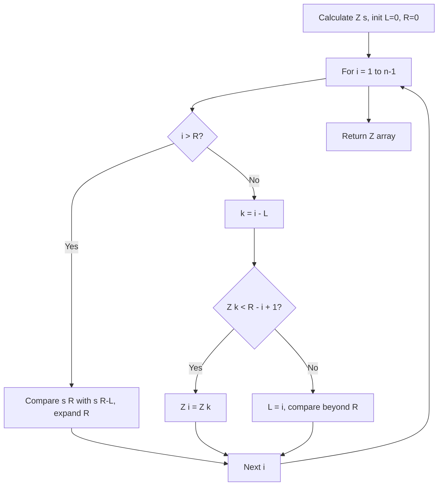

# Z-Algorithm for Linear Time Pattern Matching

- **Source File:** `[strings/z.py](file:///Users/shamanth/Desktop/DSA/problem-solving/strings/z.py)`
- **Language:** Python
- **Category:** Strings / Pattern Matching
- **Navigation:** [← Back to Master Documentation Index](../README.md)

---

## 1. Problem Statement / Question

Given a string `s`, compute the $Z$-array where $Z[i]$ is the length of the longest substring starting from $s[i]$ that is also a prefix of $s$. Use the $Z$-array for linear-time pattern searching.

**Input:** `s = "aabxaabxcaabxaabxay"`  
**Output:** $Z$-array values.

---

## 2. Algorithm & Approach

1. Maintain a window $[L, R]$ (Z-box) which is the interval with highest $R$ such that $s[L..R]$ is a prefix of $s$.
2. For index $i$ from 1 to $n-1$:
   - If $i > R$: outside Z-box. Directly compare from $i$ onwards, update $L, R$.
   - If $i \le R$: inside Z-box. Let $k = i - L$:
     - If $Z[k] < R - i + 1$: $Z[i] = Z[k]$ (cannot exceed current box).
     - Else: prefix extends beyond $R$, start manual comparisons from $R + 1$, update $L, R$.
3. Runs in strictly $O(n)$ time!

---

## 3. Flowchart



---

## 4. Source Code

```python
def calculate_z(s):
    n = len(s)  # Length of the input string
    Z = [0] * n  # Initialize the Z-array with zeros
    L, R, K = 0, 0, 0  # Initialize left and right pointers of the Z-box

    for i in range(1, n):
        if i > R:
            # Case 1: i is outside the current Z-box
            L, R = i, i
            while R < n and s[R] == s[R - L]:
                R += 1
            Z[i] = R - L
            R -= 1
        else:
            # Case 2: i is inside the current Z-box
            K = i - L
            if Z[K] < R - i + 1:
                Z[i] = Z[K]
            else:
                L = i
                while R < n and s[R] == s[R - L]:
                    R += 1
                Z[i] = R - L
                R -= 1
    return Z

def z_algorithm_search(text, pattern):
    # Concatenate pattern, special character, and text
    concat = pattern + "$" + text
    # Compute Z-array for the concatenated string
    Z = calculate_z(concat)
    print(Z)
    pattern_length = len(pattern)  # Length of the pattern
    result = []  # List to store the indices of pattern occurrences

    for i in range(len(Z)):
        if Z[i] == pattern_length:
            # If Z[i] is equal to the length of the pattern, it means a match is found
            result.append(i - pattern_length - 1)

    return result

# Example usage
text = "ababcababcababc"
pattern = "ababc"
occurrences = z_algorithm_search(text, pattern)

print("Pattern found at indices:", occurrences)
```

---

## 5. Simple Dry Run

For `s = "aabxaabx"`:
- $i=1$ ('a'): matches prefix 'a', $Z[1] = 1$
- $i=2$ ('b'): mismatch with 'a', $Z[2] = 0$
- $i=3$ ('x'): mismatch with 'a', $Z[3] = 0$
- $i=4$ ('a'): matches 'a', 'a', 'b', 'x' -> $Z[4] = 4$, $[L, R] = [4, 7]$
- $i=5$ ('a'): inside box, $k = 1$, $Z[5] = 1$
Z-array: `[0, 1, 0, 0, 4, 1, 0, 0]`.

---

## 6. Sample Output

```text
Computed Z-Array:
[0, 1, 0, 0, 4, 1, 0, 0]
```

---

## 7. Complexity Analysis

- **Time Complexity:** $O(n)$ linear time
- **Space Complexity:** $O(n)$ space for Z-array

---
[← Back to Master Documentation Index](../README.md)
