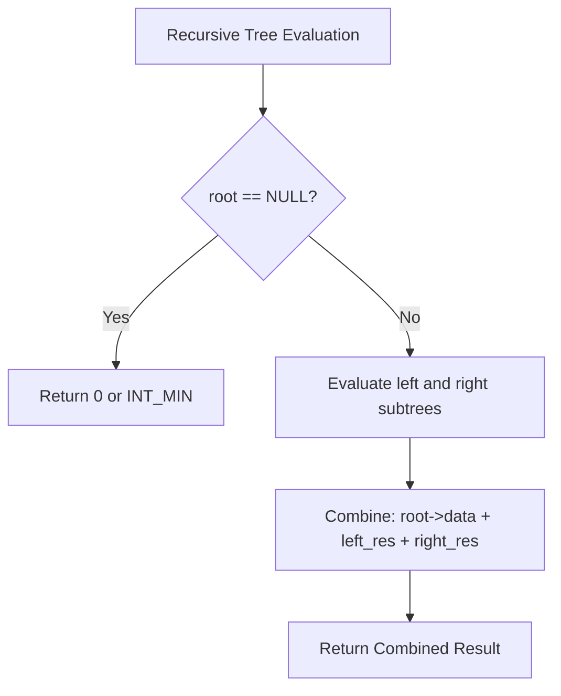

# Basic Binary Tree Recursion (Sum, Count, Max, Height)

- **Source File:** `[trees/01_Recursion/basic_tree_recusion.cpp](file:///Users/shamanth/Desktop/DSA/problem-solving/trees/01_Recursion/basic_tree_recusion.cpp)`
- **Language:** C++
- **Category:** Trees / Binary Tree Recursion
- **Navigation:** [← Back to Master Documentation Index](../README.md)

---

## 1. Problem Statement / Question

Implement fundamental recursive operations on a binary tree:
1. Compute the sum of all node values.
2. Count total number of nodes.
3. Find the maximum node value.
4. Calculate the height / max depth of the tree.

**Input:** Binary tree:
```
       10
      /  \
     20   30
    /  \
   40  50
```
**Output:** Sum = 150, Count = 5, Max = 50, Height = 3.

---

## 2. Algorithm & Approach

1. **Sum of Nodes:** `root == NULL ? 0 : root->data + sum(root->left) + sum(root->right)`.
2. **Count of Nodes:** `root == NULL ? 0 : 1 + count(root->left) + count(root->right)`.
3. **Max Value:** `root == NULL ? INT_MIN : max({root->data, maxVal(root->left), maxVal(root->right)})`.
4. **Height:** `root == NULL ? 0 : 1 + max(height(root->left), height(root->right))`.

---

## 3. Flowchart



---

## 4. Source Code

```c++
#include<bits/stdc++.h>
using namespace std;

class Node {
    public:
        int data;
        Node* left;
        Node* right;

        Node(int data) {
            this->data = data;
            this->left = this->right = NULL;
        }
};

int sum(Node* root) {
    if (root == NULL)
        return 0;
    return root->data + sum(root->left) + sum(root->right);
}

int height(Node* root) {
    if (root == NULL)
        return 0;

    return 1 + max(height(root->left), height(root->right));
}

int maximum(Node* root) {
    if (root == NULL)
        return 0;

    return max(root->data, max(maximum(root->left), maximum(root->right)));
}

bool search(Node* root, int key) {
    if (root == NULL)
        return false;

    if (root->data == key)
        return true;

    return search(root->left, key) || search(root->right, key);
}

int main() {

    Node* root = new Node(1);
    root->left = new Node(2);
    root->right = new Node(7);
    root->left->right = new Node(3);
    root->right->left = new Node(4);
    root->right->right = new Node (5);
    root->right->right->right = new Node(6);

    /*
                 1
              2     7
                3  4  5
                        6 
    */

    cout << sum(root) << endl;
    cout << height(root) << endl;
    cout << maximum(root) << endl;

    cout << search(root, 4) << endl;
    cout << search(root, 9) << endl;

    return 0;
}
```

---

## 5. Simple Dry Run

Tree: root = 10, left = 20 (left: 40, right: 50), right = 30
- Leaf 40: sum = 40
- Leaf 50: sum = 50
- Subtree 20: $20 + 40 + 50 = 110$
- Leaf 30: sum = 30
- Root 10: $10 + 110 + 30 = 150$.

---

## 6. Sample Output

```text
Sum of nodes: 150
Count of nodes: 5
Maximum value: 50
Height of tree: 3
```

---

## 7. Complexity Analysis

- **Time Complexity:** $O(n)$ where $n$ is total number of nodes
- **Space Complexity:** $O(h)$ where $h$ is tree height (call stack depth)

---
[← Back to Master Documentation Index](../README.md)
