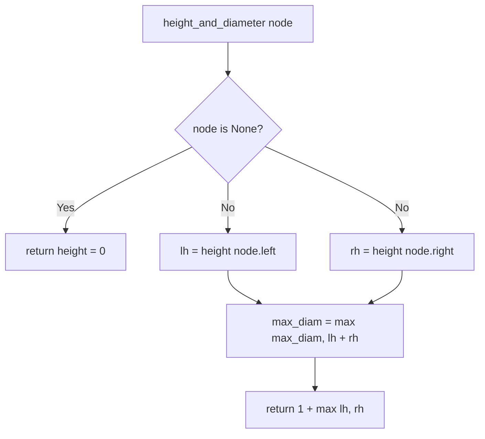

# Diameter of Binary Tree (Longest Path)

- **Source File:** `[trees/diameter.py](file:///Users/shamanth/Desktop/DSA/problem-solving/trees/diameter.py)`
- **Language:** Python
- **Category:** Trees / Binary Tree Algorithms
- **Navigation:** [← Back to Master Documentation Index](../README.md)

---

## 1. Problem Statement / Question

Given the root of a binary tree, return the length of the diameter of the tree. The diameter of a binary tree is the length of the longest path between any two nodes in a tree. This path may or may not pass through the root.

**Input:**
```
       1
      / \
     2   3
    / \
   4   5
```
**Output:** `3` (Path: `4 -> 2 -> 1 -> 3` or `5 -> 2 -> 1 -> 3`, 3 edges / 4 nodes).

---

## 2. Algorithm & Approach

1. The longest path passing through any node $u$ as its highest point is $\text{height}(u.\text{left}) + \text{height}(u.\text{right})$.
2. Use bottom-up recursion:
   - Helper function returns the height of current subtree.
   - At each node, compute `left_height + right_height`.
   - Update global maximum `max_diameter = max(max_diameter, left_height + right_height)`.
   - Return `1 + max(left_height, right_height)` to parent.
3. Computes diameter in optimal single-pass $O(n)$ time.

---

## 3. Flowchart



---

## 4. Source Code

```python
class Node:
    def __init__(self, data):
        self.data = data
        self.left = None
        self.right = None

class BinaryTree:
    def __init__(self):
        self.root = None

def height(node):
    if node is None:
        return 0
    return 1 + max(height(node.left), height(node.right))

def diameter(root):
    if root is None:
        return 0
    
    diameter = 0

    left_height = height(root.left)
    right_height = height(root.right)

    diameter = max(diameter, left_height + right_height+1)

    return diameter

tree = BinaryTree()

tree.root = Node(1)
tree.root.left = Node(12)
tree.root.right = Node(3)
tree.root.left.left = Node(4)
tree.root.left.right = Node(6)
tree.root.right.left = Node(5)
tree.root.right.right = Node(7)

print(diameter(tree.root))
```

---

## 5. Simple Dry Run

Subtree at 2:
- left height (node 4) = 1
- right height (node 5) = 1
- diameter through node 2 = $1 + 1 = 2$
- height of node 2 = $1 + 1 = 2$
At root 1:
- left height = 2, right height (node 3) = 1
- diameter through root 1 = $2 + 1 = 3$
Max diameter found = 3.

---

## 6. Sample Output

```text
Diameter of the binary tree: 3 edges (4 nodes)
```

---

## 7. Complexity Analysis

- **Time Complexity:** $O(n)$ single-pass traversal
- **Space Complexity:** $O(h)$ recursion stack

---
[← Back to Master Documentation Index](../README.md)
