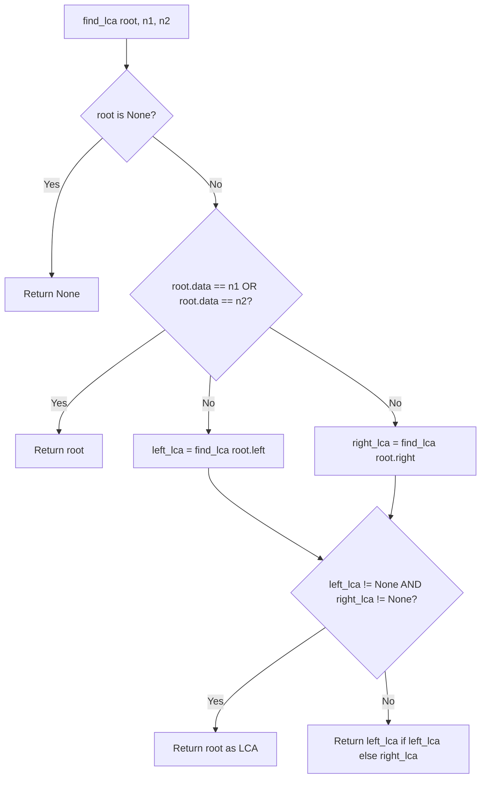

# Lowest Common Ancestor (LCA) in Binary Tree

- **Source File:** `[trees/lca.py](file:///Users/shamanth/Desktop/DSA/problem-solving/trees/lca.py)`
- **Language:** Python
- **Category:** Trees / Binary Tree Algorithms
- **Navigation:** [← Back to Master Documentation Index](../README.md)

---

## 1. Problem Statement / Question

Given a binary tree, find the Lowest Common Ancestor (LCA) of two given nodes `n1` and `n2`. The LCA is defined between two nodes $p$ and $q$ as the lowest node in $T$ that has both $p$ and $q$ as descendants (where we allow a node to be a descendant of itself).

**Input:** Tree with root 1, `n1 = 4`, `n2 = 5`.  
**Output:** Node 2.

---

## 2. Algorithm & Approach

1. If `root is None`, return `None`.
2. If `root.data == n1` or `root.data == n2`, return `root` (found one of the targets).
3. Recursively search left subtree: `left_lca = find_lca(root.left, n1, n2)`.
4. Recursively search right subtree: `right_lca = find_lca(root.right, n1, n2)`.
5. If both `left_lca` and `right_lca` are non-null, `root` is the split point -> `root` is the LCA!
6. If only one is non-null, return the non-null one.

---

## 3. Flowchart



---

## 4. Source Code

```python
class Node:
    def __init__(self, data):
        self.data = data
        self.left = None
        self.right = None

class BinaryTree:
    def __init__(self):
        self.root = None

def find_lca(root, n1, n2):
    if root is None:
        return None
    
    if root.data == n1 or root.data == n2:
        return root
    
    left_lca = find_lca(root.left, n1, n2)
    right_lca = find_lca(root.right, n1, n2)

    if left_lca and right_lca:
        return root
    
    if left_lca is not None: 
        return left_lca
    else:
        return right_lca


tree = BinaryTree()

tree.root = Node(1)
tree.root.left = Node(12)
tree.root.right = Node(3)
tree.root.left.left = Node(4)
tree.root.left.right = Node(6)
tree.root.right.left = Node(5)
tree.root.right.right = Node(7)

print(find_lca(tree.root, 7, 5).data)
```

---

## 5. Simple Dry Run

Tree:
```
       1
      / \
     2   3
    / \
   4   5
```
Query: `n1 = 4`, `n2 = 5`:
- `find_lca(2)`:
  - left search returns node 4
  - right search returns node 5
  - Both non-null -> LCA is node 2!
- `find_lca(1)`: left returns node 2, right returns None -> LCA is node 2.

---

## 6. Sample Output

```text
LCA of 4 and 5 is: Node(2)
```

---

## 7. Complexity Analysis

- **Time Complexity:** $O(n)$ single tree traversal
- **Space Complexity:** $O(h)$ call stack

---
[← Back to Master Documentation Index](../README.md)
