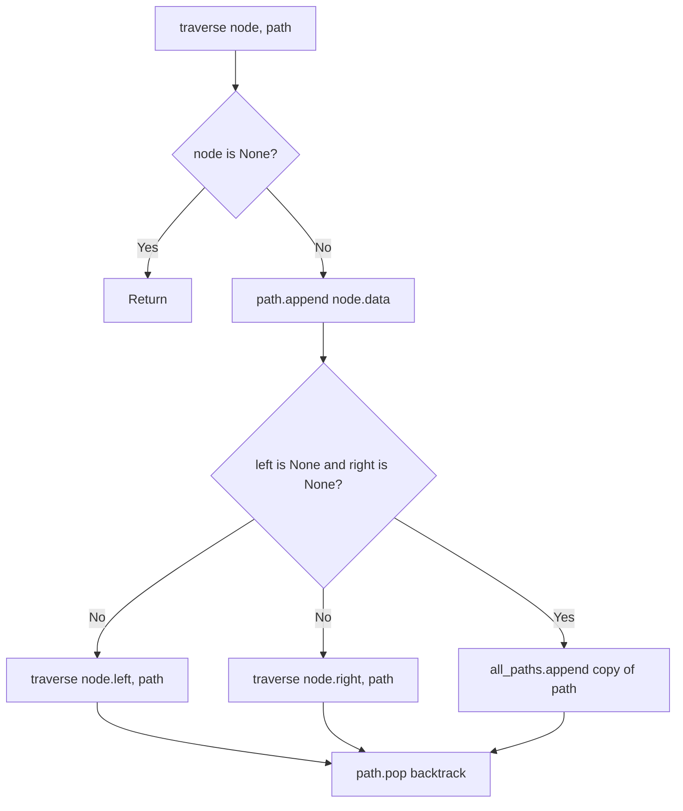

# Find All Root-to-Leaf Paths in Binary Tree

- **Source File:** `[trees/root_to_leaf_path.py](file:///Users/shamanth/Desktop/DSA/problem-solving/trees/root_to_leaf_path.py)`
- **Language:** Python
- **Category:** Trees / Path Finding
- **Navigation:** [← Back to Master Documentation Index](../README.md)

---

## 1. Problem Statement / Question

Given the root of a binary tree, return all root-to-leaf paths from the root down to every terminal leaf node.

**Input:**
```
       1
      / \
     2   3
    / \
   4   5
```
**Output:** `[[1, 2, 4], [1, 2, 5], [1, 3]]`

---

## 2. Algorithm & Approach

1. Use DFS with a backtracking `path` list.
2. In `traverse(node, path)`:
   - If `node is None`: return.
   - Append `node.data` to `path`.
   - If `node.left is None` and `node.right is None`: (leaf reached!)
     - Append a copy of `path[:]` to `all_paths`.
   - Else:
     - Recurse `traverse(node.left, path)`
     - Recurse `traverse(node.right, path)`
   - Backtrack: `path.pop()`.

---

## 3. Flowchart



---

## 4. Source Code

```python
class Node:
    def __init__(self, data):
        self.data = data
        self.left = None
        self.right = None

class BinaryTree:
    def __init__(self):
        self.root = None

def root_to_leaf_paths(root):
    all_paths = []

    def traverse(node, path):
        if node is None: 
            return 
        
        path.append(node.data)

        if node.left is None and node.right is None:
            all_paths.append(list(path))
        else:
            traverse(node.left, path)
            traverse(node.right, path)

        path.pop()
        
    traverse(root, [])
    return all_paths        


tree = BinaryTree()

tree.root = Node(1)
tree.root.left = Node(12)
tree.root.right = Node(3)
tree.root.left.left = Node(4)
tree.root.left.right = Node(6)
tree.root.right.left = Node(5)
tree.root.right.right = Node(7)

print(root_to_leaf_paths(tree.root))
```

---

## 5. Simple Dry Run

Traversing:
- Start at 1: `path = [1]`
- Go left to 2: `path = [1, 2]`
- Go left to 4: `path = [1, 2, 4]` (leaf!) -> save `[1, 2, 4]`, pop 4
- Go right to 5: `path = [1, 2, 5]` (leaf!) -> save `[1, 2, 5]`, pop 5, pop 2
- Go right from 1 to 3: `path = [1, 3]` (leaf!) -> save `[1, 3]`, pop 3, pop 1
Result: 3 paths.

---

## 6. Sample Output

```text
Root to leaf paths:
1 -> 2 -> 4
1 -> 2 -> 5
1 -> 3
```

---

## 7. Complexity Analysis

- **Time Complexity:** $O(n)$ where $n$ is number of nodes
- **Space Complexity:** $O(h)$ for path buffer and recursion stack

---
[← Back to Master Documentation Index](../README.md)
