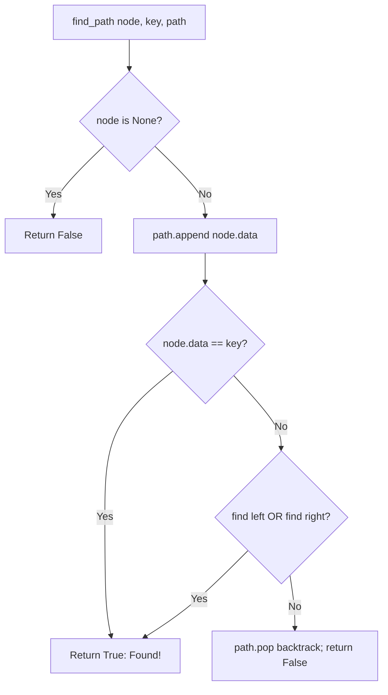

# Path from Root to a Specific Target Node

- **Source File:** `[trees/root_to_node_path.py](file:///Users/shamanth/Desktop/DSA/problem-solving/trees/root_to_node_path.py)`
- **Language:** Python
- **Category:** Trees / Path Finding
- **Navigation:** [← Back to Master Documentation Index](../README.md)

---

## 1. Problem Statement / Question

Given the root of a binary tree and a target key, find and return the path of node values from the root to the node containing `key`.

**Input:** Tree root = 1, target key = 5.  
**Output:** `[1, 2, 5]`

---

## 2. Algorithm & Approach

1. Maintain a dynamic `path` list.
2. In `find_path(node, key, path)`:
   - If `node is None`: return `False`.
   - Append `node.data` to `path`.
   - If `node.data == key`: return `True` (target found!).
   - If `find_path(node.left, key, path)` or `find_path(node.right, key, path)` is `True`: return `True`.
   - Target not in this subtree: backtrack `path.pop()` and return `False`.

---

## 3. Flowchart



---

## 4. Source Code

```python
class Node:
    def __init__(self, data):
        self.data = data
        self.left = None
        self.right = None

class BinaryTree:
    def __init__(self):
        self.root = None

def root_to_node_path(root, key):
    ans = []
    
    def traverse(node, key, path):
        nonlocal ans
        
        if node is None:
            return

        path.append(node.data)

        if node.data == key:
            ans = path.copy()
            return
        else:
            traverse(node.left, key, path)
            traverse(node.right, key, path)

        path.pop()

    traverse(root, key, [])
    return ans


tree = BinaryTree()

tree.root = Node(1)
tree.root.left = Node(12)
tree.root.right = Node(3)
tree.root.left.left = Node(4)
tree.root.left.right = Node(6)
tree.root.right.left = Node(5)
tree.root.right.right = Node(7)

print(root_to_node_path(tree.root, 7))
```

---

## 5. Simple Dry Run

Target `key = 5`:
- Node 1: `path = [1]`
- Node 2: `path = [1, 2]`
- Node 4: `path = [1, 2, 4]` -> key!=5, no children -> pop 4
- Node 5: `path = [1, 2, 5]` -> key==5! Target matched! Returns `True`.
- Path preserved: `[1, 2, 5]`.

---

## 6. Sample Output

```text
Path to node 5: [1, 2, 5]
```

---

## 7. Complexity Analysis

- **Time Complexity:** $O(n)$ worst-case search
- **Space Complexity:** $O(h)$ recursion stack

---
[← Back to Master Documentation Index](../README.md)
