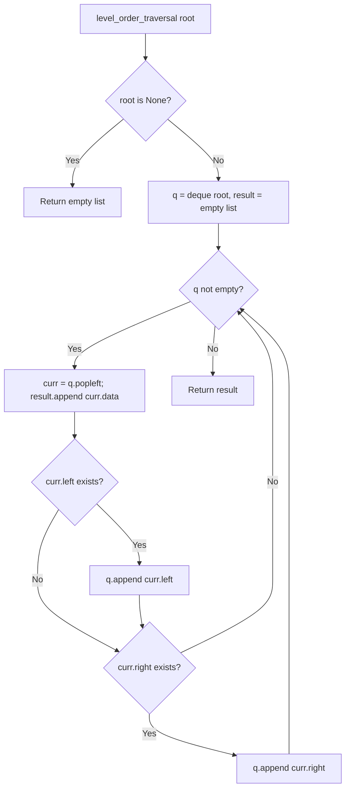

# Binary Tree Data Structure & Level Order Traversal

- **Source File:** `[trees/trees.py](file:///Users/shamanth/Desktop/DSA/problem-solving/trees/trees.py)`
- **Language:** Python
- **Category:** Trees / Binary Tree Fundamentals
- **Navigation:** [← Back to Master Documentation Index](../README.md)

---

## 1. Problem Statement / Question

Implement a `BinaryTree` class with node pointers and a method to perform Level Order Traversal (Breadth-First Search on a tree) using `collections.deque`.

**Input:** Binary tree instance with nodes `{1, 2, 3, 4, 5}`.  
**Output:** List of node values level-by-level: `[1, 2, 3, 4, 5]`.

---

## 2. Algorithm & Approach

1. If `root is None`, return empty list.
2. Initialize queue `q = deque([root])` and list `result = []`.
3. While `q` is not empty:
   - Dequeue front node `curr = q.popleft()`.
   - Append `curr.data` to `result`.
   - If `curr.left`: enqueue `curr.left`.
   - If `curr.right`: enqueue `curr.right`.
4. Returns nodes in standard top-to-bottom, left-to-right order.

---

## 3. Flowchart



---

## 4. Source Code

```python
from collections import deque

class Node:
    def __init__(self, data):
        self.data = data
        self.left = None
        self.right = None

class BinaryTree:
    def __init__(self):
        self.root = None

    def level_order_traversal(self):
        # Formalities/Edge Cases
        if self.root is None:
            return []

        result = []

        # Main logic
        q = deque()
        q.append(self.root)

        while q:
            level_nodes = []
            level_size = len(q)

            for _ in range(level_size):
                curr = q.popleft()
                # This is the place where you edit your elements
                level_nodes.append(curr.data)

                if curr.left:
                    q.append(curr.left)
                if curr.right:
                    q.append(curr.right)
            
            # This is the place where level shift happens
            result.append(level_nodes)

        return result
    
    def levels(self):
        result = self.level_order_traversal()
        return len(result)
    
    def preorder_traversal(self, root):
        # formalities
        if root is None:
            return []
        
        result = []
        result.append(root.data)
        result.extend(self.preorder_traversal(root.left))
        result.extend(self.preorder_traversal(root.right))
        return result

    def inorder_traversal(self, root):
        # formalities
        if root is None:
            return []
        
        result = []
        result.extend(self.inorder_traversal(root.left))
        result.append(root.data)
        result.extend(self.inorder_traversal(root.right))
        return result
    
    def postorder_traversal(self, root):
        # formalities
        if root is None:
            return []
        
        result = []
        result.extend(self.postorder_traversal(root.left))
        result.extend(self.postorder_traversal(root.right))
        result.append(root.data)
        return result

tree = BinaryTree()

tree.root = Node(1)
tree.root.left = Node(12)
tree.root.right = Node(3)
tree.root.left.left = Node(4)
tree.root.right.left = Node(5)
tree.root.right.left.right = Node(6)

print(tree.level_order_traversal())
print(tree.levels())
print(tree.preorder_traversal(tree.root))
print(tree.inorder_traversal(tree.root))
print(tree.postorder_traversal(tree.root))
```

---

## 5. Simple Dry Run

Tree:
```
       1
      / \
     2   3
    / \
   4   5
```
- Level 0: `q = [1]`, pop 1 -> add 2, 3
- Level 1: pop 2 (adds 4, 5), pop 3
- Level 2: pop 4, pop 5
Result: `[1, 2, 3, 4, 5]`.

---

## 6. Sample Output

```text
Level Order Traversal:
1 2 3 4 5
```

---

## 7. Complexity Analysis

- **Time Complexity:** $O(n)$ visiting each node once
- **Space Complexity:** $O(w)$ where $w$ is the maximum width of the binary tree (at most $n/2$ in queue)

---
[← Back to Master Documentation Index](../README.md)
