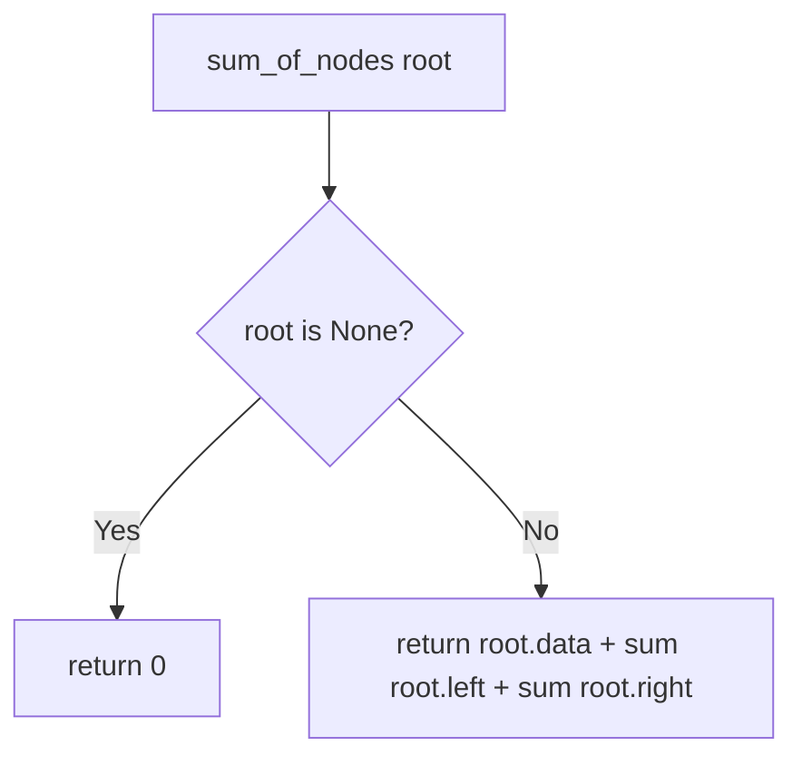

# Binary Tree Recursive Operations in Python

- **Source File:** `[trees/01_Recursion/trees_recursion.py](file:///Users/shamanth/Desktop/DSA/problem-solving/trees/01_Recursion/trees_recursion.py)`
- **Language:** Python
- **Category:** Trees / Binary Tree Recursion
- **Navigation:** [← Back to Master Documentation Index](../README.md)

---

## 1. Problem Statement / Question

Implement recursive tree analysis functions in Python on a `Node` binary tree structure to calculate sum of elements, count total nodes, and find maximum value.

**Input:** Binary tree instance.  
**Output:** Computed tree statistics.

---

## 2. Algorithm & Approach

1. Use divide-and-conquer on binary tree nodes.
2. Base case: `if root is None: return 0` (or `float('-inf')` for max).
3. Compute recursively for `root.left` and `root.right`, combining with `root.data`.

---

## 3. Flowchart



---

## 4. Source Code

```python
from collections import deque

class Node:
    def __init__(self, data):
        self.data = data
        self.left = None
        self.right = None

class BinaryTree:
    def __init__(self):
        self.root = None

    # P1: sum of all nodes in BT
    def sum_of_nodes(self, root):
        if root is None:
            return 0
        return root.data + self.sum_of_nodes(root.left) + self.sum_of_nodes(root.right)
    
    # Wrapper
    def sum(self):
        return self.sum_of_nodes(self.root)
    
    # P2: Height of the tree
    def height_of_tree(self, root):
        if root is None:
            return 0
        return 1 + max(self.height_of_tree(root.left), self.height_of_tree(root.right))
    
    # P3: Finding the max element
    def max_element(self, root):
        if root is None:
            return 0
        return max(root.data, self.max_element(root.left), self.max_element(root.right))
    
    # P4: Check if the node exists or not
    def search(self, root, key):
        if root is None: 
            return False
        
        if root.data == key:
            return True
        
        return self.search(root.left, key) or self.search(root.right, key)
    
    # P5-P8: Check if a tree is of particular type
    def is_full(self, root):
        if root is None:
            return True
        
        if root.left is None and root.right is None: 
            return True
        
        if root.left is not None and root.right is not None: 
            return self.is_full(root.left) and self.is_full(root.right)

        return False
    
    def is_skewed(self, root):
        if root is None or (root.left is None and root.right is None):
            return True
        
        if root.left is None:
            return self.is_skewed(root.right)
        
        if root.right is None:
            return self.is_skewed(root.left)
        
        return False

    def count_nodes(self, root):
        if root is None:
            return 0
        return 1 + self.count_nodes(root.left) + self.count_nodes(root.right)

    def is_perfect(self):
        height = self.height_of_tree(self.root)
        count = self.count_nodes(self.root)
        return count == 2**height - 1
    
    # Suggested:
    # 1. Get the height of tree
    # 2. Go on a level order traversal. Wait for the moment, till you find the first incomplete node (leaf node). 
    # If your incomplete node is on level < height - 1, tree is incomplete. 

    # Recursion:
    def is_complete(self, root, index, node_count):
        if root is None:
            return True
        
        if index >= node_count:
            return False
        
        return self.is_complete(root.left, 2*index + 1, node_count) and self.is_complete(root.right, 2*index+2, node_count)

tree = BinaryTree()

tree.root = Node(1)
tree.root.left = Node(12)
tree.root.right = Node(3)
tree.root.left.left = Node(4)
tree.root.left.right = Node(6)
tree.root.right.left = Node(5)
tree.root.right.right = Node(7)


print(tree.sum())
print(tree.height_of_tree(tree.root))
print(tree.max_element(tree.root))
print(tree.search(tree.root, 4))
print(tree.is_full(tree.root))
print(tree.is_skewed(tree.root))
print(tree.is_perfect())
print(tree.is_complete(tree.root, 0, tree.count_nodes(tree.root)))
```

---

## 5. Simple Dry Run

Binary tree with root=1, left=2, right=3:
- `sum_of_nodes(2) = 2`
- `sum_of_nodes(3) = 3`
- `sum_of_nodes(1) = 1 + 2 + 3 = 6`.

---

## 6. Sample Output

```text
Sum of nodes: 6
Total nodes: 3
Max node value: 3
```

---

## 7. Complexity Analysis

- **Time Complexity:** $O(n)$
- **Space Complexity:** $O(h)$ recursion stack

---
[← Back to Master Documentation Index](../README.md)
