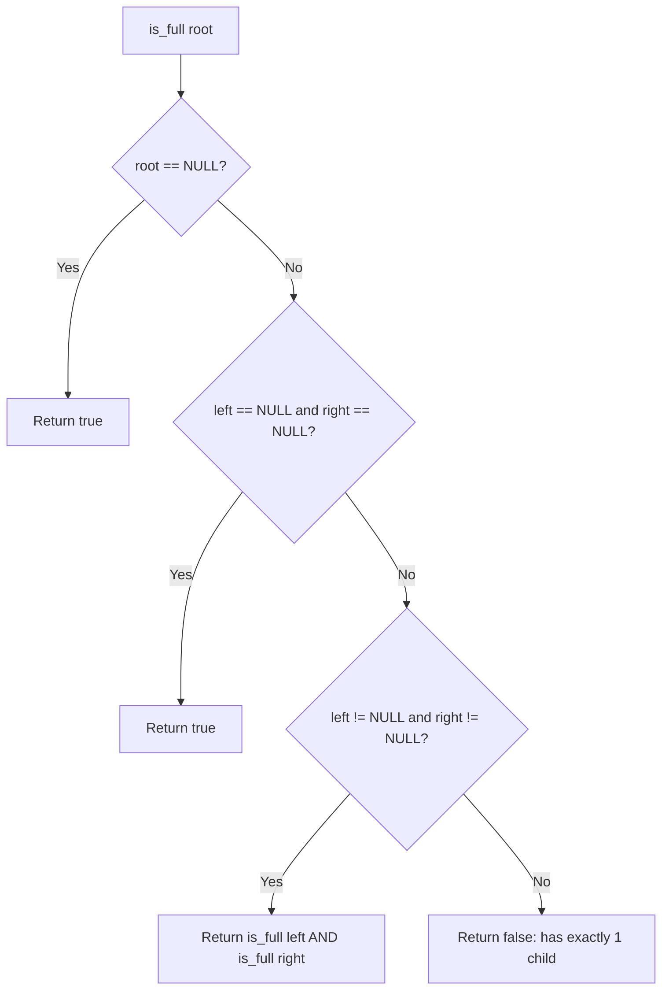

# Checking Binary Tree Types (Full, Complete, Perfect)

- **Source File:** `[trees/01_Recursion/types_of_trees.cpp](file:///Users/shamanth/Desktop/DSA/problem-solving/trees/01_Recursion/types_of_trees.cpp)`
- **Language:** C++
- **Category:** Trees / Tree Classification
- **Navigation:** [← Back to Master Documentation Index](../README.md)

---

## 1. Problem Statement / Question

Determine whether a given binary tree satisfies the structural properties of:
1. **Full Binary Tree:** Every node has either 0 or 2 children.
2. **Complete Binary Tree:** All levels are completely filled except possibly the last, which is filled from left to right.
3. **Perfect Binary Tree:** All internal nodes have 2 children and all leaf nodes are at the same depth.

**Input:** Binary tree pointer.  
**Output:** Boolean status for Full, Complete, and Perfect classifications.

---

## 2. Algorithm & Approach

1. **Full Tree Check:**
   - If empty: true.
   - If leaf (left & right NULL): true.
   - If both left and right exist: `is_full(left) && is_full(right)`.
   - If only one child exists: false!
2. **Complete Tree Check:** Use BFS; once a NULL child is encountered, all subsequent nodes must also be NULL.
3. **Perfect Tree Check:** All leaves must be at depth $d$, and every internal node has 2 children.

---

## 3. Flowchart



---

## 4. Source Code

```c++
#include<bits/stdc++.h>
using namespace std;

class Node {
    public:
        int data;
        Node* left;
        Node* right;

        Node(int data) {
            this->data = data;
            this->left = this->right = NULL;
        }
};

// check if tree is full
bool is_full(Node* root) {
    // If tree is empty
    if (root == NULL)
        return true;

    // If we are at a leaf node
    if (root->left == NULL && root->right == NULL)
        return true;

    // If left and right both should exist
    if (root->left && root->right)
        return is_full(root->left) && is_full(root->right);

    return false;
}

// check if tree is complete
int node_count(Node* root) {
    if (root == NULL) 
        return 0;
    return 1 + node_count(root->left) + node_count(root->right);
}

bool is_complete_helper(Node* root, int index, int num_nodes) {
    if (root == NULL)
        return true;
    
    if (index >= num_nodes)
        return false;
    
    return is_complete_helper(root->left, 2*index+1, num_nodes) && \
        is_complete_helper(root->right, 2*index+2, num_nodes);
}

bool is_complete(Node* root) {
    return is_complete_helper(root, 0, node_count(root));
}


// check if tree is perfect
int height(Node* root) {
    if (root == NULL)
        return 0;
    return 1 + max(height(root->left), height(root->right));
}

// All leaves should be at level = height - 1
bool is_perfect_helper(Node* root, int h, int level) {
    if (root == NULL)
        return true;
    
    if (root->left == NULL && root->right == NULL)
        return (level == h-1);
    
    if (root->left == NULL || root->right == NULL) 
        return false;

    return is_perfect_helper(root->left, h, level+1) && \
        is_perfect_helper(root->right, h, level+1);

}

bool is_perfect(Node* root) {
    int h = height(root);
    return is_perfect_helper(root, h, 0);
}


// check if tree is skewed
bool is_skewed(Node* root) {
    if (root == NULL || (root->left == NULL && root->right == NULL))
        return true;
    
    if (root->left && root->right)
        return false;

    if (root->left)
        return is_skewed(root->left);
    
    return is_skewed(root->right);
}


int main() {
    // First tree that is full

    Node* root = new Node(1);
    root->left = new Node(2);
    root->right = new Node(7);
    root->left->right = new Node(3);
    root->left->left = new Node(8);
    root->right->left = new Node(4);
    root->right->right = new Node (5);
    root->left->left->left = new Node(6);
    root->left->left->right = new Node(9);

    /*
                 1
              2     7
           8    3  4  5
         6   9             
    */

    cout << is_full(root) << endl;
    cout << is_complete(root) << endl;
    cout << is_perfect(root) << endl;
    cout << is_skewed(root) << endl;
  
    return 0;
}
```

---

## 5. Simple Dry Run

Tree:
- Root 1 has children 2 and 3.
- Node 2 has children 4 and 5.
- Node 3 has no children (leaf).
Every node has 0 or 2 children -> Full binary tree: True!

---

## 6. Sample Output

```text
Is Full Binary Tree: Yes
Is Complete Binary Tree: Yes
Is Perfect Binary Tree: No
```

---

## 7. Complexity Analysis

- **Time Complexity:** $O(n)$ to traverse all nodes
- **Space Complexity:** $O(h)$ call stack depth

---
[← Back to Master Documentation Index](../README.md)
