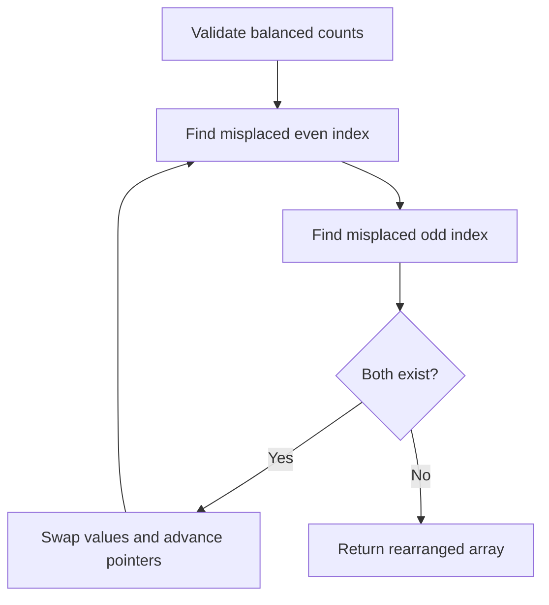

# Two pointers: partition and alternating placement

[← Preparation roadmap](README.md)

## Recognize the pattern

Look for in-place segregation or two positions whose movement can be justified without revisiting earlier work. Here the implemented problems are sign/parity rearrangement and moving zeros.

## Problems already in this project

- [arrays/arrangement.py](../arrays/arrangement.py)
- [arrays/arrangement2.py](../arrays/arrangement2.py)
- [arrays/arrangement3.py](../arrays/arrangement3.py)
- [my_codes/two_pointer.cpp](../my_codes/two_pointer.cpp)

## Core idea and invariant

Read/write pointers: before reading index r, a[0..w) contains exactly the retained values already seen. For alternating placement, even and odd index scans locate values in the wrong category.

## Example question

**Question A — alternate signs:** Given equal numbers of positive and negative integers, rearrange in place so even indices hold positive values and odd indices hold negative values. Keeping the original relative order within a sign is **not** required. Zeros are outside this variant.

**Input:** `[-1, 2, -3, 4]`

**One valid output:** `[2, -1, 4, -3]`

**Question B — move zeros:** Move zeros to the end while preserving the order of nonzero values. Input `[0,1,0,3,12]` should become `[1,3,12,0,0]`.

## Detailed explanation and diagram

The two sign pointers inspect disjoint sets of positions: `even` visits 0,2,4,…; `odd` visits 1,3,5,…. Each skips positions that already have the correct category. Once both stop, the values are misplaced in opposite ways, so one swap fixes both positions. With equal counts, there cannot be unmatched misplaced values at termination.

```text
Index:           0    1    2    3
Required sign:   +    -    +    -
Initial value:  -1    2   -3    4
                even odd
After swap:      2   -1   -3    4
                          even odd
Final:           2   -1    4   -3
```

Moving zeros uses a different invariant: `[0,write)` is the final nonzero prefix, `[write,read)` contains zeros, and `[read,n)` is unread. When a nonzero arrives, swapping with `write` extends the finished prefix. The two-pointer pattern is the shared idea; the pointer meanings differ.

## Algorithm

1. To move zeros, scan every element; swap each nonzero value into the next write position.
2. To alternate categories, first count the category members. This version requires equal category counts.
3. Advance an even-index pointer until its value is misplaced; do the same for an odd-index pointer.
4. Swap the misplaced pair, then continue. For signs, positive values belong at even indices and negative values at odd indices; zero is rejected.
5. For parity, even values belong at even indices. Negative integers are supported.

## Flowchart



## Pseudocode

The pseudocode uses the same state and update rules as the Java methods. Separate variants are named explicitly.

```text
ALTERNATE(array, belongsAtEven):
    require exactly half the values satisfy belongsAtEven
    even = 0; odd = 1
    while both pointers are in bounds:
        advance even by 2 while its value belongs there
        advance odd by 2 while its value belongs there
        if both are in bounds: swap their values
    return array

MOVE_ZEROS(array):
    write = 0
    for read from 0 through n-1:
        if array[read] is nonzero:
            swap array[write] with array[read]
            write = write + 1
```

## Java implementation

This is a corrected Java study implementation derived from the linked project problems, rather than a verbatim copy of their bugs. Save the entire block as the public class name plus `.java` and compile with Java 17 or later. Methods are called from a driver or test; these classes do not require a `main` method to compile.

```java
import java.util.function.IntPredicate;

public class TwoPointers {
    public static void moveZeros(int[] a) {
        int write = 0;
        for (int read = 0; read < a.length; read++) {
            if (a[read] != 0) swap(a, write++, read);
        }
    }
    public static void alternateSigns(int[] a) {
        for (int x : a) if (x == 0)
            throw new IllegalArgumentException("Zero has no sign category here");
        alternate(a, x -> x > 0);
    }
    public static void alternateParity(int[] a) {
        alternate(a, x -> x % 2 == 0);
    }
    private static void alternate(int[] a, IntPredicate belongsAtEven) {
        int count = 0;
        for (int x : a) if (belongsAtEven.test(x)) count++;
        if (count * 2 != a.length)
            throw new IllegalArgumentException("Equal category counts required");
        int even = 0, odd = 1;
        while (even < a.length && odd < a.length) {
            while (even < a.length && belongsAtEven.test(a[even])) even += 2;
            while (odd < a.length && !belongsAtEven.test(a[odd])) odd += 2;
            if (even < a.length && odd < a.length) swap(a, even, odd);
        }
    }
    private static void swap(int[] a, int i, int j) {
        int t = a[i]; a[i] = a[j]; a[j] = t;
    }
}
```

## Step-by-step dry run

### A. Alternating signs

| Step | even / odd before scanning | Decision | Array afterward |
| --- | --- | --- | --- |
| 0 | 0 / 1 | Validate two positives and two negatives | `[-1,2,-3,4]` |
| 1 | 0 / 1 | Both values are misplaced; swap | `[2,-1,-3,4]` |
| 2 | 0 / 1 | Skip corrected positions; stop at 2 / 3 | `[2,-1,-3,4]` |
| 3 | 2 / 3 | Swap the second misplaced pair | `[2,-1,4,-3]` |
| 4 | 2 / 3 | Scans advance beyond the array; stop | `[2,-1,4,-3]` |

### B. Moving zeros

| read | Value examined | write before | Action | Array afterward |
| --- | --- | --- | --- | --- |
| 0 | 0 | 0 | Skip | `[0,1,0,3,12]` |
| 1 | 1 | 0 | Swap positions 0 and 1; write=1 | `[1,0,0,3,12]` |
| 2 | 0 | 1 | Skip | `[1,0,0,3,12]` |
| 3 | 3 | 1 | Swap positions 1 and 3; write=2 | `[1,3,0,0,12]` |
| 4 | 12 | 2 | Swap positions 2 and 4; write=3 | `[1,3,12,0,0]` |

**Why it stops:** every scan advances and no index must be reconsidered once it has the correct role.

## Complexity

Each scan advances monotonically: O(n) time and O(1) auxiliary space. The operations modify the input array.

## Common mistakes and source differences

The source arrangement routines ignore their computed boundary and fail even for balanced inputs. The Java version checks balance explicitly. The project’s two_pointer.cpp is only a placeholder; a sorted two-sum solution is not claimed to exist there.

## Related LeetCode practice

- [283. Move Zeroes](https://leetcode.com/problems/move-zeroes/) — directly matches `moveZeros`; retain nonzero order.
- [2149. Rearrange Array Elements by Sign](https://leetcode.com/problems/rearrange-array-elements-by-sign/) — related, but this problem also preserves each sign’s original relative order. The in-place sign swaps here do not guarantee that; adapt with stable placement into an output array.

The official problem links above were checked on 10 November 2026. Descriptions here are summaries; follow each link for the judge’s complete constraints and API.

## Practice and recall

Implement the read/write invariant from memory. Test empty arrays, all zeros, balanced signs, and invalid unbalanced input. Then study [linked-list slow/fast pointers](07_linked_lists.md).
