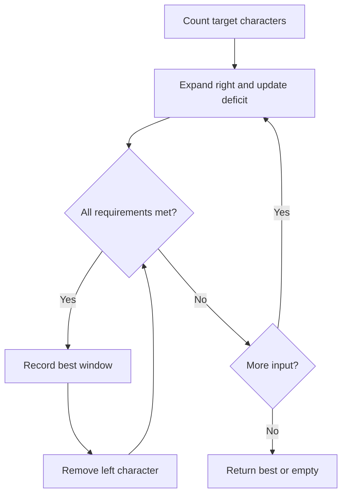

# Sliding window: minimum window substring

[← Preparation roadmap](README.md)

## Recognize the pattern

A shortest contiguous substring must contain all required characters, including multiplicities. Moving either boundary changes only one character count.

## Problems already in this project

- [arrays/leetcode_sliding_window_map_76.cpp](../arrays/leetcode_sliding_window_map_76.cpp)

## Core idea and invariant

`missing` is the number of required character occurrences not yet supplied. A window is valid exactly when missing == 0. A deficit may become negative when the window contains extra copies.

## Example question

Find the shortest contiguous substring of `s` containing every required character of `t`, including repeated copies. Return `""` if no such window exists.

**Input:** `s="ADOBECODEBANC"`, `t="ABC"`

**Output:** `"BANC"`

## Detailed explanation and diagram

An exhaustive solution tries every start/end pair. A window avoids restarting: adding or removing one endpoint changes only one frequency. `need[c]` records a deficit: positive means more copies are needed, zero means enough, and negative means surplus. `missing` counts required **occurrences**, not distinct letters.

```text
Index:  0 1 2 3 4 5 6 7 8 9 10 11 12
s:      A D O B E C O D E B  A  N  C
First: [A D O B E C]                   length 6
Last:                   [B  A  N  C]   length 4
```

The inner loop removes characters only while the current window remains valid. Removing surplus characters keeps `missing=0`; removing the last required copy makes it positive and ends shrinking. This is safe because, for a fixed right endpoint, removing more characters cannot create a shorter valid window after a required character is lost.

## Algorithm

1. Count the required characters in t; initialize missing = t.length().
2. Expand right. If the incoming character still has positive deficit, decrease missing; always decrease its deficit.
3. While valid, record the shortest window and remove the left character.
4. If removal makes a deficit positive, the window becomes invalid. Continue expanding.
5. Return the best substring, or an empty string when no window exists. Empty t returns an empty result.

## Flowchart



## Pseudocode

The pseudocode uses the same state and update rules as the Java methods. Separate variants are named explicitly.

```text
MIN_WINDOW(s, t):
    if t is empty: return empty string
    need = target character counts
    missing = length(t); left = 0; best = none
    for right from 0 through length(s)-1:
        c = s[right]
        if need[c] > 0: missing = missing - 1
        need[c] = need[c] - 1
        while missing == 0:
            update best if current window is shorter
            removed = s[left]; left = left + 1
            need[removed] = need[removed] + 1
            if need[removed] > 0: missing = missing + 1
    return best substring, or empty string
```

## Java implementation

This is a corrected Java study implementation derived from the linked project problems, rather than a verbatim copy of their bugs. Save the entire block as the public class name plus `.java` and compile with Java 17 or later. Methods are called from a driver or test; these classes do not require a `main` method to compile.

```java
public class SlidingWindow {
    public static String minWindow(String s, String t) {
        if (t.isEmpty() || s.length() < t.length()) return "";
        int[] need = new int[Character.MAX_VALUE + 1];
        for (int i = 0; i < t.length(); i++) need[t.charAt(i)]++;
        int missing = t.length(), left = 0, bestStart = 0, bestLength = Integer.MAX_VALUE;
        for (int right = 0; right < s.length(); right++) {
            char c = s.charAt(right);
            if (need[c] > 0) missing--;
            need[c]--;
            while (missing == 0) {
                if (right - left + 1 < bestLength) {
                    bestLength = right - left + 1;
                    bestStart = left;
                }
                char removed = s.charAt(left++);
                if (++need[removed] > 0) missing++;
            }
        }
        return bestLength == Integer.MAX_VALUE ? "" : s.substring(bestStart, bestStart + bestLength);
    }
}
```

## Step-by-step dry run

Initial deficits are A=1, B=1, C=1; `missing=3`. Characters absent from t start at deficit zero.

| Step / right | Change | left after shrinking | missing | Best retained |
| --- | --- | --- | --- | --- |
| 0 / A | A supplied | 0 | 2 | None |
| 1–2 / D,O | Nonrequired characters enter | 0 | 2 | None |
| 3 / B | B supplied | 0 | 1 | None |
| 4 / E | Nonrequired character enters | 0 | 1 | None |
| 5 / C | All supplied; record `[0,5]`; remove A | 1 | 1 | `ADOBEC` (6) |
| 6–8 / O,D,E | No missing requirement supplied | 1 | 1 | `ADOBEC` |
| 9 / B | B becomes surplus | 1 | 1 | `ADOBEC` |
| 10 / A | Valid again; discard D,O,old B,E, then required C | 6 | 1 | `ADOBEC` (equal-length windows do not replace it) |
| 11 / N | Still missing C | 6 | 1 | `ADOBEC` |
| 12 / C | Valid; discard O,D,E; record `[8,12]` then `[9,12]`; remove B | 10 | 1 | `BANC` (4) |

At right=12, `[8,12]` is `EBANC`, length 5; removing E exposes `BANC`, length 4. Removing B makes the window invalid, so shrinking stops.

**Multiplicity check:** with `t="AA"`, one A only reduces missing from 2 to 1; the window is not valid yet.

## Complexity

O(|s| + |t| + alphabet size) time and O(alphabet size) auxiliary space, plus the returned substring. This implementation indexes UTF-16 code units, not Unicode code points.

## Common mistakes and source differences

A set loses duplicate requirements. Shrink only while valid. The original C++ code prints debugging indices; the Java method returns only the answer. The project has a variable-size window example, not a separate fixed-size-window implementation.

## Related LeetCode practice

- [76. Minimum Window Substring](https://leetcode.com/problems/minimum-window-substring/) — the direct problem; adapt the class/method signature for the judge.

The official problem links above were checked on 10 November 2026. Descriptions here are summaries; follow each link for the judge’s complete constraints and API.

## Practice and recall

Explain why the nested while loop is still linear. Reimplement with a HashMap for a sparse alphabet, and test repeated target characters.
