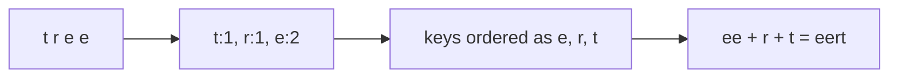
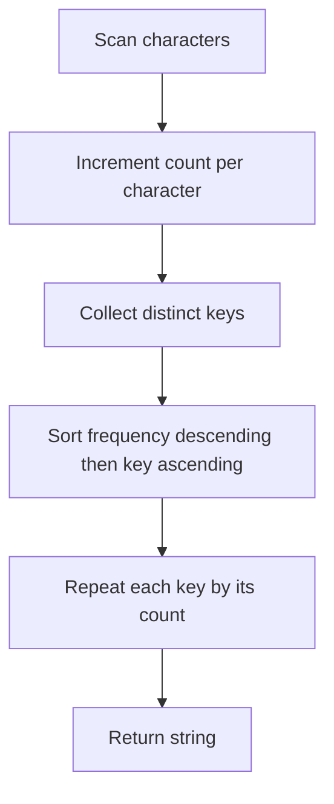

# Hashing and ordered maps: membership and frequencies

[← Preparation roadmap](README.md)

## Recognize the pattern

Need deduplication, membership, or frequency lookup. Choose an ordered collection only when sorted iteration or range navigation is required.

## Problems already in this project

- [arrays/maps.cpp](../arrays/maps.cpp)
- [arrays/sets.cpp](../arrays/sets.cpp)
- [arrays/sets.py](../arrays/sets.py)

## Core idea and invariant

A set stores presence; a map stores a count per key. Frequency sorting is a second operation over the distinct keys, independent of how counts were collected.

## Example question

Group characters by descending frequency. For equal counts, this guide chooses ascending character order to make the output deterministic.

**Input:** `"tree"`

**Output under this tie rule:** `"eert"`

## Detailed explanation and diagram

Separate counting from ordering. During counting, the map summarizes everything seen so far; there is no reason to keep the input sorted. Afterward, only the k distinct keys need comparison. Repeating a character by its stored count reconstructs an output with exactly the original multiplicities.



HashMap gives expected constant-time lookup; TreeMap/TreeSet keep keys ordered with logarithmic operations. An ordered map by character would not automatically order by frequency: that still needs a frequency comparator. The comparator must stop at a nonzero frequency difference and use character order only for a genuine tie.

## Algorithm

1. Build counts using HashMap.merge.
2. Copy distinct characters into a list.
3. Sort by descending frequency; on ties, compare characters ascending.
4. Append each character as many times as it occurs.
5. Use HashSet for ordinary membership and TreeSet for sorted unique output.

## Flowchart



## Pseudocode

The pseudocode uses the same state and update rules as the Java methods. Separate variants are named explicitly.

```text
FREQUENCY_SORT(s):
    count = empty map
    for each character c: count[c] = count[c] + 1
    keys = list of distinct characters
    sort keys by descending count, then ascending character
    result = empty builder
    for c in keys: append c exactly count[c] times
    return result

DEDUPLICATE(values):
    insert each value into a set
    use a sorted set only if sorted iteration is required
```

## Java implementation

This is a corrected Java study implementation derived from the linked project problems, rather than a verbatim copy of their bugs. Save the entire block as the public class name plus `.java` and compile with Java 17 or later. Methods are called from a driver or test; these classes do not require a `main` method to compile.

```java
import java.util.*;

public class Hashing {
    public static String frequencySort(String s) {
        Map<Character, Integer> count = new HashMap<>();
        for (char c : s.toCharArray()) count.merge(c, 1, Integer::sum);
        List<Character> keys = new ArrayList<>(count.keySet());
        keys.sort((a, b) -> {
            int byCount = Integer.compare(count.get(b), count.get(a));
            return byCount != 0 ? byCount : Character.compare(a, b);
        });
        StringBuilder result = new StringBuilder();
        for (char c : keys) result.append(String.valueOf(c).repeat(count.get(c)));
        return result.toString();
    }
    public static Set<Integer> unique(int[] a) {
        Set<Integer> result = new HashSet<>();
        for (int x : a) result.add(x);
        return result;
    }
    public static SortedSet<Integer> sortedUnique(int[] a) {
        SortedSet<Integer> result = new TreeSet<>();
        for (int x : a) result.add(x);
        return result;
    }
}
```

## Step-by-step dry run

| Step | Character/action | Map or ordered keys | Output |
| --- | --- | --- | --- |
| 1 | Read t | `{t:1}` | — |
| 2 | Read r | `{t:1,r:1}` | — |
| 3 | Read e | `{t:1,r:1,e:1}` | — |
| 4 | Read e | `{t:1,r:1,e:2}` | — |
| 5 | Sort distinct keys | `[e,r,t]`; r precedes t on equal count | — |
| 6 | Emit e twice | Same counts | `ee` |
| 7 | Emit r once | Same counts | `eer` |
| 8 | Emit t once | Same counts | `eert` |

**Correctness check:** counts in the result are e=2,r=1,t=1, matching the input; group frequencies are 2,1,1 and never increase.

For membership, adding `[3,1,3,2]` to a set visits four values but stores three keys. HashSet has no promised iteration order; TreeSet returns keys in order 1,2,3.

## Complexity

With k distinct characters: expected O(n + k log k) time and O(n + k) space including output. Hash membership is expected O(1); TreeSet operations are O(log k).

## Common mistakes and source differences

The C++ comparator falls through to character comparison even when frequencies differ; it can violate comparator ordering. Java uses the character tie-break only when frequencies are equal. HashSet iteration order is unspecified.

## Related LeetCode practice

- [451. Sort Characters By Frequency](https://leetcode.com/problems/sort-characters-by-frequency/) — direct match, except LeetCode accepts any ordering between equal-frequency groups; this guide adds a deterministic tie-break.

The official problem links above were checked on 10 November 2026. Descriptions here are summaries; follow each link for the judge’s complete constraints and API.

## Practice and recall

Explain why TreeMap is not a hash table. Write a frequency comparator with a deterministic tie-break and test equal as well as unequal counts.
