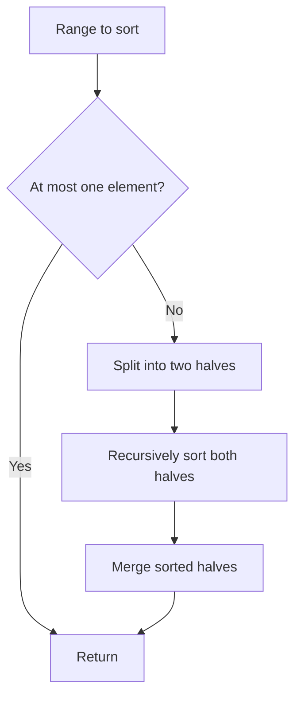

# Sorting and divide and conquer

[← Preparation roadmap](README.md)

## Recognize the pattern

Order helps simplify later work; or a problem splits into independent ranges with a merge/recombination step. Custom comparators express the ordering needed by the result.

## Problems already in this project

- [arrays/custom_sort.cpp](../arrays/custom_sort.cpp)
- [arrays/custom_sort.py](../arrays/custom_sort.py)
- [arrays/sort.py](../arrays/sort.py)
- [cpp_language/01_Array_Operations/sort.cpp](../cpp_language/01_Array_Operations/sort.cpp)

## Core idea and invariant

During merge, the written prefix is sorted and contains the smallest consumed items from both halves. For the largest concatenated number, a precedes b when a+b is lexicographically larger than b+a.

## Example question

**Primary question:** Sort `[4,1,3,2]` in ascending order without calling a built-in sort. Expected result: `[1,2,3,4]`.

**Comparator variant:** Arrange `[9,98,41]` to make the largest concatenated number. Expected string: `"99841"`.

## Detailed explanation and diagram

Merge sort has a useful separation of responsibility: recursion promises two sorted halves, and merging only has to select the smaller current front. Once a front value is emitted, no later value in either sorted half can precede it. Empty/singleton ranges are already sorted, providing the induction base.

```text
                  [4,1,3,2]
                 /         \
              [4,1]       [3,2]
              /   \       /   \
            [4]   [1]   [3]   [2]
              \   /       \   /
              [1,4]       [2,3]
                   \     /
                  [1,2,3,4]
```

The Java ranges are half-open `[lo,hi)`: the length is `hi-lo`, the halves are `[lo,mid)` and `[mid,hi)`, and there is no shared midpoint element.

Quick sort instead establishes a pivot partition before recursing; bubble sort establishes one correct suffix element per pass. For the largest-number variant, compare concatenations: numeric descending order would put 98 before 9, but `998 > 989`, so 9 must come first.

## Algorithm

1. Merge sort: recursively sort each half, then merge the two sorted halves into a temporary buffer.
2. Quick sort: partition around the last element, then recurse on the two smaller ranges.
3. Bubble sort: move the largest remaining value to the end by adjacent swaps; stop early if no swaps occur.
4. Largest number: sort non-negative numbers as strings by (b+a) versus (a+b), join, and collapse an all-zero result to "0".
5. Word length sorting uses Comparator.comparingInt(String::length); Java's object sort preserves ties.

## Flowchart



## Pseudocode

The pseudocode uses the same state and update rules as the Java methods. Separate variants are named explicitly.

```text
MERGE_SORT(a, lo, hi):
    if hi - lo <= 1: return
    mid = lo + floor((hi - lo) / 2)
    MERGE_SORT(a, lo, mid)
    MERGE_SORT(a, mid, hi)
    i = lo; j = mid
    while both halves have values:
        emit the smaller front into a temporary buffer
        prefer the left front on equality
    emit leftovers and copy buffer into a[lo..hi)

LARGEST_NUMBER(values):
    convert values to strings
    sort x before y when x+y is greater than y+x
    join strings; collapse an all-zero result to "0"
```

## Java implementation

This is a corrected Java study implementation derived from the linked project problems, rather than a verbatim copy of their bugs. Save the entire block as the public class name plus `.java` and compile with Java 17 or later. Methods are called from a driver or test; these classes do not require a `main` method to compile.

```java
import java.util.*;

public class Sorting {
    public static void mergeSort(int[] a) { mergeSort(a, new int[a.length], 0, a.length); }
    private static void mergeSort(int[] a, int[] temp, int lo, int hi) {
        if (hi - lo <= 1) return;
        int mid = lo + (hi - lo) / 2;
        mergeSort(a, temp, lo, mid); mergeSort(a, temp, mid, hi);
        int i = lo, j = mid, k = lo;
        while (i < mid && j < hi) temp[k++] = a[i] <= a[j] ? a[i++] : a[j++];
        while (i < mid) temp[k++] = a[i++];
        while (j < hi) temp[k++] = a[j++];
        System.arraycopy(temp, lo, a, lo, hi - lo);
    }
    public static void quickSort(int[] a) { quickSort(a, 0, a.length - 1); }
    private static void quickSort(int[] a, int lo, int hi) {
        if (lo >= hi) return;
        int pivot = a[hi], write = lo;
        for (int read = lo; read < hi; read++) if (a[read] < pivot) swap(a, write++, read);
        swap(a, write, hi);
        quickSort(a, lo, write - 1); quickSort(a, write + 1, hi);
    }
    public static void bubbleSort(int[] a) {
        for (int end = a.length - 1; end > 0; end--) {
            boolean changed = false;
            for (int i = 0; i < end; i++) if (a[i] > a[i + 1]) {
                swap(a, i, i + 1); changed = true;
            }
            if (!changed) break;
        }
    }
    private static void swap(int[] a, int i, int j) { int t = a[i]; a[i] = a[j]; a[j] = t; }
    public static String largestNumber(int[] a) {
        if (a.length == 0) return "";
        String[] words = new String[a.length];
        for (int i = 0; i < a.length; i++) {
            if (a[i] < 0) throw new IllegalArgumentException("Non-negative numbers required");
            words[i] = Integer.toString(a[i]);
        }
        Arrays.sort(words, (x, y) -> (y + x).compareTo(x + y));
        return words[0].equals("0") ? "0" : String.join("", words);
    }
    public static void sortByLength(String[] words) {
        Arrays.sort(words, Comparator.comparingInt(String::length));
    }
}
```

## Step-by-step dry run

| Step | Range/action | Result or buffer |
| --- | --- | --- |
| 1 | Split `[0,4)` at 2 | `[4,1]` and `[3,2]` |
| 2 | Split the left half | `[4]` and `[1]` |
| 3 | Merge left singletons | Compare 4 and 1 → `[1,4]` |
| 4 | Split/merge the right half | `[3]` and `[2]` → `[2,3]` |
| 5 | Merge fronts 1 and 2 | Emit 1; buffer `[1]` |
| 6 | Merge fronts 4 and 2 | Emit 2; buffer `[1,2]` |
| 7 | Merge fronts 4 and 3 | Emit 3; buffer `[1,2,3]` |
| 8 | Right half exhausted | Append 4 → `[1,2,3,4]` |

**Comparator dry run:** comparing 9 with 98 uses `998` versus `989`; comparing 98 with 41 uses `9841` versus `4198`. The chosen order `[9,98,41]` joins to `99841`.

**Stability check:** when two labeled equal values meet, `<=` selects the left one first, preserving its earlier position.

## Complexity

Merge sort: O(n log n) time, O(n) buffer plus O(log n) stack. Quick sort: average O(n log n), worst O(n²), stack worst O(n). Bubble sort: O(n²) worst, O(n) best with early exit. Largest-number sorting: O(n log n × d) comparison work for up to d digits per number, plus output.

## Common mistakes and source differences

Do not sort largest-number inputs numerically. Merge with <= to preserve stability. Last-element quick sort can overflow the recursion stack on adverse input; merge sort is the predictable baseline here.

## Related LeetCode practice

- [912. Sort an Array](https://leetcode.com/problems/sort-an-array/) — use merge sort for a guaranteed O(n log n) bound; the guide’s last-pivot quick sort has a quadratic worst case.
- [179. Largest Number](https://leetcode.com/problems/largest-number/) — direct application of the concatenation comparator.

The official problem links above were checked on 10 November 2026. Descriptions here are summaries; follow each link for the judge’s complete constraints and API.

## Practice and recall

Trace one merge and one partition by hand. Explain stability, comparator transitivity, and why repeated equal quick-sort keys can be a bad case.
