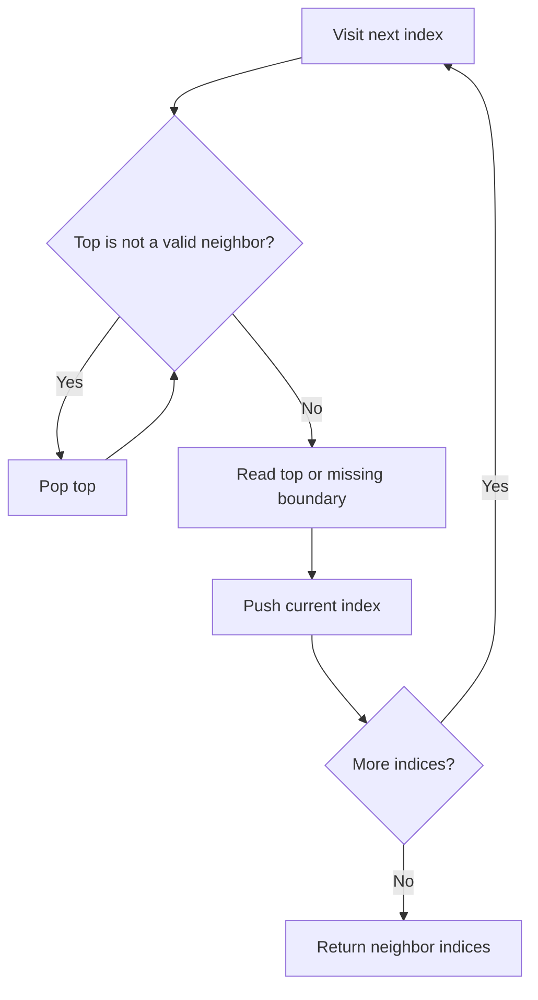

# Monotonic stacks: nearest neighbors and histogram

[← Preparation roadmap](README.md)

## Recognize the pattern

Find the nearest strictly greater/smaller element or the widest span bounded by smaller values. An element that is dominated by a closer candidate can be removed permanently.

## Problems already in this project

- [stacks_queues/max_area_hist.cpp](../stacks_queues/max_area_hist.cpp)
- [stacks_queues/max_area_hist.java](../stacks_queues/max_area_hist.java)
- [stacks_queues/max_area_hist.py](../stacks_queues/max_area_hist.py)
- [stacks_queues/ngr_ngl.cpp](../stacks_queues/ngr_ngl.cpp)
- [stacks_queues/ngr_ngl_index.cpp](../stacks_queues/ngr_ngl_index.cpp)
- [stacks_queues/nsr_nsl.cpp](../stacks_queues/nsr_nsl.cpp)

## Core idea and invariant

The stack stores candidate indices in monotonic value order. Every index enters once and leaves at most once. Store indices when distance or width matters.

## Example question

A histogram has heights `[2,1,2]`; each bar has width 1. Find the maximum area of a rectangle under its bars.

**Output:** `3`, from height 1 spanning all three bars.

## Detailed explanation and diagram

Fix a bar i as the limiting height. Its rectangle may extend until the first strictly smaller bar on either side; all bars between those boundaries are at least its height. Therefore its width is `right[i]-left[i]-1`.

The left-to-right smaller-neighbor stack holds strictly increasing heights. If a new height is no taller than the top, that top cannot be a future nearest-smaller answer: the new bar is closer and at least as useful. Discarding it is permanent, which is why repeated popping stays linear overall.

```text
Height 2:  #   #
Height 1:  # # #  <- height 1 extends across width 3
Index:     0 1 2

bar i:       0   1   2
left small: -1  -1   1
right small: 1   3   3
width:       1   3   1
area:        2   3   2
```

Use indices for widths, not just heights. Missing boundaries are positions just outside the array. To switch to nearest greater, reverse the inequality; to switch sides, reverse traversal direction.

## Algorithm

1. To find a nearest smaller neighbor, scan toward that neighbor from the opposite direction and pop values >= the current height.
2. The surviving top is the nearest strictly smaller index; use −1 on the left and n on the right when absent.
3. For nearest greater, pop values <= the current value instead.
4. For a histogram bar i, its maximum width is rightSmaller[i] − leftSmaller[i] − 1; maximize height × width.

## Flowchart



## Pseudocode

The pseudocode uses the same state and update rules as the Java methods. Separate variants are named explicitly.

```text
NEAREST_SMALLER_LEFT(h):
    stack = empty
    for i from 0 through n-1:
        while stack not empty and h[top] >= h[i]: pop
        left[i] = top if present, otherwise -1
        push i

NEAREST_SMALLER_RIGHT(h):
    same logic while scanning from n-1 down to 0
    missing boundary is n

HISTOGRAM_AREA(h):
    compute left and right smaller indices
    return maximum h[i] * (right[i] - left[i] - 1), or 0 if empty
```

## Java implementation

This is a corrected Java study implementation derived from the linked project problems, rather than a verbatim copy of their bugs. Save the entire block as the public class name plus `.java` and compile with Java 17 or later. Methods are called from a driver or test; these classes do not require a `main` method to compile.

```java
import java.util.*;

public class MonotonicStack {
    // Missing left neighbor is -1; missing right neighbor is a.length.
    public static int[] nearest(int[] a, boolean toLeft, boolean greater) {
        int n = a.length;
        int[] answer = new int[n];
        Deque<Integer> stack = new ArrayDeque<>();
        for (int step = 0; step < n; step++) {
            int i = toLeft ? step : n - 1 - step;
            while (!stack.isEmpty() && (greater ? a[stack.peek()] <= a[i] : a[stack.peek()] >= a[i]))
                stack.pop();
            answer[i] = stack.isEmpty() ? (toLeft ? -1 : n) : stack.peek();
            stack.push(i);
        }
        return answer;
    }
    public static int[] neighborValues(int[] a, boolean toLeft, boolean greater) {
        int[] indices = nearest(a, toLeft, greater);
        for (int i = 0; i < a.length; i++)
            indices[i] = indices[i] < 0 || indices[i] >= a.length ? -1 : a[indices[i]];
        return indices;
    }
    public static long largestRectangle(int[] heights) {
        for (int h : heights) if (h < 0) throw new IllegalArgumentException("Negative height");
        int[] left = nearest(heights, true, false), right = nearest(heights, false, false);
        long best = 0;
        for (int i = 0; i < heights.length; i++)
            best = Math.max(best, (long) heights[i] * (right[i] - left[i] - 1));
        return best;
    }
}
```

## Step-by-step dry run

### Left smaller pass

Stacks below are listed bottom → top and contain indices.

| i / height | Stack before | Pops | left[i] | Stack after push |
| --- | --- | --- | --- | --- |
| 0 / 2 | `[]` | None | −1 | `[0]` |
| 1 / 1 | `[0]` | Index 0, because 2>=1 | −1 | `[1]` |
| 2 / 2 | `[1]` | None; 1<2 | 1 | `[1,2]` |

### Right smaller pass and areas

| i / height | Stack before | Pops | right[i] | Width / area |
| --- | --- | --- | --- | --- |
| 2 / 2 | `[]` | None | 3 | `3−1−1=1`; area 2 |
| 1 / 1 | `[2]` | Index 2 | 3 | `3−(−1)−1=3`; area 3 |
| 0 / 2 | `[1]` | None | 1 | `1−(−1)−1=1`; area 2 |

The maximum is 3. Equal-height input `[2,2]` must pop on `>=` so both bars can see the full width; using only `>` would block expansion incorrectly in this two-boundary implementation.

## Complexity

Each neighbor pass is O(n) time and O(n) space. Histogram uses two passes and O(n) space. long arithmetic avoids overflowing int area products.

## Common mistakes and source differences

Equal bars must be popped for strictly smaller boundaries. Missing right indices are n here; some project greater-neighbor examples use −1 instead, so distinguish index sentinels from value sentinels. The Java guide avoids the source’s undefined Pair type.

## Related LeetCode practice

- [84. Largest Rectangle in Histogram](https://leetcode.com/problems/largest-rectangle-in-histogram/) — direct match to `largestRectangle`.
- [496. Next Greater Element I](https://leetcode.com/problems/next-greater-element-i/) — compute greater-right values for nums2, then map results to the queried subset nums1.

The official problem links above were checked on 10 November 2026. Descriptions here are summaries; follow each link for the judge’s complete constraints and API.

## Practice and recall

Derive greater-left, greater-right, smaller-left, smaller-right by changing only scan direction and pop comparison. Test equal-height bars and an empty histogram.
