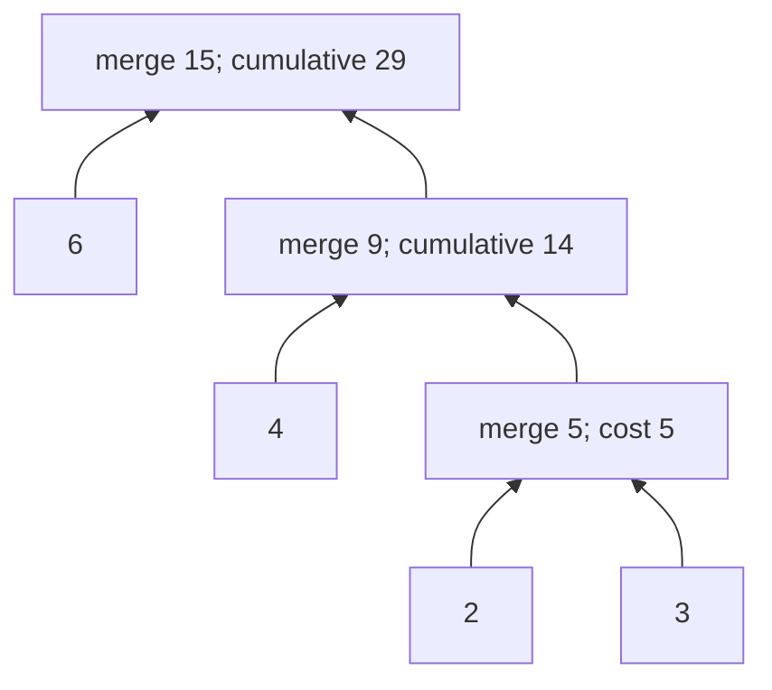
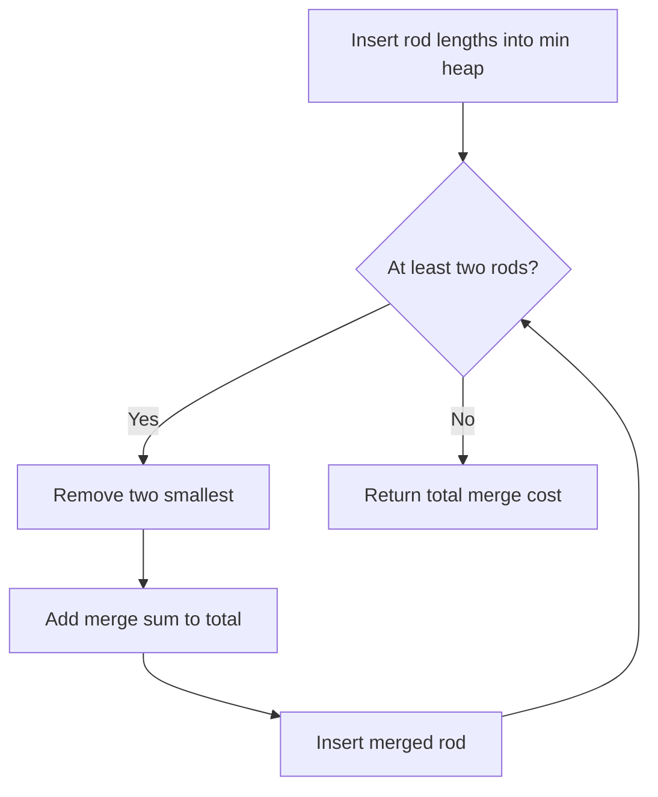

# Heap and greedy: merge cost, Kruskal, fair allocation

[← Preparation roadmap](README.md)

## Recognize the pattern

Repeatedly choose a smallest item with a provably safe local choice, or process candidates in sorted order. A data structure alone does not establish a greedy proof.

## Problems already in this project

- [graphs/mst.cpp](../graphs/mst.cpp)
- [interview questions/google_log_truncate.cpp](../interview%20questions/google_log_truncate.cpp)
- [stacks_queues/mergeRods.java](../stacks_queues/mergeRods.java)
- [stacks_queues/merge_rods.cpp](../stacks_queues/merge_rods.cpp)
- [stacks_queues/merge_rods.py](../stacks_queues/merge_rods.py)

## Core idea and invariant

Rod merging: an optimal merge tree can place the two smallest weights deepest, so merge them first. Kruskal: the lightest edge joining two components is safe by the cut property. Fair allocation: satisfy small demands before splitting remaining capacity.

## Example question

**Merge question:** Connecting two rods costs their combined length. Merge lengths `[4,3,2,6]` into one rod at minimum total cost. Expected cost: `29`.

**MST variant:** For edges `(0,1,2)`, `(1,2,1)`, `(0,2,9)`, connect all three vertices with minimum total weight. Expected cost: `3`.

**Fair-share variant:** Allocate 30 units among demands A=50,B=20,C=5. The code returns A=13,B=12,C=5.

## Detailed explanation and diagram

Merge costs charge a rod again every time it participates in a later merge. Large rods should therefore avoid unnecessary repeated depth. In an optimal merge tree, the two smallest weights can be placed as deepest siblings without increasing cost; contract them into their sum and repeat. The heap implements that repeated smallest-choice rule efficiently.



Kruskal has a different proof: choosing a minimum edge across a component cut is safe. DSU tracks only connectivity, so adding an edge within one component is rejected as a cycle. Fair allocation is different again: satisfying a small producer first leaves the unused share available to larger producers. These algorithms share greedy reasoning, not an identical state or proof.

## Algorithm

1. Rods: insert lengths into a min-heap, extract two minima, add their sum to cost, and reinsert it until at most one remains.
2. Kruskal: sort edges ascending, use DSU to reject cycles, and stop after n−1 accepted edges; report disconnection if edges run out.
3. Fair allocation: sort demand indices ascending. Allocate min(demand, remainingCapacity / remainingServices), subtract it, and continue. Integer rounding is deterministic and larger-demand allocations differ by at most one when unsatisfied. This is a batch policy, not an online admission algorithm.

## Flowchart



## Pseudocode

The pseudocode uses the same state and update rules as the Java methods. Separate variants are named explicitly.

```text
MERGE_COST(lengths):
    heap = min-heap containing all lengths
    total = 0
    while heap has at least two values:
        merged = remove minimum + remove minimum
        total = total + merged
        insert merged
    return total

KRUSKAL(vertices, edges):
    sort edges by ascending weight
    make one DSU component per vertex
    for each edge:
        if its endpoints have different roots:
            union them and keep the edge
        stop if vertices-1 edges have been kept
    if insufficient edges remain: report disconnected

FAIR_ALLOCATION(demand, capacity):
    process indices in ascending demand order
    allocation[i] = min(demand[i], capacity / remaining services)
    subtract allocation[i] and continue
```

## Java implementation

This is a corrected Java study implementation derived from the linked project problems, rather than a verbatim copy of their bugs. Save the entire block as the public class name plus `.java` and compile with Java 17 or later. Methods are called from a driver or test; these classes do not require a `main` method to compile.

```java
import java.util.*;

public class Greedy {
    public static long mergeCost(int[] lengths) {
        PriorityQueue<Long> heap = new PriorityQueue<>();
        for (int x : lengths) {
            if (x < 0) throw new IllegalArgumentException("Negative rod length");
            heap.add((long) x);
        }
        long total = 0;
        while (heap.size() > 1) {
            long sum = heap.remove() + heap.remove();
            total += sum; heap.add(sum);
        }
        return total;
    }
    public record Edge(int u, int v, int weight) {}
    private static class DSU {
        int[] parent, size;
        DSU(int n) { parent = new int[n]; size = new int[n];
            for (int i = 0; i < n; i++) { parent[i] = i; size[i] = 1; } }
        int find(int x) { return parent[x] == x ? x : (parent[x] = find(parent[x])); }
        boolean union(int a, int b) {
            a = find(a); b = find(b);
            if (a == b) return false;
            if (size[a] < size[b]) { int t = a; a = b; b = t; }
            parent[b] = a; size[a] += size[b]; return true;
        }
    }
    public static List<Edge> mst(int n, List<Edge> input) {
        if (n < 0) throw new IllegalArgumentException("Negative vertex count");
        List<Edge> edges = new ArrayList<>(input), result = new ArrayList<>();
        edges.sort(Comparator.comparingInt(Edge::weight));
        DSU dsu = new DSU(n);
        for (Edge e : edges) {
            if (e.u < 0 || e.u >= n || e.v < 0 || e.v >= n)
                throw new IllegalArgumentException("Invalid vertex");
            if (dsu.union(e.u, e.v)) result.add(e);
            if (result.size() == n - 1) break;
        }
        if (result.size() != Math.max(0, n - 1))
            throw new IllegalArgumentException("Graph is disconnected");
        return result;
    }
    public static int[] fairAllocation(int[] demand, int capacity) {
        if (capacity < 0) throw new IllegalArgumentException("Negative capacity");
        Integer[] order = new Integer[demand.length];
        for (int i = 0; i < demand.length; i++) {
            if (demand[i] < 0) throw new IllegalArgumentException("Negative demand");
            order[i] = i;
        }
        Arrays.sort(order, Comparator.comparingInt(i -> demand[i]));
        int[] answer = new int[demand.length];
        for (int k = 0; k < order.length; k++) {
            int i = order[k];
            answer[i] = Math.min(demand[i], capacity / (order.length - k));
            capacity -= answer[i];
        }
        return answer;
    }
}
```

## Step-by-step dry run

### Merge cost

The heap column lists values in sorted order for readability; a real heap's backing array need not be sorted.

| Step | Values before | Take two | Merge cost | Total | Values afterward |
| --- | --- | --- | --- | --- | --- |
| 1 | `[2,3,4,6]` | 2,3 | 5 | 5 | `[4,5,6]` |
| 2 | `[4,5,6]` | 4,5 | 9 | 14 | `[6,9]` |
| 3 | `[6,9]` | 6,9 | 15 | 29 | `[15]` |

Merging 4+6 first instead would cost 10, then 2+3 costs 5, then 10+5 costs 15: total 30, demonstrating why arbitrary pairing can lose.

### Kruskal

| Edge in sorted order | Components before | Decision | Cost kept |
| --- | --- | --- | --- |
| 1–2, weight 1 | `{0},{1},{2}` | Union 1 and 2 | 1 |
| 0–1, weight 2 | `{0},{1,2}` | Union remaining components | 3 |
| 0–2, weight 9 | Already connected | Not needed; n−1 edges reached | 3 |

### Fair allocation

| Producer | Capacity before | Services remaining | Integer share | Granted | Capacity after |
| --- | --- | --- | --- | --- | --- |
| C, demand 5 | 30 | 3 | 10 | 5 | 25 |
| B, demand 20 | 25 | 2 | 12 | 12 | 13 |
| A, demand 50 | 13 | 1 | 13 | 13 | 0 |

The final mapping restores original producer order: `[13,12,5]`. Rounding makes A/B differ by one; this is the documented batch policy.

## Complexity

Merge cost: O(n log n) time, O(n) space. Kruskal: O(E log E + (V+E) α(V)) time, O(V+E) space including sorted edge copy. Fair allocation: O(k log k) time, O(k) space.

## Common mistakes and source differences

Kruskal uses sorting plus DSU, not necessarily a heap. The original MST loop can overrun disconnected inputs. The log source admits until full and can starve later services; Java implements the stated batch fairness objective. No physical logs are edited.

## Related LeetCode practice

- [1584. Min Cost to Connect All Points](https://leetcode.com/problems/min-cost-to-connect-all-points/) — build candidate edges weighted by Manhattan distance, then apply Kruskal; this is an adaptation from an edge-list MST.
- [1167. Minimum Cost to Connect Sticks](https://leetcode.com/problems/minimum-cost-to-connect-sticks/) — direct two-smallest merge problem; the page currently requires LeetCode Premium.

The official problem links above were checked on 10 November 2026. Descriptions here are summaries; follow each link for the judge’s complete constraints and API.

## Practice and recall

Prove the two-smallest-merge rule. Trace DSU on a triangle. Explain why a first-come stream cannot guarantee batch fairness without retaining or evicting previous logs.
